# AI 编程工作流详解：从共同理解、垂直切片到自主实现与架构控制

> **原视频**：[Full Walkthrough: Workflow for AI Coding — Matt Pocock](https://www.youtube.com/watch?v=-QFHIoCo-Ko)  
> **讲师**：Matt Pocock · AI Engineer 工作坊  
> **视频时长**：1:36:30  
> **辅助资料**：[AI Engineer 官方文章与校订时间线](https://ai.engineer/talks/-QFHIoCo-Ko-ai-coding-workflow)  
> **阅读说明**：本文按完整视频字幕连续整理，保留论证、类比、现场案例、操作过程和实质问答；只清理口癖、设备调试和无关重复。模型能力、工具体验及工作流取舍均是讲师在演讲时的判断，不代表通用定律。提示词中文转述和流程图是对讲述的重构，不是未经核验的原仓库代码。原演讲及画面版权归讲者与主办方所有，本页为署名的个人学习笔记。

## 一、工作坊的出发点：AI 变了，工程基本功仍然有效

*(参考时间：00:00:15–00:03:00)*

### 1.1 这不是“规格自动变成代码”的展示

Matt 先介绍自己是一名教师，现在主要教 AI。他提出这场工作坊的基本假设：人们谈论 AI 时，经常把它当成一个全新的范式，却容易忘记，**那些让人与人能够一起开发软件的工程基本功，同样适用于人与 AI 协作。**

任务拆分、共同理解、设计、测试与反馈，并不会因为代码由模型生成就失去作用。恰恰因为模型的行为有一些特殊约束，这些基本功需要更加自觉地运用。这场工作坊要用一个真实风格的功能开发过程，把这件事演示出来，而不是只展示一段漂亮的自动生成结果。

现场举手调查很能说明背景：许多人已经每天用 AI 写代码，也几乎都经历过被 AI 搞得沮丧的时刻。讲师不把这种挫败简单归因于提示词不够好，而是先追问：**我们围绕模型的工作方式，组织了怎样的开发流程？**

### 1.2 为什么用异步提问而非只听最会发言的人

讲师不喜欢只靠抢麦的问答形式，因为最健谈的人往往占据讨论。他让现场和远程观众把问题投到 Slido，并相互投票，让更有共性的疑问浮上来。后面有关产品职责、前端原型、代码审查量和文档保留的讨论，都来自这些现场问题。

这也决定了演讲不是一条整齐的直线：代理在后台运行时，讲师会回答问题；架构分析还没结束，他会先讲审查和编排，稍后再回来看结果。本文保持这些论点之间的关系，并在必要处提示前后呼应。

## 二、两个模型约束：聪明区，以及《记忆碎片》式的失忆

*(参考时间：00:03:00–00:11:06)*

### 2.1 足球联赛的类比：上下文越长，关系越多

讲师引用 HumanLayer 的 Dex Horthy 所讲的 **smart zone / dumb zone**，把一次会话里相对可靠的工作区间称为“聪明区”，把后面决策容易变差的区间称为“迟钝区”。

他的类比是足球联赛：往联赛里增加一支球队，不只多出一场比赛；新球队需要与原来的球队建立许多比赛关系。同样，向上下文添加 token，也会增加 token 之间需要处理的关系。他用这一类比解释为什么长会话会逐渐吃力，而不是把“窗口还装得下”直接等同于“模型仍然一样聪明”。

讲师给出的个人经验标尺是约 100K token，早先也用过窗口约 40% 的说法。他特别把这个经验与“200K 还是 1M 的标称窗口”区分开：**模型可以接收多少内容，与它能在多少内容中稳定写好代码，是两件事。**

> **编者说明**：足球联赛是讲师解释注意力关系的直观类比，100K 也是他的经验阈值；本文不把它们改写成所有模型、所有任务都适用的性能公式。

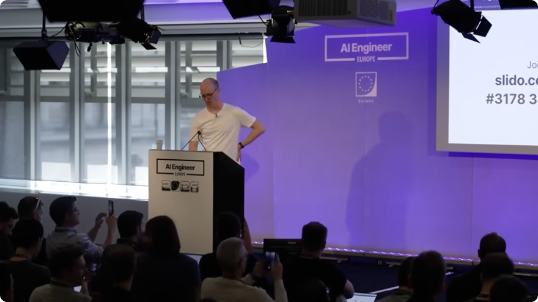

### 2.2 让每个任务落在有效区间内

*(参考时间：00:04:20)*

如果模型在长会话里越走越偏，就不能只靠“继续、继续、继续”推进大任务。要让一次工作小到足以在有效上下文里完成。这与 Martin Fowler 的《重构》和《程序员修炼之道》里的老建议相通：不要一次咬下超过自己能处理的工作量。

讲师用一个夸张的大目标来提问：假如任务大到像“复制一家公司的产品”，怎样把它拆成小块？一种自然做法是不断延长会话，进入迟钝区，再 compact，继续，再 compact。问题是每次请求都带着很重的历史，而且压缩后的历史还会留下新的“沉积物”。

他之前用多阶段计划解决这个问题：phase 1、phase 2、phase 3，各阶段在新会话里完成。但从程序员角度看，这些阶段都在重复同一种动作，于是可以把它们视为一个循环：

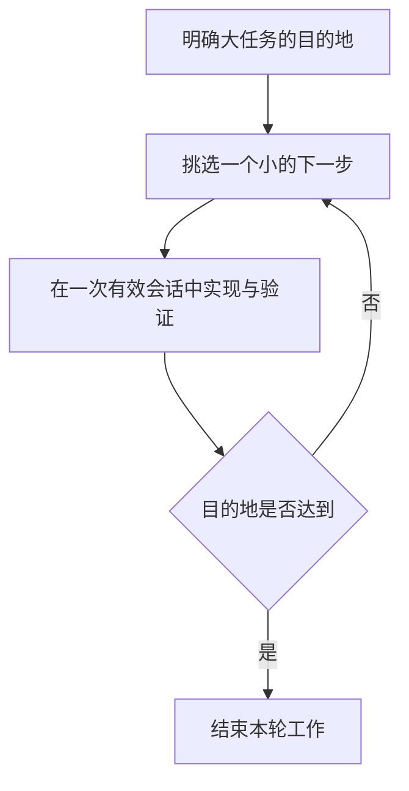

### 2.3 从多阶段计划到 Ralph Loop

*(参考时间：00:06:14)*

这就是讲师引入 Ralph Wiggum / Ralph Loop 的入口：先用 PRD 描述最终要到哪里，再让代理每次做一个使系统更接近目标的小改动，直到完成。

关键不在循环名字，而在**每轮都小、每轮都朝同一个目的地前进**。讲师认为纯粹让模型“再往前做一点”有用，但他希望增加一些结构，所以后面会把 PRD 进一步拆成带依赖的 issue，而不是只给一个终点就无限运行。

### 2.4 《记忆碎片》：新会话没有上一轮的记忆

*(参考时间：00:07:27)*

第二个约束来自电影《记忆碎片》（Memento）的类比：模型像那个不断失去记忆的人，每次新会话都会回到基础状态。

讲师在 tldraw 画布上把一次会话拆成四部分：

1. **始终存在的系统提示与持久指令**；
2. **探索**：代理阅读代码库，寻找修改点；
3. **实现**：编辑文件、形成改动；
4. **测试与反馈**：检查实现是否有效。

持久指令应尽量小。如果一开始就塞入极多内容，模型尚未处理任务，就可能被迫在一个很差的上下文状态里工作。讲师说自己见过有人往基础指令中放入约 250K token，他用这个例子强调“基础包袱”也要算在会话成本内。

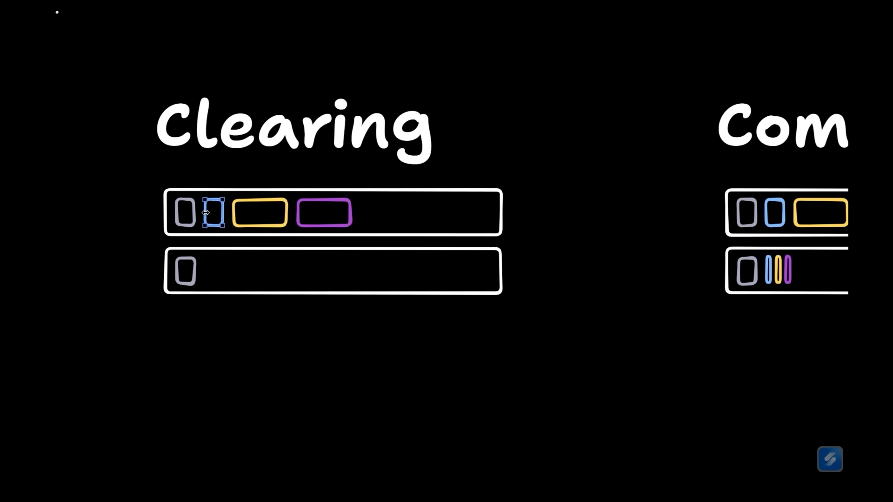

### 2.5 Clear 与 Compact 为什么不是同一种重启

*(参考时间：00:09:00)*

现场演示使用 Claude Code，但讲师明确说方法并不依赖 Claude Code，也不必只用这一种工具。他指着状态栏，强调应看见**精确的 token 使用量**，才能知道会话正在靠近什么位置。

接着他演示两个操作的区别：

- **Clear**：删掉当前对话，回到基础指令；
- **Compact**：把对话压缩成文字记录，再带着这份记录继续。

Compact 的确能缩短输入，但新的起点由那份摘要决定。讲师个人更喜欢 clear：因为清空后的状态可预测，每次都相同。他宁愿主动围绕“代理会失忆”设计可持久读取的工作材料，也不愿一直依赖不可完全控制的历史压缩。

这里并不是说“旧会话的知识不重要”，而是把知识放到合适的位置：最终目的地、待办任务和已完成改动要能在新一轮被重新读取，而不是只存在于一条越积越长的聊天里。

## 三、从一句客户消息开始：先建立共同设计概念

*(参考时间：00:11:06–00:22:00)*

### 3.1 演示项目 Cadence 与那条模糊需求

工作坊的项目是一个课程管理平台：教师管理内容，学生学习课程。讲师要从一个功能想法出发，走到 PRD，再走到实现。

仓库根目录的 `client-brief.md` 放着一条模拟 Slack 消息。客户 Sarah Chen 说：Cadence 留存不好，学生注册后只做几节课就走了，希望给平台加一些游戏化。

这一句话给出了业务动机，却没有给出足够的实现决策。讲师问观众会如何开始：有人说进入 plan mode，有人说先获取更多信息。他认同后者，又补了一个现实限制：假设客户已经度假，开发者预算紧、时间紧，仍然得把事情往前推进。

### 3.2 为什么反对只改规格、不看代码

*(参考时间：00:12:37)*

讲师在这里批评一种 specs-to-code 做法：先写一份规格交给 AI，代码有问题就回去改规格，再生成；开发者不必理解代码，只要不断调整文档。

他把这称作换了名字的 vibe coding，并说自己认真试过，但效果不好。原因是：**代码库才是后续工作的真实环境。** 人需要知道里面有什么、怎样组织、哪些地方已经变复杂。忽略代码，就会丢掉塑造系统的能力。

所以后面即使会生成 PRD，也不是把人变成“规格编译器”的操作员。讲师要在整个过程中保留对代码结构的控制，只把合适的执行部分交给代理。

### 3.3 Grill Me 的作用：不要急着交出一份计划

*(参考时间：00:15:07)*

讲师先 clear，再调用 Grill Me 技能，并把客户 brief 传进去。此时代理拿到的是很少的初始材料：技能指令和需求描述，而不是几十页历史聊天。

他展示技能中的关键要求，中文可转述为：

```text
持续就这个计划的每个方面向我提问，直到我们形成共同理解。
沿着决策树的各个分支推进，逐一解决依赖。
每次只问一个问题，并为该问题给出你的推荐答案。
```

这里的目标不是“多问几个问题”本身。讲师注意到 plan mode 常急着输出：模型一觉得信息够了，就开始生成完整计划；但他真正需要的不是一份资产，而是与代理处于同一个理解状态。

他借 Frederick P. Brooks 的《The Design of Design》解释 **design concept（设计概念）**：共同参与设计的人之间，需要共享“我们到底在造什么”的概念。计划是这个概念的记录，共同理解才是它的前提。

### 3.4 子代理探索：不要让主对话吞下所有代码

*(参考时间：00:17:31)*

Grill Me 先探索代码库，再开始提问。现场的 explore 子代理消耗了约 93.7K token，但主会话的 token 使用没有同幅增加。

讲师向不熟悉子代理的观众解释：父代理把探索任务交给另一个具有**隔离上下文**的模型；它读大量资料，再把重要内容总结给父代理。这使主会话可以围绕产品决策保持简洁，而不必装入探索的全部细节。

画面中的探索结果也补充了项目背景：Cadence 使用 React Router 与 SQLite，已有课程进度和测验评分，但尚未实现游戏化。这些既有能力决定了新功能可以连接哪些行为，而不是从空白系统重新发明一遍。

如果开发者不熟悉仓库，也可以在问答过程中反问代理：现在的数据模型是什么？已有行为在哪里发生？讨论不必建立在“人已经记住所有源码”的假设上。

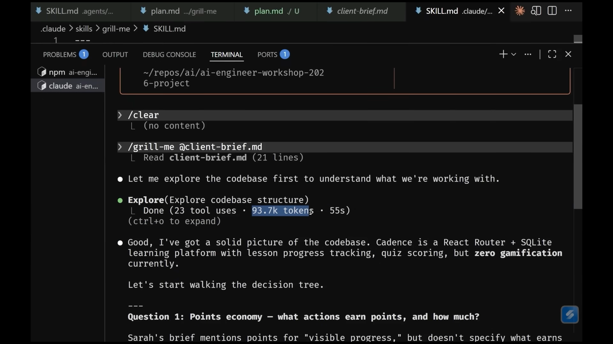

### 3.5 第一组决策：哪些行为赚积分

*(参考时间：00:18:38)*

模型的第一个问题是积分经济：**什么动作赚分，分别赚多少？** 它还建议先保持简单，只做少量积分来源。

这种“问题 + 推荐答案”很重要：人不必每次都面对一张空白纸。代理先用代码库和常见方案提出选项，人再决定它是否适合业务。

现场明确同意的一项建议是跳过视频观看事件，因为这类事件噪声大，也容易刷分，把课程学习中的稳定行为放在优先位置。这轮对话先确定行为来源，后面的任务说明再把奖励与边界条件写具体。原始客户消息并没有替团队作出这些选择。

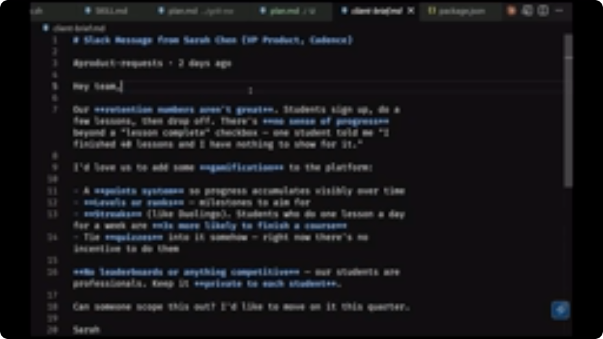

### 3.6 第二组决策：历史记录是否回填积分

*(参考时间：00:19:38)*

接着模型问：**过去已完成的课程是否也应获得积分？** 仓库里已经有带完成时间戳的学习进度，理论上可以回填。

讲师说这是一个他和客户都未预先想到的棘手问题，并让现场投票：要回填，还是不要？房间里还有不少人没作选择。他最终接受模型建议，后面的任务列表也出现了 retroactive backfill。

画面把这个问题说得更具体：数据库已有带 `completedAt` 的 `lesson_progress`，也有记录分数的 `quiz_attempts`。模型指出，一个已经完成 40 节课的学生，如果新功能上线时从零分开始，就仍然面对“以前的努力没有东西可展示”的问题。它建议回填已完成课程和已通过测验，使这类学生马上看见已有积累，并用“40 节课后看到 400 多积分和相应等级”作示例。

模型同时列出两种可能的触发方式：首次加载 dashboard 时计算，或通过一次性迁移 / backfill 完成。此时仍在讨论推荐方案；后面的修订切片才明确选择 dashboard 加载时的懒触发，且计划仍须经过实现与 QA。

这个例子说明 Grill Me 的价值不只在列清单。它会把被一句“做游戏化”藏起来的产品后果抬到台面：老用户与新用户怎样公平比较，已有数据如何解释，是否要增加一次数据回填。这样的分歧应在实现前对齐，不能等代理自行决定后再惊讶。

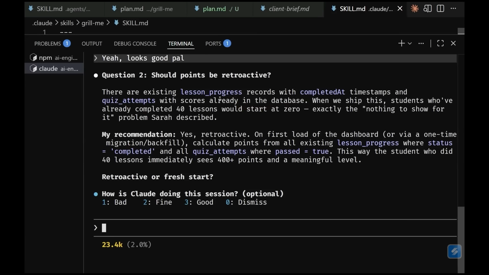

### 3.7 等级、连续学习和界面位置

*(参考时间：00:20:39–00:23:14)*

后续问题包括等级的成长曲线、连续学习是否额外赚分，以及游戏化界面放在哪里。现场给出的取舍包括：连续学习单独处理，相关界面放进 dashboard。

问答可以很长。讲师经历过 40、80 个问题，也听人说过 100 个问题，可能要聊一小时。重要产物是这段经过反复澄清的对话，它本身就是共同设计概念的载体。

输入也不必只有客户 brief。比如先与领域专家开会，把会议转录喂给 Grill Me，再沿着里面尚未解决的假设提问。这样，真实世界的信息经过讨论进入设计，而不是由代理在缺乏依据时补全。

## 四、规划阶段的现场问答：掌握自己的工具，也承认人的职责

*(参考时间：00:22:10–00:29:10)*

### 4.1 Spec Kit、OpenSpec、Taskmaster 能否替代 Grill Me

观众问其他规划框架是不是更结构化的替代方案。讲师的重点不是评出一个框架冠军，而是**在工具快速变化、没有公认赢家时，尽量拥有自己的规划栈**。

他观察到一些学生过度依赖某个框架。出了问题，因为不知道内部发生什么、没有可观测性，只能说“这东西不好用”。如果控制着整个流程，至少知道问题在哪里，也有机会修复。

即使讲师给了大家自己的技能组合，也不希望大家把它当黑箱。他强调控制权应在使用者手里：理解每一步的目的，发现某条技能指令导致失败时，就能调整它。

### 4.2 产品问题不是开发者能独自拍板的，怎么办

*(参考时间：00:24:59)*

有人指出 Grill Me 的很多问题更像产品负责人要答的问题。在大团队里，到底谁来使用它？

讲师把它比作多了一个成员的结对编程：如果问题属于业务，就让开发者、领域专家和 AI 同时在场；如果问题属于实现，就让开发者、另一位工程师和 AI 一起讨论。甚至可以变成多人协作的 mob programming。

**执行能自动化，不等于关键判断只需一个人。** 后面的实现可以很快，但前面真正影响方向的决策，恰恰可能需要更多人参与。AI 的持续追问能让团队暴露分歧，而不是让一个不具备权限或知识的人假装回答所有问题。

### 4.3 为什么不能把 Grill Me 也放进 Ralph Loop

*(参考时间：00:26:29)*

有人建议直接让循环跑掉剩下的问答。讲师说这碰到了任务的根本区别：

- **Human-in-the-loop**：需要人坐在这里判断、补信息、做取舍；
- **AFK（away from keyboard）**：人离开键盘，任务仍能沿清楚的规则执行。

规划中的对齐属于前者，实现可以组织成后者。把前者误装进自动循环，不会凭空生成人才掌握的业务知识。

为了赶工作坊进度，他现场让模型一次列出所有推荐，自己快速扫过；稍后模型回答了约 22 个自己的问题。这是现场加速，不是前面“人必须参与对齐”的原则被撤销。

### 4.4 问答 UI 与角色预测：讲师没有给出的答案

*(参考时间：00:27:18)*

讲师演示 Claude Code 的 AskUserQuestion 界面，认为它初看好看，但在他的体验里有不少问题，所以平时偏好普通对话。这里是他对当时产品的个人体验，也再次说明流程可以换别的代理工具。

对于 PM 或其他非开发角色做 vibe coding，以及未来岗位是否收敛的问题，他没有给出完整判断。后面他直接说自己不是预测未来的评论员，不能回答。这些开放问题不能从演讲中提炼出一个确定的行业结论。

## 五、把对话变成 PRD：保存目的地，不迷信文档形式

*(参考时间：00:29:10–00:39:23)*

### 5.1 目的地与旅程是两份不同的东西

讲师在画布上区分两种需要记录的内容：

1. **目的地**：用户故事是什么，什么状态算完成；
2. **旅程**：怎样分步抵达，哪些任务先做、哪些任务后做。

Grill Me 主要帮助人和代理弄清“这是什么”，接下来才把理解变成可持久使用的材料。此时会话已积累约 25K token，讲师称里面有很多“金子”：它们承载真实做过的决定，不能在 clear 时直接丢掉。

PRD 的功能就是记录目的地。它的形状可以采用团队原有模板，不必为了工作流换成某种唯一正确的格式。与其执着标题格式，不如检查它是否保存了已经形成的设计概念。

### 5.2 Write a PRD 技能到底做什么

*(参考时间：00:31:12)*

现场直接调用 Write a PRD。讲师解释，这个技能也可以单独使用：先要求用户详细描述问题，再探索仓库、采访用户，最后生成模板；他个人更喜欢先 Grill Me，再写 PRD，因为前面的共同理解已经建立。

展示的 PRD 包含：

| 部分 | 在这次游戏化功能中的作用 |
| --- | --- |
| 问题陈述 | 学生注册、学习几节课后流失 |
| 解决方案 | 引入经过讨论的游戏化行为 |
| 用户故事 | 描述用户需要获得的行为，现场生成约 18 条 |
| 实现决策 | 记录积分、等级阈值等已经决定的方向 |
| 测试决策 | 哪些逻辑值得测试，怎样验证 |
| 非目标 | 明确本轮不做什么，界定完成边界 |

现场打开的 PRD 进一步把方案写成**个人、非竞争性的游戏化**：通过积分、等级和每日连续学习，让学生看见不断积累的进展；每人的数据对自己可见，不设置排行榜或相互比较。画面中可读到的前几条用户故事是：

1. 完成一节课获得积分，让进展变得可感知、可积累；
2. 通过测验比单纯完成课程获得更多积分，鼓励学生参加测验；
3. 测验成绩达到 90% 以上时获得额外奖励，奖励掌握程度；
4. 在 dashboard 看见总积分，一眼知道自己已经取得多少进展。

这些细节来自视频中实际显示的文档。它们比“加积分、加等级”更完整地定义了产品方向；但画面没有完整展示的其余故事和具体奖励数值，不在这里补写。

讲师提到用户故事可以采用熟悉的自然语言方式，也有人使用 Cucumber 一类表达。重点是给出行为和完成定义，不是把某一种语法当成工程质量的来源。

### 5.3 在 PRD 阶段就检查模块

*(参考时间：00:32:46)*

模型并没有立刻输出最终文档，而是先提出要修改的模块。讲师认真看这个部分，因为他不想直到代码生成后才第一次面对系统结构。

这次新建的 gamification service 包含有意义的业务逻辑，是测试的主要边界；还需要连接已有的 progress service、lesson route 和 dashboard route。后面讲深模块时，他会回到同一份 PRD，解释这些边界为何从一开始就要清楚。

这正是他反复反对“忽略代码”的含义：**即使当前阶段主要讨论需求，也在持续设计代码库。** 不是让规格文档自由漂浮，等自动生成时再看会长成什么样。

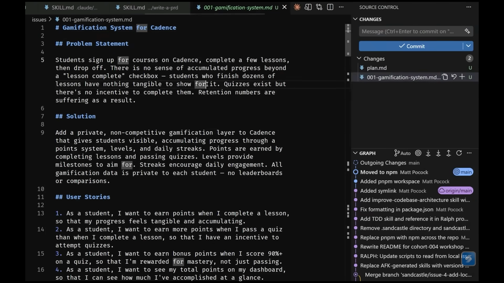

### 5.4 本地 Markdown 与 GitHub issue：存放方式服务于流程

*(参考时间：00:33:48)*

为了让工作坊容易启动，讲师希望在本地 `issues/` 目录创建 PRD 和任务 Markdown；平时他更多用 GitHub issue。他展示自己的 course-video-manager 工作仓库，说自己用这个应用录制大量视频，里面已有数百条关闭的 issue，包含 PRD 和实现任务。

现场代理后来误把任务建到了 GitHub，他再次要求改成本地 Markdown，并更明确地说要引用本地版本。这是一个实际的小失败：**即使流程本身清楚，代理也会在产物位置上偏离要求。** 指令需要指向本次环境，而不能只靠技能的通用默认行为。

### 5.5 为什么他不逐字审阅生成的 PRD

*(参考时间：00:35:11)*

讲师问观众：现在是否应该审阅这份 PRD？他的回答是自己通常不看。

他的理由有明确前提：已经通过 Grill Me 达到共同理解，而此刻 PRD 主要是把对话总结下来。假如逐字看，自己究竟在测试什么失败模式？如果只是重新检查模型是否能总结对话，他认为收益不高。

这不等于“所有需求文档都无需审阅”，也不等于前面的模块提案不需要人判断。恰好相反，他已经在讨论阶段作出决策，在模块阶段检查边界；只是不过度把精力花在最终总结文档的每个字上。

### 5.6 问答：还需要深入理解 TypeScript 和代码吗

*(参考时间：00:36:35)*

面对“AI 已经可以修 TypeScript，开发者还需要懂多深”的疑问，讲师的回答很直接：**糟糕的代码库会制造糟糕的代理。** 如果输入环境是垃圾，不能期待代理在里面稳定产出好东西。

他认为深入理解工具和代码会让开发者更强，也会让开发者从 AI 得到更多价值。后面“人掌握接口、代理实现内部”的策略，就是对“理解到哪一层”作进一步划分，而不是主张完全不懂代码。

### 5.7 问答：1M 上下文难道完全不值得用吗

*(参考时间：00:37:27)*

讲师开玩笑说，自己刚用 200K 窗口录完课程，发布当天工具就推出 1M 窗口。在他的看法里，这可能只是把迟钝区拉长，而不一定把适合编码的聪明区同步放大。

但他没有否定大窗口的全部用途。他举“放进几本《战争与和平》，检索其中的人物或信息”的例子：**长上下文的检索价值，与长上下文里持续编码的可靠性要分开评估。** 他也承认模型进步后，有效区间可能扩大。

## 六、从 PRD 到 issue：让每一枪都看得见落点

*(参考时间：00:39:23–00:52:18)*

### 6.1 为什么不用固定编号的多阶段计划

现在目的地已清楚，问题变成怎样抵达。最直接的做法是让模型生成 phase 1、phase 2、phase 3，但讲师改用 Kanban：一组带阻塞关系的任务卡片。

它不是新发明，而是团队开发长期使用的组织方式。每张卡片说明做什么，以及依赖谁。这样代理不是机械执行“第几步”，而是从所有当前可执行的工作中领取一项。

现场第一轮提出五类任务：

- schema 和 gamification service，无前置阻塞；
- streak tracking；
- 把 points 和 streaks 接到课程、测验完成事件，依赖前两项；
- retroactive backfill，只依赖第一项；
- 需要等待前面任务完成的后续整合项。

模型还把其中任务标为 AFK，表示可以交给无人值守的代理执行。这个列表乍看合理，但讲师马上发现了一个结构性问题。

### 6.2 AI 为什么容易横着写

*(参考时间：00:41:19)*

系统有层次：数据库可能在一个地方，API 是另一个部署单元，前端又在 CDN；即使在同一应用内，也有 quiz、team、user、coupon、course 等服务，它们互相依赖。

模型常自然地产生这样的计划：先做完数据库，再做完 API，最后加上前端。每一层看起来都完整，却直到第三阶段才得到跨层反馈。

假如数据库层“完成”后，根本还没有一个用户动作能一路走通，那么早期测试只是局部的；真正连接起来时，接口不匹配、遗漏的状态变化才会暴露。讲师让现场指出问题，观众回答：缺少完整反馈回路。

### 6.3 Tracer bullet：曳光弹的比喻

*(参考时间：00:44:20)*

讲师用《程序员修炼之道》的 **tracer bullet（曳光弹）** 解释垂直切片。

想象夜间防空射击：如果打出去的都是看不见的普通子弹，即使看见目标，也不知道自己的弹道究竟朝哪里走。隔几发放一枚能发光的曳光弹，就能看见轨迹，及时调整方向。

软件中的曳光弹不是“先把某一层做得很厚”，而是一条**很薄、但穿过必要层次的完整功能路径**。它让开发者和代理尽早看见行为是否走通。哪怕功能很小，也能从整条路径获得反馈。

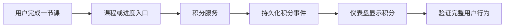

### 6.4 现场纠偏：有“垂直切片”指令，仍可能横向拆分

*(参考时间：00:45:16)*

PRD-to-issues 技能已经要求“独立可领取的垂直切片”，但模型仍把“单独建立 gamification service”作为第一个任务。讲师认为这太横向：有了服务，还没有任何用户可见行为。

他希望第一条切片包含必要的 schema 改动、一个服务，以及最小的前端表示。于是直接告诉代理：

```text
第一个切片太横向了。
```

模型随后改成：**完成课程后获得积分，并在 dashboard 看见积分。** 讲师认可这个版本，因为它虽然涉及多个用户故事，但结束后能立刻看见结果，后续功能可以在这条已打通的路径上追加。

这段演示有两层含义：经典工程概念很适合变成自然语言提示词；但“提示词里写了好原则”不代表模型每次都遵守，人的设计判断仍需要留在任务拆分处。

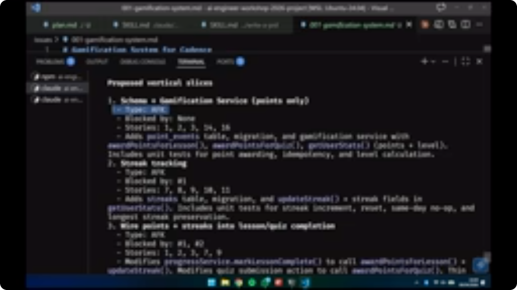

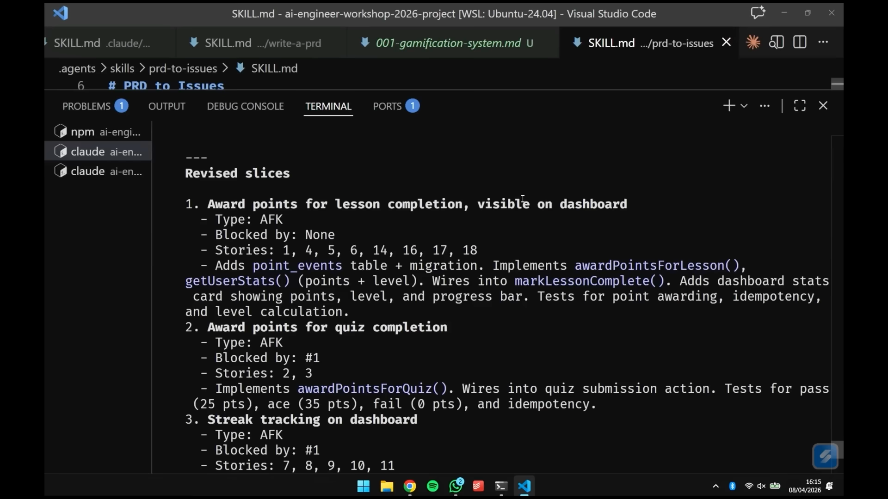

画面中的修订列表还给出了足够具体的接口与验收范围。以下编号是这份提案中的切片顺序，并非后面已经创建的 issue 文件编号：

| 切片 | 前置条件 | 具体工作与反馈 |
| --- | --- | --- |
| 1. 完成课程后获得积分并在 dashboard 可见 | 无 | 新建 `point_events` 表与迁移；实现 `awardPointsForLesson()`、`getUserStats()`；接入 `markLessonComplete()`；展示积分、等级和进度条；测试发分、幂等性、等级计算 |
| 2. 测验完成后获得积分 | 切片 1 | 实现 `awardPointsForQuiz()` 并接入测验提交；计划中明确测试通过 25 分、优秀 35 分、失败 0 分，以及重复操作的幂等性 |
| 3. dashboard 展示连续学习情况 | 切片 1 | 把连续学习结果显示在统计卡片；测试增长、中断后重置、同一天不重复增长、最长连续记录 |
| 4. 回填历史积分 | 切片 1、2 | 实现 `backfillPoints(userId)`，在 dashboard 加载时懒触发；从历史课程完成记录和测验尝试回填；测试正确性与幂等性 |

这里的函数名、表名和测验积分来自实际画面，不是根据“游戏化”自行设计的一套实现。它们仍是当前提案的要求，不代表演示结束时全部功能都已完成。注意四项中反复出现的**幂等性**：同一学习事件被再次处理时，不应不断额外发分。

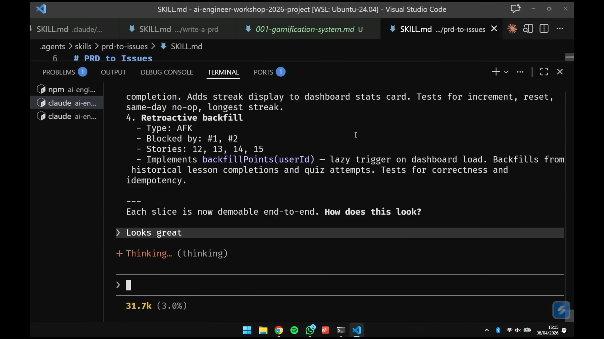

### 6.5 PRD-to-issues 技能的执行顺序

*(参考时间：00:44:05)*

讲师逐项解释技能：定位 PRD；新会话时探索代码库；起草垂直切片；向用户确认；创建任务文件。

“独立可领取”并不等于彼此完全无关，而是每个任务的前置条件清楚，满足后就能由一个新会话接手。不能把关键决策藏在前面某条聊天里，再假设下个代理天然知道。

### 6.6 依赖图如何打开并行机会

*(参考时间：00:49:34)*

讲师画出一张有向无环图：先完成共同前置任务，再由两个代理各领一个互不阻塞的任务，最后做依赖这两项的整合。

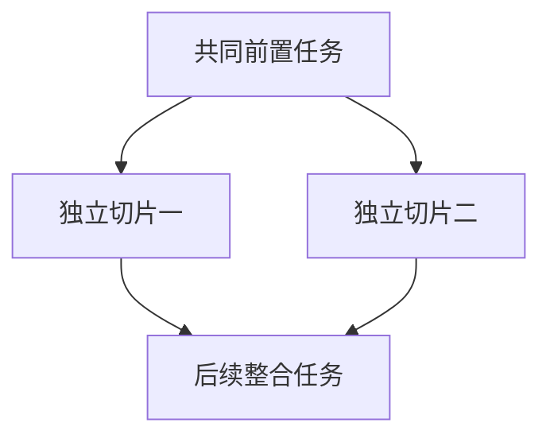

这张图隐含三轮执行，而不是永久固定为“只能一个代理按编号做”。一个团队同时有多个 PRD 时，多张依赖图还可能提供更多并行工作。前提仍是先看真实依赖，而不是盲目增加代理数。

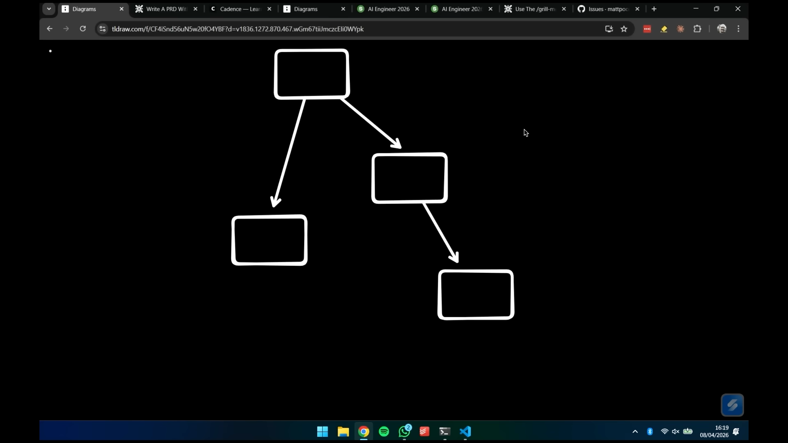

### 6.7 问答：Grill Me 一直问不完，什么时候停

*(参考时间：00:47:19)*

讲师承认问答可能非常密集。技能归自己所有，完全可以让它适当收敛、设置停止点，或在已经足够对齐时结束。

如果这是反复出现的失败模式，就改技能，而不是把现有提示词当成不可改变的规则。这与前面“掌握规划栈”的建议一致：使用者要能根据观察到的问题调整流程。

### 6.8 为什么他放弃了“牺牲语法换简洁”的旧建议

*(参考时间：00:47:54–00:49:17)*

讲师曾建议在持久指令里写“为了简洁，可以牺牲语法”，因为当时需要快速阅读模型生成的计划。但后来他发现，自己真正需要的是持续提问形成共同理解，而不是阅读压缩得极短的计划。

因此，当他不再依赖逐字阅读计划，便不再要求目的地文档极度简洁。PRD 是后续代理需要重新读取的完整目标，没必要为了人的快速扫读而丢掉关键内容。

这不是一条永久有效的“短提示词最好”法则，而是工作方式改变后，指令也跟着调整的例子。

## 七、把实现交给夜班：一次迭代怎样变成 AFK 循环

*(参考时间：00:52:18–00:58:37)*

### 7.1 白班负责准备，夜班负责有边界的执行

讲师把前面的过程比作人的白班：提出想法、Grill Me、必要的研究与原型、PRD、Kanban，均需要人工判断和确认。

只有到实现阶段，人才退开，让一个或多个代理处理已经准备好的任务。前面花时间，不是拖慢实现，而是在为夜班准备一批有清楚方向的工作。

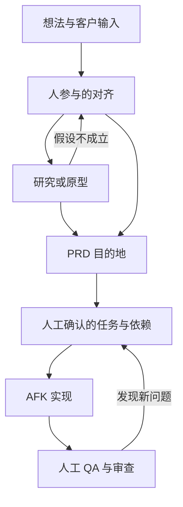

### 7.2 once.sh 给模型哪些材料

*(参考时间：00:54:19)*

最简单的演示入口是 `once.sh`。讲师解释它做的事情：

1. 把 `issues/` 下本地 Markdown 读入变量，让当前 backlog 出现在上下文起点；
2. 获取最近五个提交；
3. 读取实现提示词；
4. 调用 Claude Code，并使用接受编辑的权限模式，把这些材料一起传进去。

画面中的 `once.sh` 可以直接读出下面这段脚本（按屏幕内容转录，长行恢复为同一行）：

```bash
#!/bin/bash

issues=$(cat issues/*.md 2>/dev/null || echo "No issues found")
commits=$(git log -n 5 --format="%H%n%ad%n%B---" --date=short 2>/dev/null || echo "No commits found")
prompt=$(cat ralph/prompt.md)

claude --permission-mode acceptEdits \
  "Previous commits: $commits Issues: $issues $prompt"
```

这段代码展示了失忆之后如何恢复执行材料：当前任务、近期提交和执行规则，都是显式放入新会话的输入。它没有依赖当前终端里上一段对话的隐含记忆。

视频提到了最近五个提交这个输入，但没有在后续完整展开其独立机制。这里保留事实，不补造脚本没展示清楚的控制逻辑。

`once.sh` 只运行一次，严格说还不是循环。AFK 版本才把一次执行反复跑起来，并加入 Docker sandbox。工作坊不要求观众现场下载 Docker 镜像，以免大型下载拖垮会场网络。


### 7.3 为什么先人工观察单轮执行

*(参考时间：00:55:41)*

讲师强调应先多次运行单轮脚本，亲眼看代理做什么，再调整提示词。这个阶段仍是人在环内：观察它会选哪条任务、会不会越界、测试是不是认真跑、是否形成预期的提交。

只有观察到这些行为之后，再让它长时间无人值守。否则，循环只是把一轮中看不见的错误重复很多遍，不会自动改进流程。

### 7.4 实现提示词怎样选任务

*(参考时间：00:56:05)*

现场提示词首先限制代理：**只处理 AFK issue。** 如果这些任务已经全部完成，就输出约定的“没有更多任务”标志，避免无事可做时继续发明工作。

接着要求挑选下一条任务。讲师给出的优先级顺序是：

1. 关键缺陷修复；
2. 开发基础设施；
3. tracer bullet，即走通端到端反馈的切片；
4. 打磨、快速收益和重构。

选定后，动作很简单：探索仓库、用 TDD 完成任务、运行反馈回路。此时演示先保持单代理顺序执行，是为了把机制看清；后面的 Sandcastle 再把它扩展到并行。

### 7.5 清空对话之后，任务还能继续

*(参考时间：00:57:35)*

讲师取消前一段交互、clear，然后执行单轮脚本。模型不用知道刚才长对话的全部内容，因为当前任务材料已经被持久化并重新传入。

这正好回应开头的《记忆碎片》约束：把不能丢失的信息写成明确的 PRD、任务和提交，才能使用可预测的新会话，而不是依赖模型记住上一轮谈过什么。

### 7.6 问答：如何保留“决定不做”的内容

*(参考时间：00:58:06)*

观众问，Grill Me 中否决过的方案和理由怎样留下来。讲师指向 PRD 尾部的 **out of scope**：明确本轮不处理的事项。

这部分不是可有可无的附录。只说“要做什么”而不说“不做什么”，代理就可能把相邻需求也当成本轮职责；非目标共同构成 definition of done，帮助未来新会话知道何时停止。

## 八、实现可以离线，协作与判断仍要有人参与

### 8.1 代理写得比人看得快，怎么办

*(参考时间：00:58:53)*

观众提出一个没有被这套流程自动消除的矛盾：**代理生成代码的速度，已经超过人审查代码的速度。** 现场很多人举手表示，使用 AI 后，自己做的代码审查比以前更多了。

讲师没有给出一个已经解决问题的万能办法。他明确承认，目前自己也不知道完整答案。前面的流程图中，真正适合 AFK 的主要是实现阶段；实现之后仍要检查实际体验和代码质量。把敲代码交出去，并不等于把工程责任一起交出去。

如果一个循环连续做了四条 issue，最后形成一大批变更，就会与“小而独立的 PR”发生冲突。可以少跑几轮、缩短每次循环，或者组织成一叠相互关联的 PR；但讲师觉得后者本身也很麻烦，而且只是把审查对象拆开，未必减少总工作量。

因此，这里的结论带有保留：应当预期自己会承担更多审查工作，而不能仅凭实现速度估计生产率。讲师也直言，这不是一个令人兴奋的回答，却是他当时面对的现实。

### 8.2 真实团队不会沿着一条直线工作

*(参考时间：01:00:15)*

另一位观众指出，前面的“想法 → PRD → 实现 → QA”看起来很线性，真实团队却会同时推进多个想法，没有一个人掌握全部背景，开发过程中还会突然插入缺陷。怎样缩短这样的反馈回路？

讲师把团队协作放回“从想法探索到明确目的地”的过程中。如果 Grill Me 问到了自己无法回答的问题，就应该找团队讨论，而不是要求模型替团队做决定。领域专家可能需要亲手试用原型；第三方库或服务可能需要研究、比较；团队成员可能要对共享的材料提出 RFC 式反馈。

这些活动也可能推翻最初设想。例如，研究发现某个第三方服务的能力与预期不同，就应把新事实带回想法阶段，重新决定做什么。它不是一次向前走完的生产线，而是可以在想法、研究、原型、讨论之间反复往返，直到团队知道自己要去哪里，才适合将工作交给看板中的实现任务。

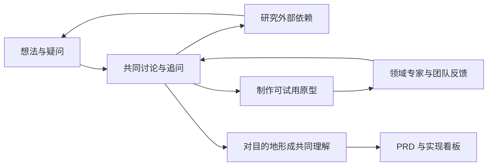

### 8.3 原型不需要先走完全部 PRD 仪式

*(参考时间：01:02:12)*

有人接着问：制作原型本身是否也要先写 PRD？讲师回答，不必为了一个探索性原型重复整套流程。原型的作用是更早得到反馈；如果必须先把所有问题研究清楚才能做，就失去了它的用途。

前端尤其需要这一点。用户界面是多模态对象，人必须真正看见它，才容易判断布局、交互和整体观感是否合适。讲师说，自己当时尝试给代理连接 agent browser 或 Playwright MCP 等工具，让它观看界面；但在成熟代码库中，模型还不太能可靠地产出符合自己要求的漂亮前端。**这是他在当时工具与项目中的个人经验，不是对所有视觉代理能力的普遍结论。**

他更喜欢这样使用 AI：请它在一个可以丢弃的临时路由中，做出三个可以点击切换的界面原型。人实际比较它们，选择较好的方向，提出反馈，再把原型这个具体材料带回 Grill Me 的讨论。

这样，抽象的“我想要一个好看、好用的页面”就变成了可以指认的差异：这个版本的结构好，那个版本的交互更自然，某个元素不应该出现。原型可以粗糙，因为它承担的是帮助决策的职责。

### 8.4 架构、API 与安全约束的问题暂时挂起

*(参考时间：01:03:37)*

现场还问到，如何让代理遵守既有架构、API 契约、安全规则和整个系统的设计约束。讲师先记录问题，稍后用 push / pull 和自动审查回答。这里没有立即给出一份安全实施清单，也没有演示完整的安全验证流程。

在等待实现代理探索仓库期间，讲师继续利用时间回答问题。这个现场节奏也提醒读者：代理运行与人类讨论可以并行，但仍应知道代理正处在哪个阶段，不能因为终端在持续输出，就假定它已经正确完成需求。

## 九、新的审查上下文，以及红—绿—重构

### 9.1 AI 可以审查代码，但审查者也需要“聪明区”

*(参考时间：01:04:47)*

观众问，为什么不让 AI 自己 QA、测试自己的代码。讲师认可自动审查，认为它能以相对低的成本抓到不少缺陷，应该安排在实现之后、人工 QA 之前。

不过，不能只在已经消耗大量上下文的实现会话末尾补一句“再审查一下”。如果实现耗尽了前面所说的聪明区，那么后续审查可能落入“笨区”，审查者反而比写代码的代理更难保持判断力。

他的做法是**清空上下文，再把需要审查的代码与相关材料交给新的审查会话**。这里的“自己审查”是指使用 AI 作为审查工具，并不要求同一个漫长会话对自己的推理进行自证。

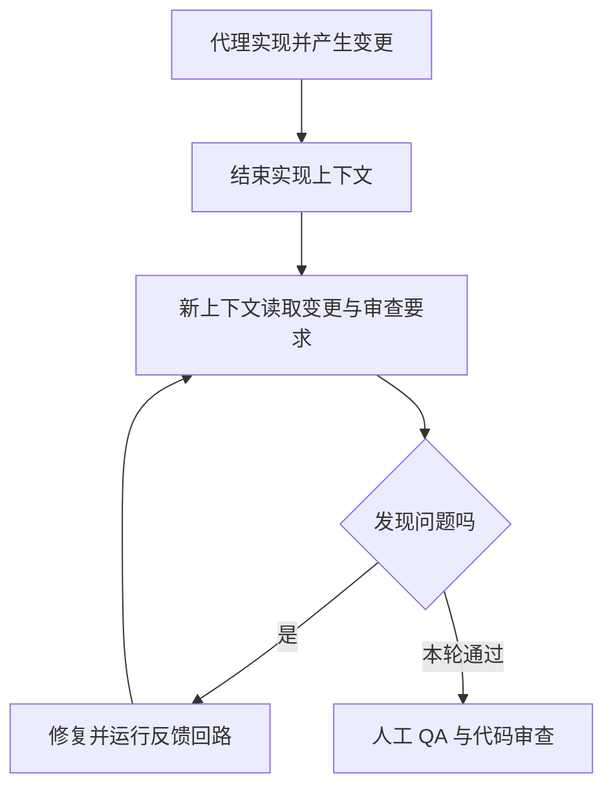

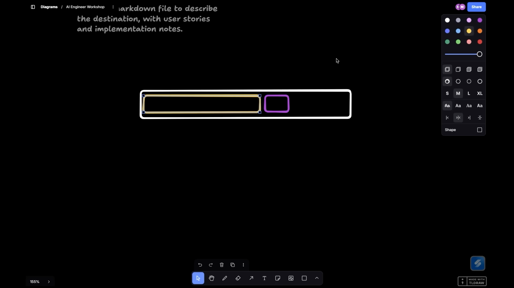

### 9.2 TDD 不只是增加测试数量

*(参考时间：01:06:32)*

讲师把 TDD，也就是测试驱动开发，视为自己充分使用代理的重要方法。仓库中有专门的 skill，教代理执行 **red → green → refactor**：先写一个失败的测试，再实现让它通过，最后在保持行为的前提下整理代码。

关键是“一次一个测试”，而不是先把整个实现层生成完，再一次性补出整个测试层。后者容易让模型写出迁就现有实现的测试：代码做了什么，测试就验证什么，看起来覆盖充分，却没有独立规定正确行为。

测试先行会让这种“作弊”更困难。测试已经把可观察的行为摆在实现之前，模型必须面对具体反馈，而不能只围着自己的代码叙述正确性。

### 9.3 现场的第一个红灯：模块还不存在

*(参考时间：01:07:14)*

演示中，代理正在为 gamification service 编写测试。它复用仓库已有的方法创建测试数据库，先运行测试；由于被测模块尚不存在，测试失败，代理确认了 red。

这个失败不是需要隐藏的事故，而是流程的起点：测试确实会失败，说明它不是一开始就无条件通过的摆设。下一步才是写出模块及相应行为，让测试转绿。现场过程中，讲师还处理了运行测试工具所需的权限提示。

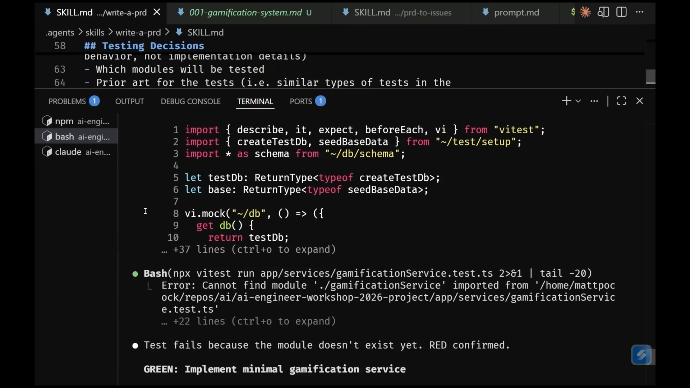

讲师没有说所有地方都一样容易做 TDD。他的表述是“在能够做好它的地方”使用，并且自己已经开始反过来调整架构，使更多功能具备适合 TDD 的边界。后面关于深模块的讲解，正是对这句话的展开。

## 十、一次真实 QA——284 个测试通过，页面仍然报错

### 10.1 端到端切片终于交出可以验收的东西

*(参考时间：01:08:56)*

单轮 Ralph 执行结束后，代理留下一个提交和一份工作摘要，宣布 issue 02 已完成。由于前面要求的是可审查的 tracer bullet，现在能直接打开应用尝试，而不必等待所有数据层、业务层和界面层任务都做完。

讲师先回顾代理的反馈回路：它修改了 dashboard 相关内容，运行测试与类型检查，遇到一个 TypeScript 类型错误，修正后重新执行检查。终端中出现的检查命令为：

```bash
npm run test
npm run typecheck
```

视频没有完整展开类型修复的源码，因此不应根据字幕里零散的 `typeof`、level threshold 等词拼出一个“现场原始修复”。能够确认的是，类型检查给了代理明确反馈，代理据此进行了修改。

这一轮后仓库共有 **284 个测试**。讲师强调，如果代码库没有反馈回路，代理就近似于盲写。遇到差的 AI 输出，不应只想到换提示词，还要检查项目是否提供了足够有质量的测试、类型和运行反馈。

### 10.2 人工审查先看测试，再看实现

*(参考时间：01:10:50)*

在这个例子中，新加入的测试主要围绕 gamification service，前端仍然较难测试。因此，“测试通过”首先支持的是被测服务的行为，不能直接推广为整套用户体验已经正确。

如果正式进行代码审查，讲师会**先读测试**，判断它们是否在检验有意义、符合需求的行为；再看实现，确认代码没有做出不合理的事情。

这个顺序很有作用：如果测试只是重复实现细节，即使实现与测试互相吻合，也没有多少验收价值。人先理解测试表达的要求，才知道绿灯究竟证明了什么。

### 10.3 用学生账号操作，缺失的数据表暴露出来

*(参考时间：01:11:18)*

随后讲师真正打开应用，以学生 **Emma Wilson** 身份登录，进入课程列表，选择 **Introduction to TypeScript**，继续学习，再点击完成这一课。

结果页面报错。进一步看错误，是 SQLite 找不到需要的 **`point_events`** 表。代理生成了迁移文件，却没有使讲师当前运行的开发数据库处于所需状态。

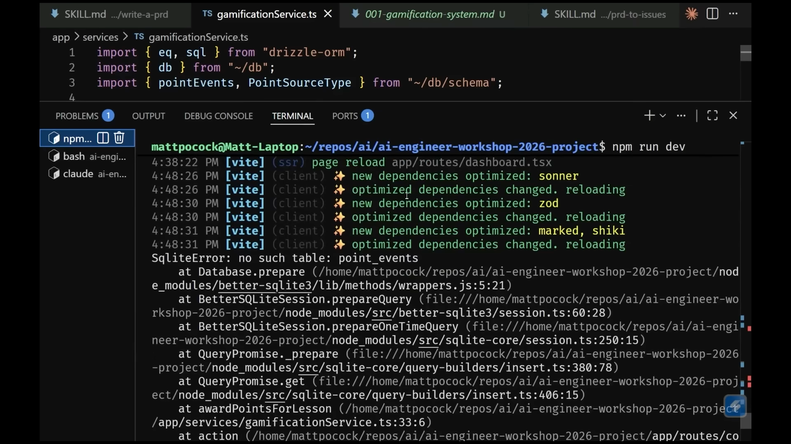

这正是为什么 284 个测试通过、类型检查通过之后，还需要运行中的验收：测试所用数据库与正在浏览的开发数据库可以具有不同状态，静态检查也不会替人把真实环境迁移到正确版本。

讲师尝试回到终端执行数据库相关命令，但现场对具体是 migrate 还是 push 也有犹疑，随后没有继续完整演示修复和复验。因此，这里记录问题与原因，**不补写一个已经验证成功的迁移命令，也不把演示描述成最终验收通过**。

### 10.4 QA 是把人的意见和品味重新带回产品

*(参考时间：01:12:21)*

讲师不打算让大家一直看自己排查数据库问题，转而解释人工 QA 的更深作用：人在真实使用时，会重新把自己的意见、品味和意图施加到代码库中。

有的团队试图把想法产生、研究、原型、实现和 QA 全部自动化。讲师个人觉得，这种产品容易缺少品味，可能不工作，也可能虽然能运行，却并没有按真实意图工作。他用 “slop” 批评这种没有充分判断的低质量产物。

这里的要求不是否定自动化，而是承认自动化反馈与人的体验判断承担不同职责。实现代理能做很多工作，但“这是不是我们想要的产品”仍要通过具体使用回答。

## 十一、为什么坏架构会限制 AI，深模块又改变了什么

### 11.1 先承认问题：有些仓库，人和 AI 都难以修改

*(参考时间：01:13:38)*

讲师接下来处理两个问题：如果手里的代码库结构复杂、AI 总做不好，应该怎样改善；以及怎样把此前的顺序执行扩展成多个代理并行。

第一个问题并不专属于 AI。如果人类开发者进入同一个仓库也常常做不好，就应当检查代码组织和反馈机制，而不是只责怪模型理解力不足。

他引用 John Ousterhout 的 **《A Philosophy of Software Design》**，用浅模块与深模块说明代码库为什么容易或难以导航、测试和修改。

### 11.2 浅模块的代价：复杂性留在模块之间

*(参考时间：01:14:12)*

想象一组小文件，每个文件导出少量东西，彼此之间有许多交叉依赖。要理解一项功能，代理必须逐个追踪：这个文件依赖那个，那个又依赖另外两个，真正的行为散布在整张图里。

文件小，并不意味着理解成本低。若每个模块只包了一点点行为，却把大量协调职责留给调用方，读者仍要同时掌握许多模块及调用顺序。这就是讲师批评的浅模块组合。

### 11.3 给每个小函数加测试，为什么仍可能漏错

*(参考时间：01:15:15)*

这种结构还让测试边界变得模糊。可以给每个小函数各包一层测试，但上层模块同时调用两个函数时，可能把调用顺序写反；两个函数单独都正确，不代表组合后的功能正确。

也可以再给上层模块加测试，但这时又要决定：底下那两个模块要不要 mock？如果都 mock 掉，测试还能不能暴露真实组合的问题？如果不 mock，又如何组织一整团相关依赖？

讲师反对的是让测试机械地追随每个小实现单元，而没有找到有意义的行为边界。表面上测试很多，真正的用户行为却可能无人负责。

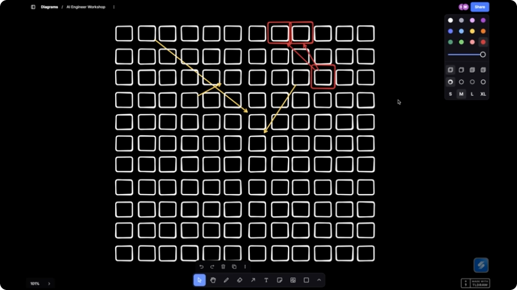

由此形成一条因果链：**模块容易从外部测试 → 反馈回路更可靠 → 代理更容易判断自己的修改是否正确。** 测试能力不是实现完成后的附加装饰，它会直接影响 AI 在这个仓库中能做到什么程度。

### 11.4 深模块：小接口背后承担大量有意义的功能

*(参考时间：01:16:55)*

与浅模块相对，深模块对外提供小而简单的接口，内部容纳较多功能和复杂性。调用方只需掌握这个接口，而不必理解内部所有协作细节。

测试也可以围绕这个有意义的边界组织：从接口输入，检查可观察结果，让模块内部真实的功能一起参与验证。这样一组测试能覆盖较多行为，而不是各自证明一堆小零件单独能转动。

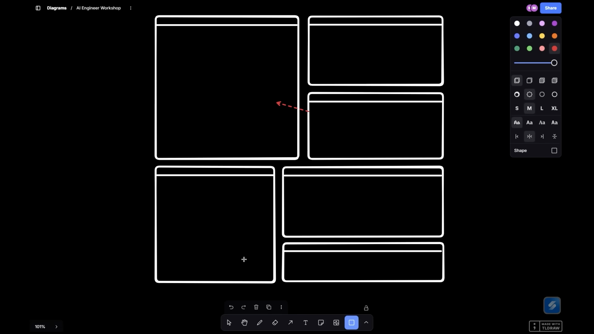

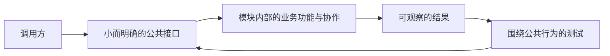

“深”在这里指**接口所暴露的复杂性与其承担功能之间的关系**，不应简单理解为把代码塞进一个很长的文件。讲师的目标是让复杂性被合适的边界吸收，而不是追求某个文件行数。

### 11.5 在 PRD 阶段就保留模块地图

*(参考时间：01:18:02)*

讲师回到前面游戏化功能的 PRD，指出其中已经明确安排：新建 gamification service 作为一个深模块，围绕它组织测试；同时修改 progress service、lesson route、dashboard route 等既有部分。

这不是把整个需求丢给 AI 后才看它生成什么形状，而是在规划时就关心模块及接口，在实现时继续检查这些边界。人的脑中需要一直保留这幅模块地图。

他认为，缺少引导时，AI 很容易继续堆出许多浅层小块。让模型写代码与让模型决定整个架构，是两件不同的事；委托前者时，仍应主动管理后者。

## 十二、把内部实现交出去，保留代码库的整体形状

### 12.1 为什么更忙了，却更不熟悉自己的代码

*(参考时间：01:19:05)*

讲师请大家举手：谁觉得使用 AI 后比以前更忙？谁觉得自己对代码库反而没有以前熟悉？现场有人对两问都有共鸣。

当团队快速委托越来越多实现时，很容易失去代码库的整体感。失去整体感之后，自己也更难改进架构，结果就是不知不觉把代码库的形状也交给了 AI。

问题因此变成：怎样既保持推进速度，又不要求人脑装下每一行代理生成的代码？讲师的回答，是把注意力放在模块的接口、职责和可观察行为上。

### 12.2 灰盒：知道行为与边界，不必记住每一处内部细节

*(参考时间：01:20:01)*

人先设计模块接口，再委托内部实现。这样，一个模块可以作为 **gray box，灰盒** 来理解：知道它是什么形状，负责什么，在什么条件下应该产生什么行为，但不需要始终记住内部所有代码。

讲师说，他不一定要审查模块里的每一处实现，也不一定要知道它正在怎样完成每一个动作；更重要的是确信它在规定条件下表现正确。这种安排使自己能保留整体概览，同时减轻认知负担。

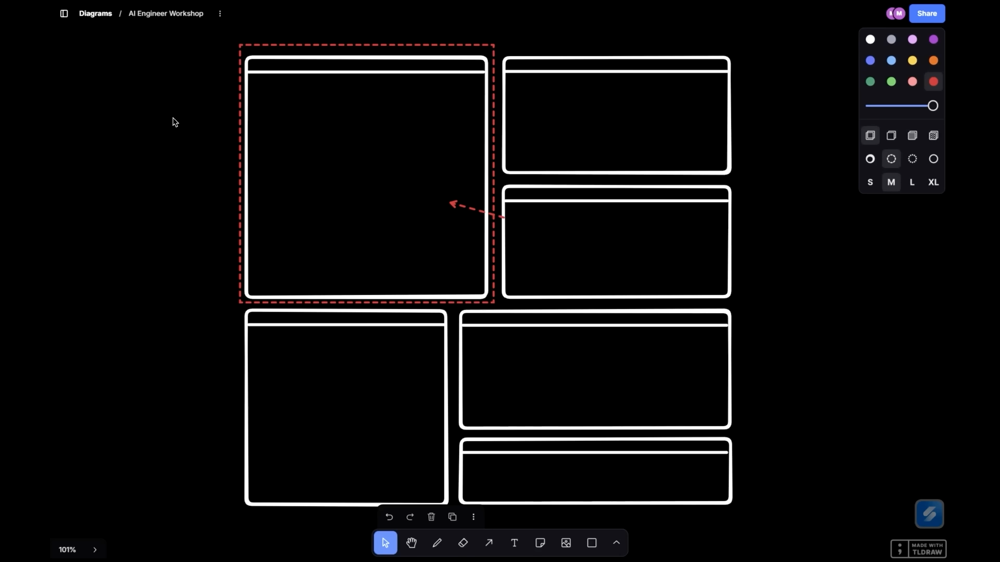

这与完全不审查代码不同。前提是接口可理解、行为有反馈、测试边界有意义；人可以把注意力放在更合适的尺度上，而不是仅凭“代理说完成了”就忽略内部风险。

### 12.3 既有仓库怎样找到可以加深的边界

*(参考时间：01:21:12)*

讲师启动名为 **improve codebase architecture** 的 skill。它扫描仓库，探索目前的架构，寻找可以加深模块的机会。

这个动作不是让代理无目标地“重构得更优雅”，而是寻找具体候选：哪些相关功能现在过度分散？能否通过一个更简单的接口包起来？能否从模块外部验证整段行为？相关依赖是否有可替代的测试形式？

分析需要时间，讲师让它在后台运行，继续回答问题，最后再回来查看结果。

### 12.4 浏览器视频编辑器：把前端到后端作为一条可测试行为

*(参考时间：01:21:57)*

讲师讲了自己 course video manager 中的浏览器视频编辑器。这是一块相当复杂的工程，代理如果没有好的测试，很难可靠地改动它。

他希望能够在一个更大的模块边界外测试：前端按下一个操作后，行为一路传到后端，整个流程都能被验证，而不是每一层各自有测试，却不知道组合起来是否正确。

通过上述 skill 的帮助，他利用前后类型之间的 **discriminated union，判别联合** 等设计，形成了一个可以从外部测试的视频编辑基础设施边界。视频只口头提到这个类型连接手段，没有完整展示类型定义，因此这里不虚构一份可复制的源码。

他看重的结果是，AI 能看见完整流程，作用于完整流程，也测试完整流程。讲师形容改动可靠性的差异是“night and day”。这个案例不是说所有前后端都必须合成一个模块，而是说明：为了反馈而设计的边界，可以显著改变代理工作的条件。

## 十三、旧计划、迁移记录与“把 PRD 优化到完美”

### 13.1 已完成的 Markdown 计划要不要留在仓库

*(参考时间：01:23:15)*

后台分析运行时，观众问，是否保留过去的 Markdown 计划和 issue 供以后参考。讲师先承认，这个问题没有清晰的统一答案，然后解释自己的担心。

设想游戏化功能完成后，PRD 留在仓库里。一个月后需要修改功能，代理搜索到旧 PRD，以为找到了权威说明；但这一个月里，名称、文件结构甚至需求都可能改变，用户测试也可能推翻当时的决定。

于是，描述旧意图的文档反而开始误导当前工作。这就是 **doc rot，文档腐化**：文件还在，内容也像一份正式说明，却不再与代码及需求保持一致。

讲师倾向于不把这些已完成的计划继续当作活跃仓库材料保留。自己使用 GitHub issue 时，会把它标记为 closed：历史仍可按需获取，同时有明确的“已完成”状态，降低代理把旧计划当成当前要求的机会。

这是一种管理过期规划材料的个人选择，不能扩大成“所有文档都应删除”。核心风险是**历史意图与现行事实混在一起**，不是文档这个载体本身有错。

### 13.2 BEADS 和 Auto Mode：问题出现，不等于已经得到完整回答

*(参考时间：01:23:19、01:25:02)*

有人问 Claude Auto Mode 是否可以减少显而易见的权限确认。讲师表示稍后谈权限，但这段工作坊没有继续提供一套实质性的 Auto Mode 配置或验证结果。因此，不应把它写成已经证明有效的操作教程。

关于 BEADS 框架，讲师明确说自己还没试过，初看像是管理 Kanban 与 issue 的另一种方式。他没有进行现场比较或推荐排名，笔记也不据此替它作进一步评价。

### 13.3 数据库迁移是不是也应该压缩或删除

*(参考时间：01:25:20)*

观众沿着文档腐化的问题追问：数据库迁移文件是否也应该 squash？

讲师直言自己没有确定答案。他随后区分，迁移与旧 PRD 不完全相同：迁移记录的是到底发生过什么变化，具有更确定的性质；PRD 则可能仍停留在已经被现实改变的意图上。

现场没有形成保留多久、何时 squash、如何处理已部署数据库的策略，也没有建议大家删除迁移。完整记录这个问答，应保留这种不确定性，而不是把两类文件硬套成同一个规则。

### 13.4 共同理解已经形成后，还要让深度思考模型优化一小时吗

*(参考时间：01:26:12)*

另一位观众问，PRD 生成之后，是否值得交给类似 Deep Think 的模型，用很长时间继续挑错和优化？

讲师把问题限定在一个前提下：已经通过前面的讨论弄清楚方向，并且形成了“旅程与目的地”材料。这时不断优化、再优化，追求一份完美 PRD，他认为收益通常不高。

因为规划只是告诉团队如何出发的线索，不会替代与实际软件相遇。真正需要投入精力的地方，是实现之后的 QA。它会揭示文档推演时没有暴露的现实问题，再使计划发生变化。

这段意见并非反对前期研究，也不是说不该检查计划中的重大错误；讲师反对的是在已经对齐之后，把无限打磨文档当成推进产品的主要方式。最重要的对齐发生在最初的 grilling，而不在一轮又一轮文字润色之中。

## 十四、怎样把规范交给实现者与审查者

### 14.1 Push：始终送进上下文的要求

*(参考时间：01:27:51)*

讲师回到前面挂起的架构、依赖库、API 与代码规范问题，把给代理提供信息分成两类：**push，主动推送；pull，按需拉取。**

如果在 `CLAUDE.md` 中写“像海盗一样说话”，这类项目指令会持续被送给代理。讲师用这个有意夸张的例子说明 push：无论当前任务是否需要，它都已经占用输入、影响行为。

这与开头“上下文不是越多越好”的问题相呼应。每一段始终推送的材料都需要占据注意力，所以哪些规则应常驻、哪些内容可以延迟加载，是工作流设计的一部分。

### 14.2 Pull：让实现代理知道去哪里找详细约定

*(参考时间：01:28:18)*

skill 则是 pull 的例子。它有简短的描述，告诉代理何时可以读取更多内容，具体材料不必每次全部展开。

讲师当时的想法是，让实现者可以按需获取编码规范。如果它对某个库、风格或约定有疑问，就应能够读取相应资料。

这只是信息提供方式，并不自动保证实现者一定读取了所有必要材料，更不等于从此无须检查遵循情况。后续审查承担的是另一种更明确的职责。

### 14.3 审查者同时拿到代码和规范，逐项比较

*(参考时间：01:28:49)*

对于自动 reviewer，讲师选择 push：直接把具体编码标准送入审查上下文，让它与实际代码比较，并明确要求检查是否符合。

因此，不能只给审查者一句“检查我们的规范”，却没有提供规范正文；也不能只展示规范，而不给它本轮实际变更。它需要同时拥有两边的材料，才有条件找出差异。

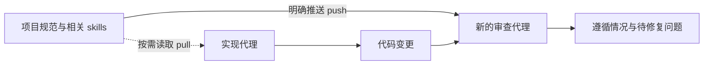

讲师最后补充，自己当时用 Sonnet 实现、Opus 审查，因为他希望把较强的判断力安排在审查阶段。这是现场展示的个人模型分工，不是模型基准测试，也不应当作对未来版本的固定选型建议。

## 十五、Sandcastle 怎样把顺序 Ralph 扩展成并行实现

### 15.1 一次运行的基础：worktree、分支、Docker 与提示词

*(参考时间：01:29:37)*

讲师因不满意已有 AFK 工具，用大约一周时间做了 **Sandcastle**。它是一套运行代理循环的 TypeScript 库，用来组织前面已经解释过的机制。

其 `run` 会创建 Git worktree，安排相应分支，在 Docker 容器中建立沙箱，然后在里面运行提示词。产生的代码仍然是分支上的提交，可以稍后合并。

这里没有神秘的新开发范式：它首先把一次执行变成有明确工作区、版本历史和隔离环境的单位，才容易同时运行多个单位。

### 15.2 Planner 根据阻塞关系选择可并行任务

*(参考时间：01:30:40)*

打开 `main.ts` 后，讲师介绍 planner。它读取 backlog，使用规划提示词，依据前面任务看板的 blocking 关系，挑选一组可以并行推进的 issue，并计算执行阶段。

前面要求把 issue 拆成 DAG，在这里产生实际作用：有前置依赖的任务不能因为还有空闲代理就立即启动；没有依赖冲突的任务才适合一起做。

选出的工作材料包含 issue 编号、标题和对应分支。之后每条 issue 都有独立沙箱，implementer 获得它需要的任务信息，在自己的工作区内执行。

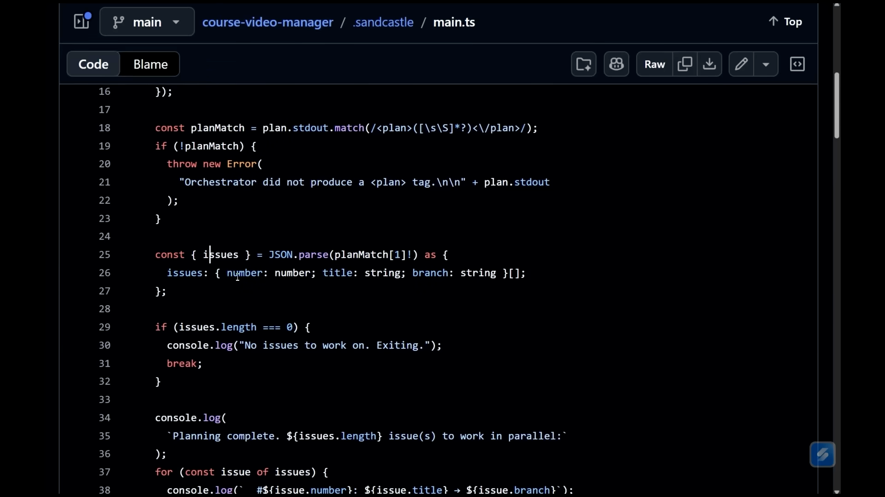

### 15.3 有提交才审查，最后仍有集成工作

*(参考时间：01:31:28)*

实现者运行后，流程先检查是否真的产生了提交；有提交才进入审查，而不是对一个没有实际代码变化的执行结果空转。

接着，把分支及相关 issue 交给 merger agent。它按合并提示词集成这些变更，如果出现类型、测试或其他合并问题，再进行解决。

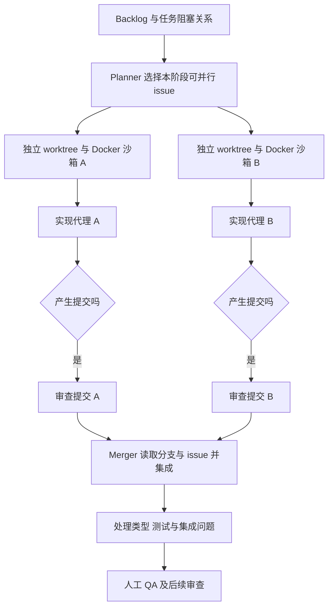

**独立工作区解决的是并行工作中的隔离问题，不能自动证明集成结果正确。** 因此讲师仍保留了合并代理及其反馈回路；前面的垂直切片、任务依赖、规范审查也没有因为进入并行模式而失效。

视频是结构讲解，并没有提供可完整复现这套循环的全部源码和配置；笔记保留可确认的步骤，不根据几秒画面补造一套“原版 Sandcastle 实现”。

### 15.4 架构分析返回：候选机会，不是已经完成的重构

*(参考时间：01:32:49)*

此前后台运行的 improve codebase architecture 分析此时结束。它返回一些相关模块组成的 cluster，解释它们为什么耦合、属于哪种依赖类型，以及能否作为一个单元测试。

其中一个候选是 **quiz scoring service**：目前没有测试，被识别为最大的测试缺口。结果提到可以使用内存 SQLite 测试数据库，这属于本地、可替代的依赖。另一个候选是提取重新排序的逻辑。

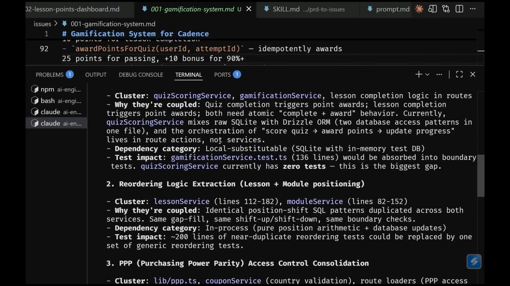

这些结果说明 skill 能把抽象的“改善架构”变成值得检查的具体机会，但现场并没有继续实施这些重构。读者应区分“分析提出候选”与“模块已经成功改造且验证”。

## 十六、把 QA 变成新的任务，而不是一次终审

### 16.1 从头到尾都要关心代码库的形状

*(参考时间：01:33:58)*

临近结束，讲师重新串起整个工作坊。他强调，这不是一个“spec to code compiler”，不是只要交出规格就会不停吐代码的机器。

人需要有意识地选择模块与代码库形状，在 grilling 中充分对齐想法；PRD 保存阶段性方向，但不应被过度神化。之后把它转成可以并行的任务，让代理实现，再认真进行 QA 和代码审查。

因此，架构不是最后补上的一章，也不是只出现在最初的设计文档里。它贯穿选择需求、划分任务、确定接口、设置反馈、检查实现的全过程。

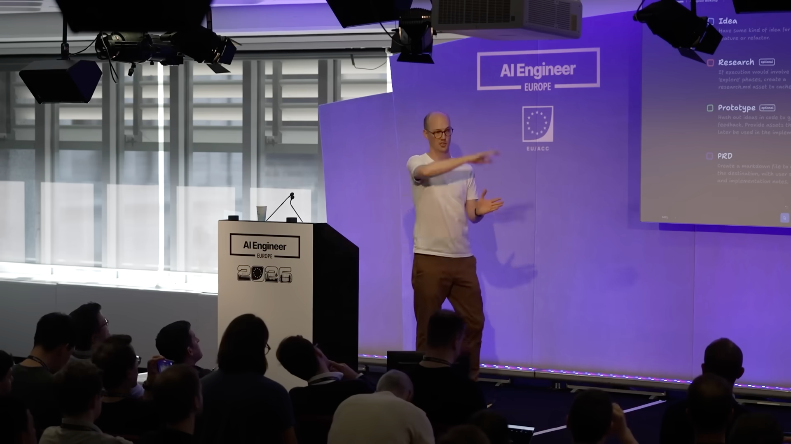

### 16.2 QA 的产物是下一批 issue

*(参考时间：01:34:35)*

讲师特别补充，QA 不只是给当前结果盖一个“通过 / 不通过”的章。它的作用之一，是为看板创建更多 issue。

发现缺陷、遗漏或需要调整的体验，就把它们转为可执行工作；新的阻塞关系也可以继续加入看板。甚至在其他代理实现任务时，人可以同时检查已经完成的部分，再把发现回流给实现队列。

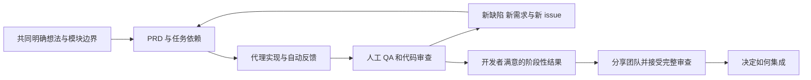

这使流程能够容纳真实工作的杂乱，而不必假设第一次计划就能预测所有问题。看板既记录最初的实现路径，也接纳过程中不断出现的新事实。

### 16.3 个人满意之后，还有团队的完整审查与合并决定

*(参考时间：01:35:00)*

上述循环可以由一位开发者或少数几位开发者管理。当他们对代码和工作成果满意，再分享给团队进行更完整的审查，之后如何合回整体项目，仍由团队决定。

它并没有把个人演示中的一个提交等同于组织层面的交付，也没有替团队规定唯一的分支策略或发布流程。讲师反复说明，这只是自己发现有效的一种工作方式，大家可以按实际环境定制。

### 16.4 结束时的推荐：回头读 AI 出现以前的软件工程书

*(参考时间：01:35:29)*

讲师最后推荐重新阅读那些旧的软件工程书。他觉得在 AI 出现以前写下的原则里，几乎每一页都有值得重新理解的东西：共同设计概念、可验证的渐进实现、模块边界和复杂性管理，在新的工具条件下依然有用。

这一推荐回应了开场：AI 改变了谁来敲代码、反馈循环能跑得多快，却没有让工程中的理解、设计和判断失去价值。视频在感谢、掌声与音乐中结束，时长约 **01:36:30**。

## 附：视频中提到的人物、书籍与工作材料

以下条目用于回查课堂内容；没有在视频中展开的资料，不补写为已讲授的内容。

| 人物或材料 | 在本视频中的作用 |
| --- | --- |
| Matt Pocock | 主讲人；以自己的工作流与 Cadence 演示说明做法 |
| Dex Horthy | 前半部分关于上下文与工作流的相关讨论来源 |
| Fred Brooks，《The Design of Design》 | 用共同的设计概念解释为什么先要对齐理解 |
| 《The Pragmatic Programmer》中的 tracer bullets | 解释可观察的端到端切片与反馈 |
| John Ousterhout，《A Philosophy of Software Design》 | 深模块、浅模块与简单接口的设计依据 |
| Grill Me、Write a PRD、PRD to Issues 等 skills | 将追问、保存方向与任务拆分作为可调用的工作步骤 |
| Ralph、`once.sh`、AFK 循环 | 将单次实现过程变成重复执行的任务机制 |
| improve codebase architecture | 分析仓库中可以加深模块及改善测试的机会 |
| Sandcastle | 演示 worktree、Docker、规划、并行实现、审查与集成的组织方式 |

原始视频：[Full Walkthrough Workflow for AI Coding — Matt Pocock](https://www.youtube.com/watch?v=-QFHIoCo-Ko)。本笔记按视频实际讲述顺序重构，时间锚点用于回看；中文说明与流程图是对讲解的整理，实际截帧来自原视频。讲师的个人判断、现场未解决的问题及演示中的错误已在相应小节保留。

逐段回查原话可使用[英文字幕对照稿](transcript.corrected.txt)。对照稿保留全部 2,894 段及原时间戳，仅订正明确的专名和术语；中文笔记按讲授主题重构。

## 附：按时间回查各段内容

| 视频区间 | 对应笔记与保留内容 |
| --- | --- |
| 00:00–00:05 | 第一、二章：工作坊背景、工程基本功、上下文与足球联赛类比 |
| 00:05–00:10 | 第二章：聪明区、《记忆碎片》、清空会话与持久化、skills |
| 00:10–00:15 | 第二、三章：共同设计概念、Cadence 场景、从客户消息启动探索 |
| 00:15–00:20 | 第三章：仓库探索与追问、积分事件、补发历史积分的取舍 |
| 00:20–00:25 | 第三、四章：等级、连续学习与 dashboard，长访谈材料，工具选择与所有权 |
| 00:25–00:30 | 第四、五章：人的领域判断、HI / AFK、前端问题、把对话转为 PRD |
| 00:30–00:35 | 第五章：用户故事、测试、模块、非目标，以及为何不逐字重读 PRD |
| 00:35–00:40 | 第五、六章：模型与上下文问答，初次横向任务拆分的问题 |
| 00:40–00:45 | 第六章：tracer bullet 的类比、纠正任务拆分方式、可验收切片 |
| 00:45–00:50 | 第六章：垂直任务、依赖 DAG、可并行工作、skill 的停顿与输出密度 |
| 00:50–00:55 | 第六、七章：本地 issue 与 GitHub 的现场修正，单次脚本、任务和近期提交 |
| 00:55–01:00 | 第七、八章：先观察单轮、AFK 任务优先级、非目标、审查负担问题 |
| 01:00–01:05 | 第八章：团队中的非线性协作、原型、前端视觉判断、约束问题 |
| 01:05–01:10 | 第九、十章：新上下文审查、TDD 红绿重构、issue 02 的提交与反馈检查 |
| 01:10–01:15 | 第十、十一章：284 个测试、先审测试、学生操作失败、迁移缺失、浅模块 |
| 01:15–01:20 | 第十一、十二章：调用组合与测试边界、深模块、PRD 模块地图、失去代码库认知 |
| 01:20–01:25 | 第十二、十三章：灰盒、架构 skill、视频编辑器案例、旧计划与文档腐化 |
| 01:25–01:30 | 第十三、十四、十五章：BEADS、迁移、过度优化 PRD、push / pull、Sandcastle |
| 01:30–01:35 | 第十五、十六章：依赖驱动并行、审查与合并、架构候选、QA 回流看板 |
| 01:35–01:36:30 | 第十六章：团队完整审查、按环境定制、旧书推荐及结束 |
