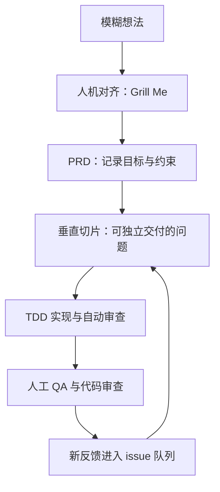
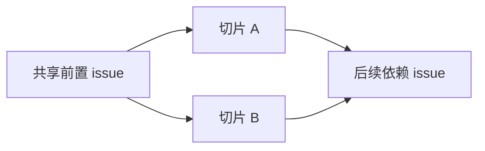
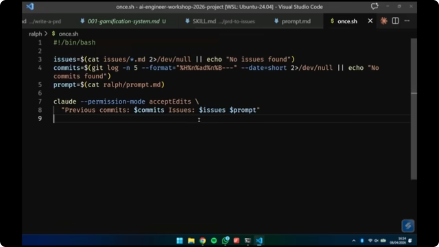
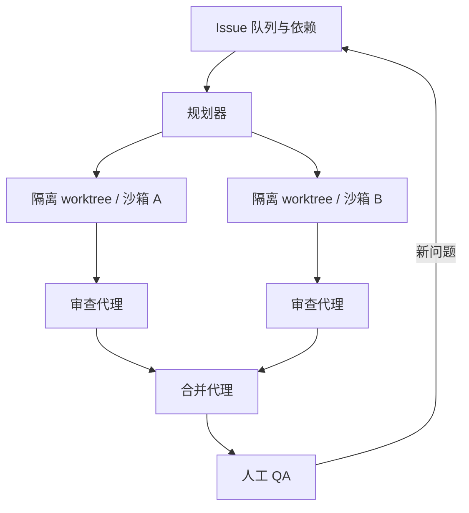

# AI 编程工作流：从模糊需求到可控的自主交付

> **视频**：Full Walkthrough: Workflow for AI Coding  
> **演讲者**：Matt Pocock  
> **来源**：[YouTube 原视频](https://www.youtube.com/watch?v=-QFHIoCo-Ko) · [AI Engineer 官方讲义与时间线](https://ai.engineer/talks/-QFHIoCo-Ko-ai-coding-workflow)  
> **时长**：1:36:30  
> **笔记说明**：以下内容是对演讲字幕的中文书面化整理，时间锚点用于回看原视频。观点与案例属于演讲者，编辑补充仅用于组织结构。

## 核心结论

AI 编程的关键不是把人从流程中拿掉，而是把人的工作放到最需要判断的地方：明确目标、划定架构边界、验证真实行为，并持续把反馈送回待办事项。代理负责在边界内快速执行，人的责任是保证方向和质量。

整套工作流可以压缩成一条循环：

## 1. 先承认代理的上下文限制

*(参考时间：00:03:00)*

演讲者把代理的工作状态分成“聪明区”和“迟钝区”。随着对话不断变长，模型需要维护的注意力关系越来越多，代码决策会逐渐变差。更大的上下文窗口有助于检索更多资料，却不等于模型能在整个窗口里保持同样的推理质量。演讲者以大约 100K token 作为自己的经验阈值，并强调这是工作标尺，不是永恒的硬限制。

因此，任务应当保持在一次会话的有效范围内：

- 观察上下文使用量，不要等到代理已经开始做出明显的糟糕决定才重置。
- 让持久化指令保持精简；每次会话都从清晰的起点开始。
- 优先使用可预测的“新会话”，谨慎依赖会携带不完美摘要的上下文压缩。
- 把仓库探索、实现和测试拆成清楚的阶段；昂贵的探索可以交给隔离的子代理，主会话只接收结论。

这也解释了为什么“再开一个阶段”通常比让同一个代理无限延长更可靠。每次重置都重新加载持久指令，代理知道自己从哪里开始，开发者也更容易判断当前结果是否可信。

## 2. 先用人机对齐解决产品歧义

*(参考时间：00:11:35)*

演讲中的例子是给课程平台 Cadence 增加游戏化功能。原始需求只有一句“学生完成几节课后就流失了，希望加点游戏化”。这还不足以直接交给代理实现，因为真正的产品决策仍然悬而未决：

- 哪些行为可以获得积分？看视频是否算分，是否容易被刷？
- 以前已经完成的课程是否追溯补分？
- 等级如何增长，连胜是否独立计算？
- 功能应当放在哪个界面，用户如何看到自己的进度？

演讲者使用 **Grill Me** 技能先探索代码库，再逐条向人提问。每个问题都附带建议答案，让人更快做决定；但决定仍由产品负责人、领域专家或团队共同承担。回答不了的问题就找能回答的人，必要时通过研究和原型重新检查最初的想法。

这一步必须有人参与，不能直接放进无人值守循环。对齐完成后，再把共同理解压缩成一份 PRD，至少包含：

1. 要解决的问题与目标用户；
2. 方案、用户故事和关键实现决策；
3. 测试策略、成功标准与明确的非目标；
4. 预计涉及的模块，以及与现有代码库的关系。

PRD 是“目的地”的记录，不是永远不变的真理。演讲者倾向于信任充分对齐后的代理总结，但仍会检查模块边界，确保方案能落在现有系统里。

## 3. 把 PRD 拆成垂直切片

*(参考时间：00:39:23)*

PRD 说明要去哪里，却没有说明如何安全抵达。下一步是把它转换成带阻塞关系的 Kanban issue：哪些任务可以立即开始，哪些任务必须等前置条件，哪些任务适合 AFK（无人值守）执行。

拆分时要避免“水平分层”：先把整个数据库层做完，再做 API，最后做前端。这样直到很晚才会发现各层无法真正连起来。优先使用 **垂直切片（vertical slice / tracer bullet）**，让一个小 issue 横跨必要的数据库、服务和界面，并产出一个可运行、可验证的行为。

在游戏化例子里，第一条切片不是“创建积分表和 gamification service”，而是：

> 课程完成后授予积分，并在用户仪表盘显示积分。

这条切片虽然小，却迫使系统走通完整路径，也能尽早暴露接口和数据模型问题。共同前置条件完成后，依赖图中互不阻塞的分支才适合并行：

检查一条 issue 是否合格，可以问三个问题：

- 它是否交付一个用户能感知的完整行为？
- 它是否足够小，能在代理的聪明区内完成？
- 它的阻塞关系和完成标准是否清楚，能否安全交给另一个会话？

## 4. 自动化实现，但保留质量所有权

*(参考时间：00:51:58)*

当目标、PRD 和 issue 图都经过人工确认后，才适合进入“夜班”循环：代理从可执行的 AFK issue 中选择一个，探索仓库、实现代码、运行反馈，然后提交结果。演讲者建议先反复运行单次循环，观察代理行为并调好提示词，再把它放进更长时间的 Docker 沙箱。

实现提示词应明确：

- 按依赖关系和优先级选任务；
- 先探索代码库，再动手修改；
- 遵循红—绿—重构的 TDD 顺序；
- 完成测试、类型检查和必要的反馈循环；
- 让提交保持可审查，并说明仍然存在的不确定性。

TDD 的价值在于先写一个失败测试，再实现使测试通过的行为。这样不容易出现“代码写完后再补一个只会通过的测试”，同时会为后续 issue 留下可复用的行为覆盖。

自动审查也应该放在流程里，但要使用**新上下文**。实现会话已经消耗了大量上下文，重新启动一个审查会话能让审查者在自己的聪明区里工作。实现者可以按需拉取技能和规范；审查者则应直接拿到适用的标准，逐项核对。

自动化无法替代真实使用。演示中测试和类型检查都通过了，但手动尝试功能时仍发现缺失的数据库表。这说明至少要保留两类证据：

- 自动证据：测试、类型检查、静态审查；
- 真实证据：人工 QA、界面体验和端到端行为。

## 5. 设计代理能够继承的代码库

*(参考时间：01:15:46)*

糟糕的代码库会制造糟糕的代理：依赖纠缠、反馈回路薄弱、测试边界不清，都会让代理难以理解、修改和验证系统。许多彼此相连的浅模块看似粒度很小，实际却把行为拆散到难以测试的函数集合里。

演讲者更偏好**深模块**：接口小而清楚，内部包含足够多的功能，并在模块边界测试有意义的行为。人应该掌握模块接口和架构地图，把内部实现交给代理；只要边界行为有可靠测试，自动化速度就不会以失去理解为代价。

当边界、依赖和验证都清楚后，平行执行才真正可行。演讲者展示的 Sandcastle 思路是：规划器从 issue 队列选择兼容任务，把每个任务放进独立 worktree 和 Docker 沙箱；实现代理各自提交，审查代理检查结果，合并代理处理测试、类型和集成冲突。

这仍然是一个循环系统，而不是完全自治的机器：人工 QA 可以继续产生新 issue，团队反馈可以推翻早先的假设，前端细节可能需要一次性的可视化原型。另一个风险是 **文档腐化（doc rot）**：已经完成的 PRD 如果长期留在仓库里，未来代理可能把旧目标误当成现状。完成的计划应当关闭、归档或删除，当前代码和待办队列才是下一轮工作的依据。

## 一份可直接执行的检查清单

1. 用一次人机对齐会话把需求中的产品问题问清楚。
2. 生成 PRD，记录目标、约束、测试与非目标。
3. 把 PRD 拆成有阻塞关系的垂直切片，并标出可 AFK 的 issue。
4. 先单次运行代理，确认它会探索、写测试、实现和验证，再扩大自动化范围。
5. 将实现、自动审查、人工 QA 放在不同的反馈环里。
6. 用小接口、深模块和边界级行为测试维持架构可理解性。
7. 让 QA 反馈回到 issue 队列，及时清理过期 PRD 和计划文档。

## 相关资源

- [YouTube 原视频](https://www.youtube.com/watch?v=-QFHIoCo-Ko)
- [AI Engineer 官方讲义、校订稿与时间线](https://ai.engineer/talks/-QFHIoCo-Ko-ai-coding-workflow)
- 演讲中提到的工具与概念：Grill Me、PRD、vertical slice / tracer bullet、TDD、AFK agent、worktree、Docker sandbox、Sandcastle。
