# 经济这台机器是怎样运行的：30 分钟读懂交易、信贷与债务周期

> **原视频**：[How The Economic Machine Works by Ray Dalio](https://www.youtube.com/watch?v=PHe0bXAIuk0)（YouTube · 31:00 · 2013-09-22）
> **讲述**：Ray Dalio（桥水基金创始人）
> **出品**：Principles by Ray Dalio
> **中文片名参考**：官方中文版《经济这台机器是怎样运行的》
> **辅助资料**：[Economic Principles 官网](https://www.economicprinciples.org/)
> **阅读说明**：本文按视频旁白整理为中文书面稿，并按主题重组为章节，保留讲者的全部类比、数字、推导链与结论；口语重复与语气词做了书面化处理，未增删机制论述。片中的动画示意图在对应位置配了截图。

## 目录

1. [一、开场：把经济看成一架机器](#_2)
2. [二、交易：经济最小组件](#_3)
3. [三、信贷：最重要也最被误解的部件](#_4)
4. [四、三大动力：生产率、短期周期与长期周期](#_5)
5. [五、信贷与货币：好信贷如何创造增长](#_6)
6. [六、短期债务周期：五到八年的潮汐](#_7)
7. [七、长期债务周期：七十五到一百年的债务累积](#_8)
8. [八、去杠杆：当利率降到零之后](#_9)
9. [九、去杠杆的四种应对（上）：紧缩、债务重组、财富再分配](#_10)
10. [十、去杠杆的四种应对（下）：印钞与央行协同](#_11)
11. [十一、和谐的去杠杆：把痛苦摊平](#_12)
12. [十二、结语：三条经验法则](#_13)
13. [附：官方参考与延伸阅读](#_14)

## 一、开场：把经济看成一架机器

*(参考时间：00:00:00–00:01:13)*

### 1.1 一个被反复争论的问题

经济这台机器，看起来极其复杂；但 Ray Dalio 开场就给出一个反直觉的判断：**它其实像一台简单的机器那样运转**。它由少数几个简单的零件构成，外加大量简单、重复了无数次的交易。真正让它显得复杂的，不是零件的种类，而是这些交易被人类本性驱动着、以亿万次的规模叠加在一起。

也正因为如此，人们对经济有着大量彼此冲突的看法：很多人不理解它，更多人对它如何运转各执一词。Dalio 认为，这种认知混乱不是无关紧要的学术分歧，它直接造成了大量本不必要的经济痛苦——错误的政策、错误的预期、错误的借贷决定，最终都落到普通人的生活上。

他表示，自己分享这套模板带着一种责任感：这套把经济拆成简单零件的“经济模板”虽然并不主流，却帮助他预判并避开了 2008 年全球金融危机，并且在三十多年里一直有效。

### 1.2 三个基本动力

在把经济拆解成交易之前，Dalio 先给出整部片子的总纲。驱动经济的力量可以归纳为三条：

1. **生产率增长（productivity growth）**：长期来看，生活水平提高的唯一来源。
2. **短期债务周期（short-term debt cycle）**：大约 5–8 年一轮的扩张与衰退。
3. **长期债务周期（long-term debt cycle）**：大约 75–100 年一轮的债务大累积与大清算。

这个模板的核心方法，不是分别理解这三条线，而是**把它们叠在一起看**：生产率决定长期趋势，短期债务周期围绕趋势上下摆动，长期债务周期则决定这些摆动是越摆越高，还是最终撞上债务天花板。学会这个叠加视角，就能判断经济“从哪里来、现在在哪里、大概率往哪里去”。

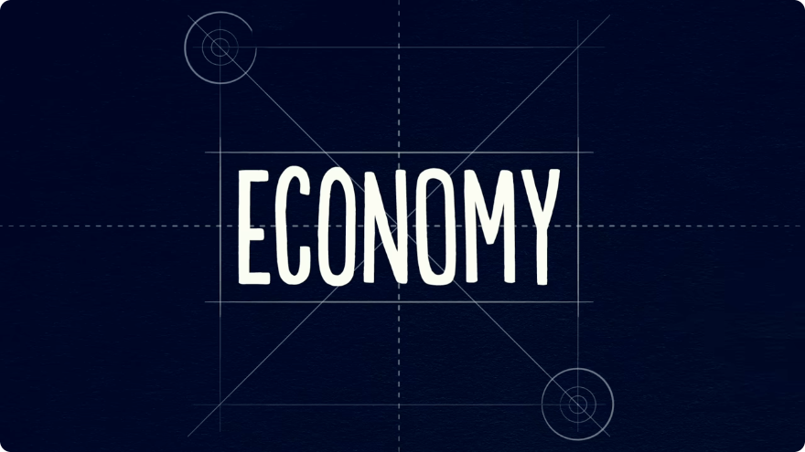

## 二、交易：经济最小组件

*(参考时间：00:01:13–00:03:27)*

### 2.1 什么是交易

从最简单的部分讲起：**经济是全部交易的总和**，而交易本身是一件极简单的事。你每一次买东西，就完成了一笔交易。一笔交易由三方要素构成：

- 一个**买方**；
- 一个**卖方**；
- 买方用**货币或信贷**，向卖方交换**商品、服务或金融资产**。

这里有个容易被忽略的关键点：**信贷和货币一样，都是“支出”**。所以，要衡量一个经济体里发生了多少支出，不能只看花了多少现金，而要把“用货币支付的金额”和“用信贷支付的金额”加在一起。全部支出的总量，就是驱动经济的引擎。

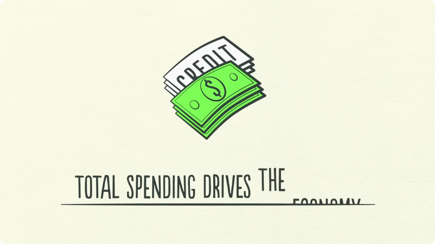

用一笔交易做除法，就得到价格：

> **价格 = 支出金额 ÷ 成交数量**

就这么简单。交易是经济机器的基本积木，经济里所有的周期、所有的力量，最终都由交易驱动。因此 Dalio 的判断是：**只要理解了交易，就理解了整个经济**。

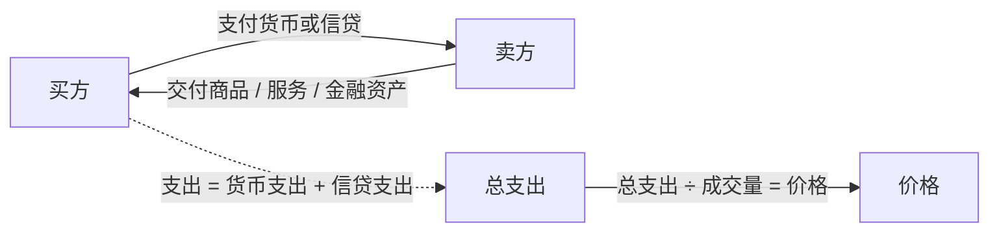

### 2.2 支出、价格与市场

把同一件东西的所有买方和卖方放在一起，就构成一个**市场**：有小麦市场、汽车市场、股票市场，以及数以百万计的其他市场。

一个经济体，就是它所有市场上所有交易的总和。因此，只要把**所有市场的总支出**和**所有市场的总成交量**加总，就得到了理解整个经济所需要的全部信息。

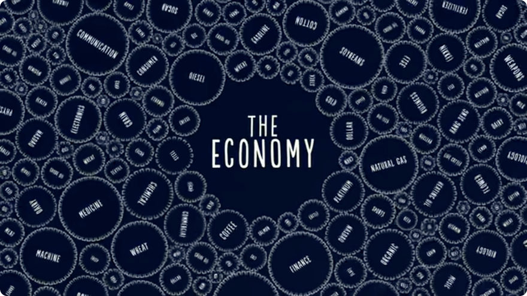

### 2.3 政府的两只手：中央政府和央行

参与交易的玩家有个人、企业、银行和政府。**政府是最大的买方兼卖方**，而政府又要拆成两个性质完全不同的部分来理解：

| 组成部分 | 做什么 | 与其他玩家的区别 |
|---|---|---|
| **中央政府** | 收税、花钱 | 政府整体是市场上最大的买方兼卖方，但中央政府不能创造货币 |
| **中央银行** | 控制经济中的货币与信贷总量 | 通过影响利率、印钞来调节；它与其他买方和卖方不同，因为它能创造货币 |

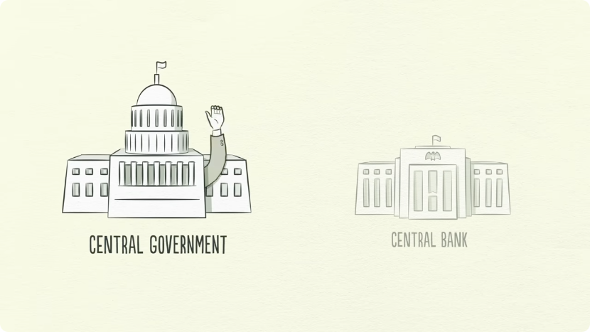

央行影响经济的两大工具，就是**利率**和**印钞**。正因如此，央行是信贷流动中的重要玩家之一，也是后文“去杠杆”阶段的关键一方。

## 三、信贷：最重要也最被误解的部件

*(参考时间：00:03:27–00:06:19)*

### 3.1 借贷双方与利率

Dalio 提醒观众重点注意**信贷**：它是经济中最重要的部分，也很可能是最不被理解的部分。重要，是因为它体量最大、波动最剧烈。

信贷市场里的主角，和商品市场一样是两方：**贷款人（lender）**与**借款人（borrower）**。

- 贷款人放贷，通常只是想让手里的钱生出更多钱；
- 借款人借钱，通常是想买当下买不起的东西（房子、汽车），或者想投资（比如创业）。

信贷能让双方同时得到想要的东西。借款人承诺归还两笔钱：**本金（principal）**，以及额外的**利息（interest）**。

利率就是信贷的价格，它直接决定借贷的意愿：

- **利率高**：借钱太贵，借贷减少；
- **利率低**：借钱便宜，借贷增加。

### 3.2 信贷如何凭空产生、又如何变成债务

当借款人承诺还钱、贷款人相信这个承诺，**信贷就被创造出来了**。任何两个人都可以达成这样的约定，于是信贷可以“凭空”产生，看起来很简单。

但信贷有一个麻烦之处：它有好几个名字。信贷一经创造，立刻变成**债务**。同一笔钱，在两个人的账本上同时存在：

- 对贷款人，它是**资产**；
- 对借款人，它是**负债**。

未来某天，借款人还本付息，资产和负债同时消失，这笔交易才算真正结清。理解这个“一体两面”，是理解后面所有杠杆、去杠杆问题的前提。

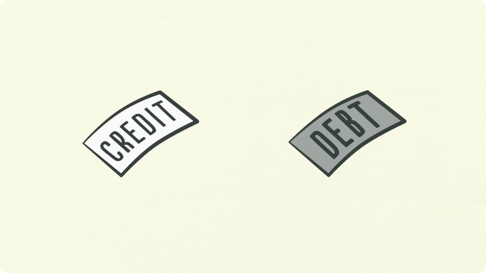

### 3.3 一个人的支出是另一个人的收入

信贷为什么如此重要？因为借款人拿到信贷，就能**增加支出**；而支出驱动经济。

这里的底层机制是一句朴素的话：

> **一个人的支出，就是另一个人的收入。**

你花出去的每一块钱，都成为别人的收入；你赚到的每一块钱，都来自别人的支出。于是，当一个人花得更多，另一个人就赚得更多；当收入上升，贷款人会更愿意借钱给他，因为他看起来更“值得授信”。

一个“值得授信”的借款人需要两样东西：

1. **偿还能力**：收入相对于债务足够高；
2. **抵押品**：万一还不上，有值钱的资产可以变卖抵债。

两者兼备，贷款人放贷才安心。于是形成了一个自我强化的回路：

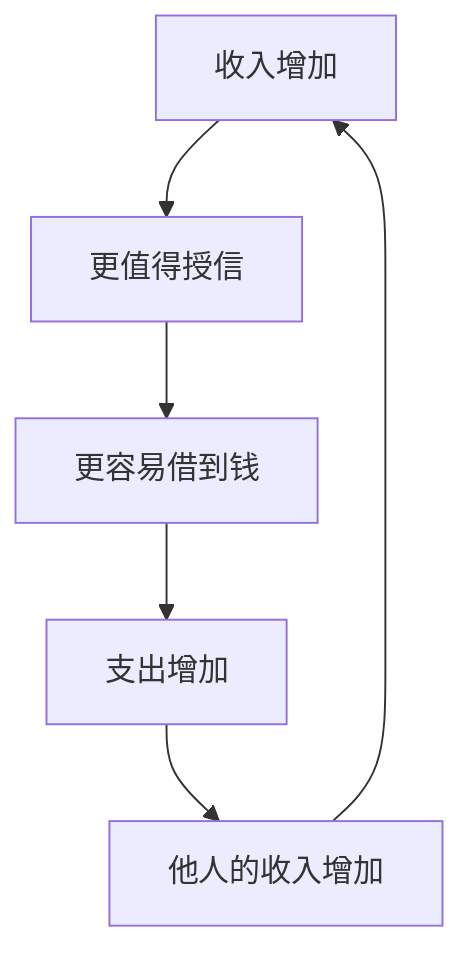

这个回路会把经济推高，但它同时埋下了周期的种子：因为借来的钱迟早要还。

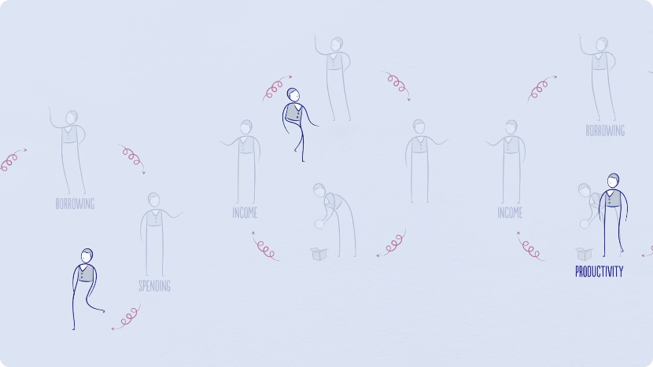

## 四、三大动力：生产率、短期周期与长期周期

*(参考时间：00:06:19–00:09:14)*

### 4.1 生产率增长：长期唯一的增长来源

在一笔交易里，你要先给出什么，才能换回什么；你能换回多少，取决于你能生产多少。随着时间推移，人类不断学习，积累的知识提高了生活水平——这就是**生产率增长**。

生产率增长有一个残酷但重要的分配含义：**勤奋且善于创新的人，生产率与生活水平提高得更快；自满懒惰的人则更慢**。不过这个规律在短期内并不成立：短期内，信贷的力量可以盖过生产率。

因此 Dalio 给出分工：

- **长期看生产率**：生产率增长波动不大，所以它不是经济短期波动的主要驱动因素；
- **短期看信贷**：债务让人们在借钱时消费超过产出，在还债时消费低于产出，因此债务才是短期波动的主角。

债务的摆动发生在两个大周期里：一个约 **5–8 年**，一个约 **75–100 年**。多数人能切身感受到摆动，却很少把它们看成“周期”，因为他们离得太近——一天一天、一周一周地看，只能看到波动，看不到周期。要看清，必须退后一步。

### 4.2 借贷 = 把未来的支出提前

退后一步之后，会看到三条线：一条向上的生产率增长线，以及围绕它上下摆动的两条债务周期线。

这里必须澄清一个常见误解：围绕趋势线的波动，**不是**由创新或勤奋程度变化引起的，而主要是由**信贷的多少**引起的。

想象一个没有信贷的经济：我想多花钱，只能先多赚钱；想多赚钱，只能提高生产率、多干活。由于我的支出是别人的收入，只要我或任何其他人变得更有效率，经济就增长。把这样的交易一笔笔推演下去，得到的是一条平滑向上的生产率增长线。

但现实中有借贷，于是有了周期。借贷的本质，是**把未来的支出提前到现在**：

- 为了买当下买不起的东西，你要花得比赚得多；
- 于是你向“未来的自己”借钱；
- 代价是未来有一段时间，你要花得比赚得少，用来还债。

这个结构一出现，就天然是一个周期。**任何人、任何经济体，只要借钱，就创造了一个周期**。这不是法律或监管规定造成的，而是人性与信贷机制共同作用的结果。

也正因如此，理解信贷才如此重要：它会在未来启动一系列**机械的、可预测的**事件。这正是信贷与货币的分野：货币用来结清交易，信贷则是对未来的一系列承诺。

### 4.3 三条线叠加的模板

把三条线叠在一起，就得到整部片子反复使用的那张“经济机器”总图：

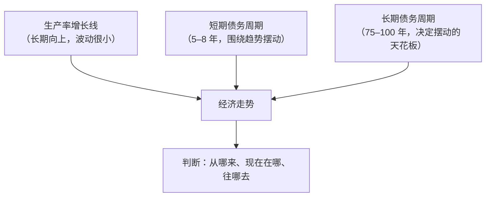

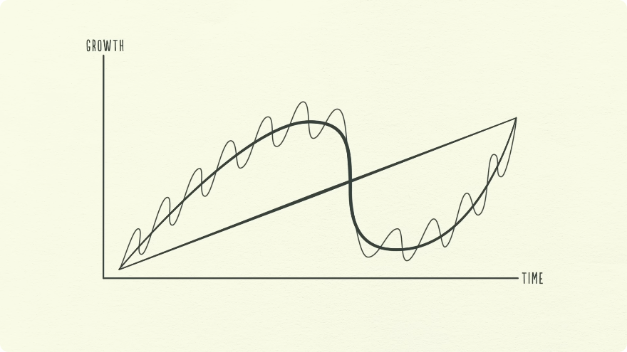

## 五、信贷与货币：好信贷如何创造增长

*(参考时间：00:09:14–00:11:56)*

把信贷放回完整的经济图景，还剩三个问题要回答：信贷与货币到底差在哪里？什么样的信贷是好的？信贷又是怎样把增长放大的？

### 5.1 信贷与货币的区别：酒吧赊账

交易的本质是“先给出什么，才能换回什么”。在现金交易里，这一进一出当场结清；在信贷交易里，结清被推迟到未来。

用酒吧的例子最直观：

- 你**用现金**买一杯啤酒：交易当场结清，钱货两清；
- 你**用信贷**买一杯啤酒：相当于在酒吧“挂账”（bar tab）。你承诺未来付款，你和酒保共同创造了一笔资产（酒保的应收账款）和一笔负债（你的欠款）——信贷就这样凭空产生。直到你后来把账还上，这笔资产和负债才一起消失，交易才真正结清。

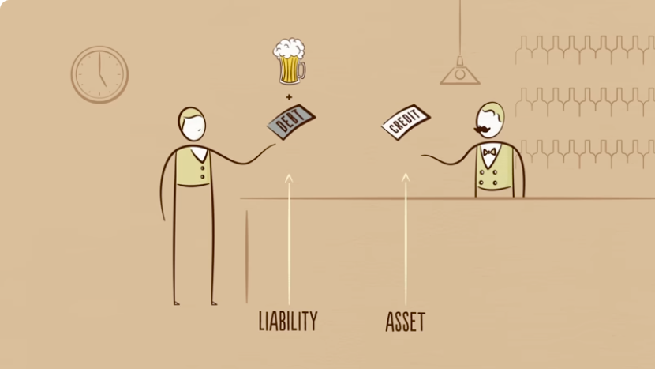

现实中最反直觉的事实是：**人们称之为“钱”的东西，大部分其实是信贷**。Dalio 给出的数字是：美国的信贷总量约 **50 万亿美元**，而货币总量只有约 **3 万亿美元**。

这也解释了两个经济的差别：

- 没有信贷的经济，想增加支出，只能靠提高生产率、多生产；
- 有信贷的经济，可以靠借钱来增加支出。因此短期内，有信贷的经济支出更多，收入可以涨得比生产率更快——但**长期不可能**。

### 5.2 信贷的好坏：电视机与拖拉机

信贷本身不是坏东西，关键看它被用来做什么。

- **坏的信贷**：为“还不起的过度消费”融资。比如借钱买一台大电视，电视不产生任何收入，还债时只能压缩别的支出。
- **好的信贷**：高效配置资源，并产生足以还债的收入。比如借钱买一台拖拉机，拖拉机让你收获更多庄稼、赚更多钱，于是你能还清债务，还提高了生活水平。

同样是“借钱买东西”，一笔让未来更穷，一笔让未来更富。区分标准不是借钱这个动作，而是**这笔钱是否创造了偿还能力**。

### 5.3 一个自我强化的数字例子

设想一个没有负债、年收入 10 万美元的人。因为他信用良好，可以在信用卡上借到 1 万美元，于是今年能支出 11 万美元。

由于一个人的支出是另一个人的收入，另一个人的年收入就变成 11 万美元。这个收入 11 万、没有负债的人，可以借到 1.1 万美元，于是能支出 12.1 万美元。如此一环扣一环，经济在信贷的推动下自我加速。

但这个链条有一个必然的终点：**借钱创造周期，周期上去，早晚要下来**。这就把镜头带进了短期债务周期。

## 六、短期债务周期：五到八年的潮汐

*(参考时间：00:11:56–00:14:28)*

### 6.1 扩张：信贷点燃支出

短期债务周期从**扩张**（expansion）开始。经济活动增加，支出持续上升，价格开始上涨。

价格上涨的根源在于：这一轮支出增长是由信贷支撑的，而信贷可以**瞬间凭空创造**。当支出和收入增长得比商品生产更快时，价格就被推高——这就是**通胀（inflation）**。

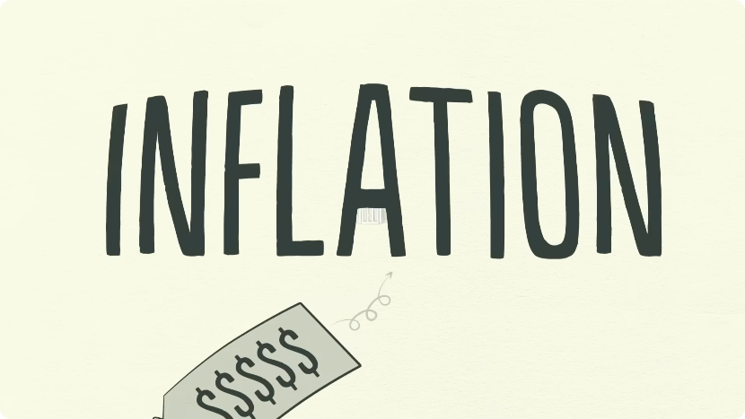

### 6.2 通胀与央行加息

央行不喜欢过高的通胀，因为它会制造问题。看到物价上涨，央行会**提高利率**。

利率一升，两件事同时发生：

1. 能负担得起借钱的人变少；
2. 已有债务的偿还成本上升（可以想象成信用卡每月还款额突然变高）。

于是人们借得更少、还款更多，手里可用于支出的钱变少，**支出放缓**。由于一个人的支出是另一个人的收入，收入随之下降，如此循环。

当人们花得更少，价格下跌——这是**通缩（deflation）**，经济活动收缩，衰退（recession）到来。

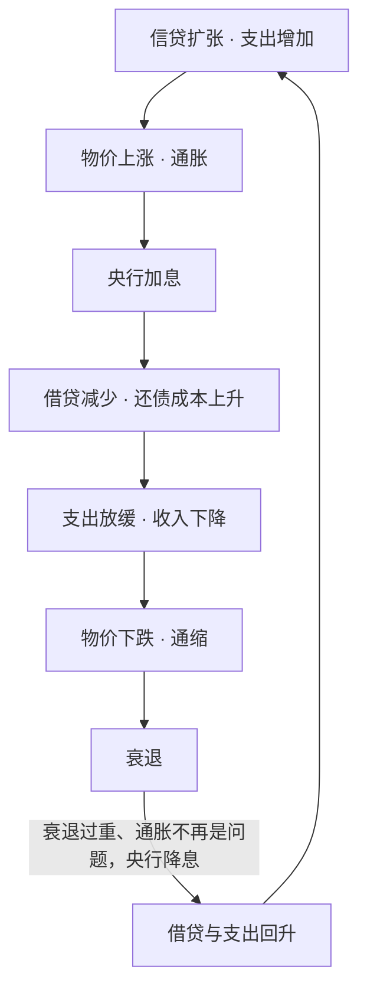

### 6.3 衰退与降息

如果衰退变得过于严重、通胀已不再是问题，央行就会**降低利率**，让一切重新启动。低利率让还债压力减轻，借贷和支出回升，经济进入新一轮扩张。

到这里可以看出：**经济像一台机器**。在短期债务周期里，支出的扩张与收缩，主要受贷款人和借款人“愿不愿意放贷、愿不愿意借钱”的约束；信贷容易获得，经济就扩张；信贷难以获得，经济就衰退。而这个周期的开关，主要握在**央行**手里。

### 6.4 周期为何一轮比一轮高

短期债务周期通常持续 5–8 年，并在几十年里反复出现。但要注意一个关键特征：**每一轮顶部与底部结束时的增长都高于上一轮，债务也更多**。

原因是人性：人们更倾向于多借、多花，而不是先还债。于是长期积累下来，**债务的增长快于收入**——这正是长期债务周期的起点。

## 七、长期债务周期：七十五到一百年的债务累积

*(参考时间：00:14:28–00:16:49)*

### 7.1 繁荣与泡沫

尽管人们越来越负债，贷款人却放贷得越来越大胆。为什么？因为所有人都觉得形势一片大好，只盯着最近发生的事：收入在涨、资产在升值、股市在狂欢。

这是一个**繁荣（boom）**：用借来的钱买商品、服务、金融资产，是划算的。当很多人一起这样做时，就形成了**泡沫（bubble）**。

### 7.2 债务负担

债务在增长，但收入也几乎以同样速度增长，抵消了债务的压力。把**债务与收入之比**称为**债务负担（debt burden）**：只要收入持续上升，债务负担就保持在可控范围。

与此同时，资产价格暴涨。人们借入巨额资金购买资产作为投资，进一步推高资产价格；资产升值让人感觉自己很富有。

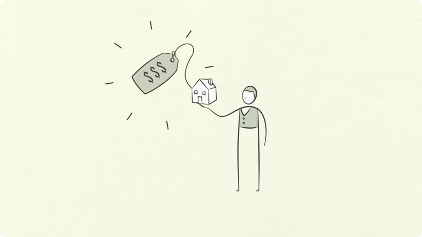

于是，即便债务不断累积，上涨的收入和资产价值仍能让借款人**在很长一段时间里保持“值得授信”**。

### 7.3 顶点：当还债快过收入增长

这种局面显然不可能永远持续。几十年下来，债务负担缓慢上升，还本付息的规模越来越大。到了某个时点，**还债支出的增长开始快于收入增长**。

于是人们被迫削减支出。由于一个人的支出是另一个人的收入，收入开始下降；收入下降又让人更不值得授信，借贷随之减少；而还债支出仍在上升，支出进一步下滑——周期就此反转。

这就是**长期债务周期的顶点（peak）**：债务负担终于大到了无法承受的地步。

### 7.4 三次历史峰值：1929、1989、2008

Dalio 用三次危机标定这个顶点：

- 美国、欧洲以及世界许多地区，在 **2008 年**到达长期债务周期的顶点；
- 日本在 **1989 年**发生了同一性质的事情；
- 美国在 **1929 年**也发生过。

三次的机制相同：债务相对于收入涨得太多，到了不可持续的水平。

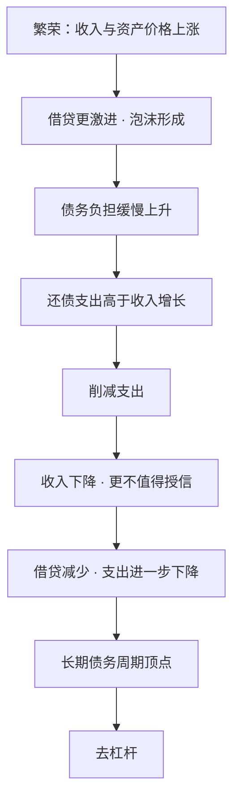

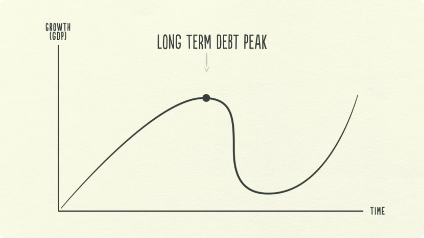

## 八、去杠杆：当利率降到零之后

*(参考时间：00:16:49–00:19:03)*

### 8.1 去杠杆的自我强化下跌

顶点之后，经济进入**去杠杆（deleveraging）**。它的表现是一连串同时发生的收缩：

- 人们削减支出，收入下降；
- 信贷消失，资产价格下跌；
- 银行承压，股市崩盘；
- 社会紧张加剧。

而且整个过程会**朝相反方向自我强化**：收入下降、还债压力上升，借款人被挤压，不再值得授信；信贷枯竭，借款人甚至借不到足够的钱来偿还到期债务。为了填补缺口，借款人被迫**变卖资产**；集中抛售又恰逢支出下滑，于是股市崩盘、房地产暴跌、银行陷入麻烦。

资产价格下跌，意味着借款人能提供的**抵押品贬值**，借款人更加不值得授信；人们感觉自己变穷，信贷迅速消失。更少的支出、更少的收入、更少的财富、更少的信贷、更少的借贷……这是一个恶性循环。

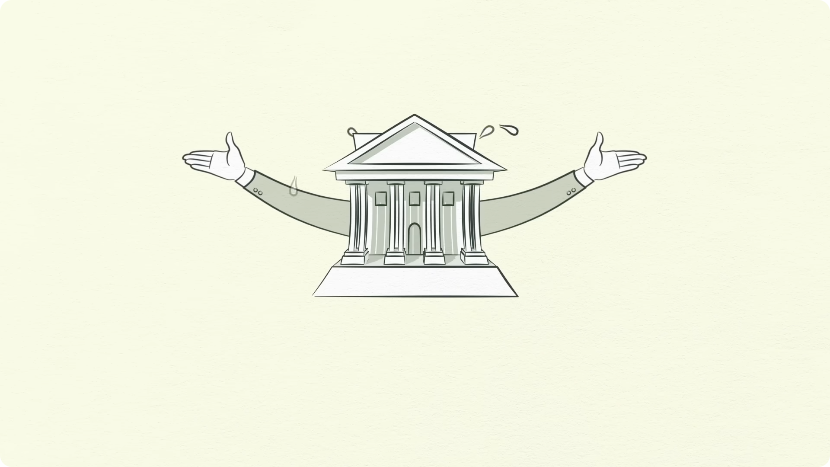

### 8.2 为什么降息救不了

去杠杆表面上像衰退，但有一个决定性区别：**利率已经降不到能救命的水平**。

在普通衰退里，降息可以刺激借贷、让经济重启；但在去杠杆里，利率本来就已经很低，很快撞到 **0%** 的地板，刺激手段就此失效。美国的利率在 1930 年代的大去杠杆中降到过 0%，2008 年又降到过 0%。

更根本的差别在于债务本身：去杠杆时，借款人的债务负担已经太大，**不是靠降低利率就能缓解的**。贷款人意识到这些债务可能永远无法足额偿还；借款人失去了偿还能力，抵押品也贬值了；他们被债务压垮，甚至不再想要更多贷款。贷款人停止放贷，借款人停止借钱——整个经济就像一个失去授信资格的个人。

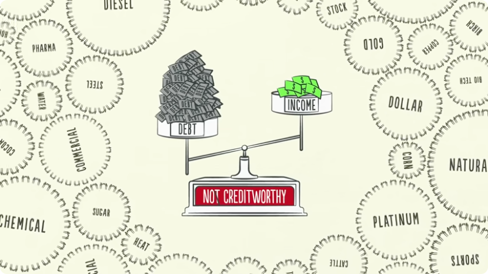

## 九、去杠杆的四种应对（上）：紧缩、债务重组、财富再分配

*(参考时间：00:19:03–00:24:06)*

### 9.1 四种办法

问题很清楚：债务负担太高，必须降下来。现代历史上，去杠杆只有四条路可走：

1. **削减支出**：个人、企业、政府都少花钱；
2. **减少债务**：通过违约和债务重组（debt restructuring）核销债务；
3. **重新分配财富**：把财富从“有产者”转移给“无产者”；
4. **印新钱**：中央银行印钞。

这四种方式在近现代每一次去杠杆中都出现过。它们的效果不同：前三种通常偏通缩，第四种是**通胀性**的；而政策制定者的任务，就是在两者之间取得平衡。

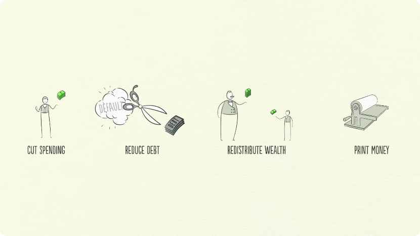

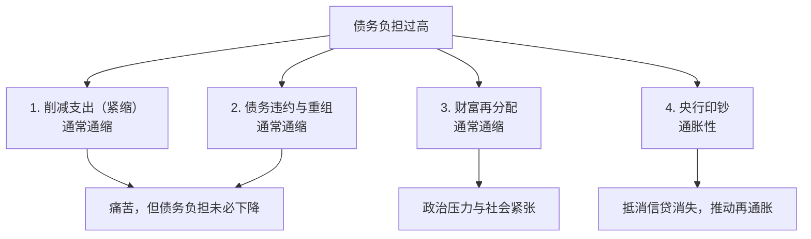

### 9.2 紧缩：越省越穷

通常第一步是**削减支出**。个人、企业甚至政府都勒紧裤腰带，少花钱，好把债还上。这被称为**紧缩（austerity）**。

直觉上，借款人不借新债、只还旧债，债务负担应该下降。但现实往往相反：支出被削减，而一个人的支出就是另一个人的收入，于是**收入下降的速度快于债务减少的速度**，债务负担反而变重。

削减支出是通缩性的、痛苦的。企业被迫压缩成本，意味着更少的工作岗位、更高的失业率。

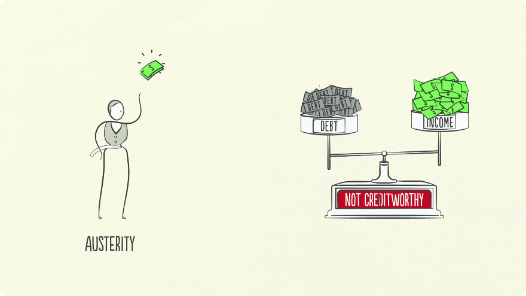

### 9.3 萧条的本质：财富消失

接下来，债务必须被减少。许多借款人发现自己根本还不上贷款，而**借款人的债务就是贷款人的资产**。当借款人还不上银行的钱，人们会担心银行也没钱还给自己，于是纷纷挤兑；银行承压，个人、企业、银行接连违约，经济严重收缩——萧条。

萧条的一个重要组成部分，是**人们发现自己以为拥有的财富，大部分并不存在**。回到酒吧的例子：你挂账时，你的承诺变成酒保的资产；一旦你违约，这笔“资产”就基本一文不值，凭空消失。财富并没有被转移，而是被**证伪**了。

### 9.4 债务重组：贷款人让步

贷款人不希望自己的资产凭空消失，于是愿意接受**债务重组**。所谓重组，就是让贷款人拿回的钱更少，或者收回得更晚，或者按比原约定更低的利率收回——总之，以一种“打破原合同”的方式减少债务。贷款人的算盘是：**拿回一点点，总比什么都拿不到强**。

但债务重组也有副作用：债务虽然消失了，收入与资产价值却消失得更快，于是债务负担继续恶化。和削减支出一样，债务重组也是痛苦且通缩性的。

### 9.5 萧条与政治后果

这一连串收缩会传导到中央政府：

- 收入下降、就业减少，政府收到的税变少；
- 失业上升，许多失业者储蓄不足，需要政府救济；
- 政府还要推出刺激计划、增加支出，以弥补经济的下滑。

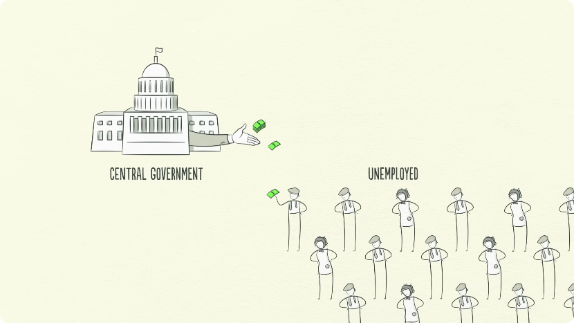

于是政府预算赤字爆炸——支出超过税收。为赤字融资，政府只能**加税或借钱**；但在收入下降、大量失业的情况下，钱从哪里来？答案是**有产者**。

由于财富高度集中在少数人手里，政府自然会向有产者加税，这就在经济中完成了从“有产者”到“无产者”的**财富再分配**。

再分配会制造新的社会张力：正在受苦的无产者开始怨恨有产者的财富；而被疲弱经济、下跌的资产价格和更高税负挤压的有产者，也开始怨恨无产者。如果萧条持续，社会秩序可能失控；紧张不仅存在于国内，也存在于国家之间，尤其是**债务国与债权国**之间。这种局面可能导致政治变化，有时走向极端——1930 年代，它把希特勒推上台，带来了欧洲的战争和美国的萧条。

## 十、去杠杆的四种应对（下）：印钞与央行协同

*(参考时间：00:24:06–00:26:21)*

### 10.1 印钞：唯一通胀性的办法

在巨大的压力下，政策制定者必须做点什么来结束萧条。这时要回到一个基本事实：人们以为的“钱”，大部分其实是信贷；信贷一消失，人们手里就没有足够的钱。人们极度渴望货币，而**唯一能印钱的是央行**。

此时央行已经把利率降到接近零，别无选择，只能**印钞**。

与削减支出、债务重组、财富再分配不同，印钞是**通胀性、刺激性的**。央行凭空印出新钱，用它购买金融资产和政府债券。这在美国大萧条期间发生过，2008 年又发生了一次：美联储印了超过 **2 万亿美元**；世界其他央行也印了很多钱，用来购买金融资产。

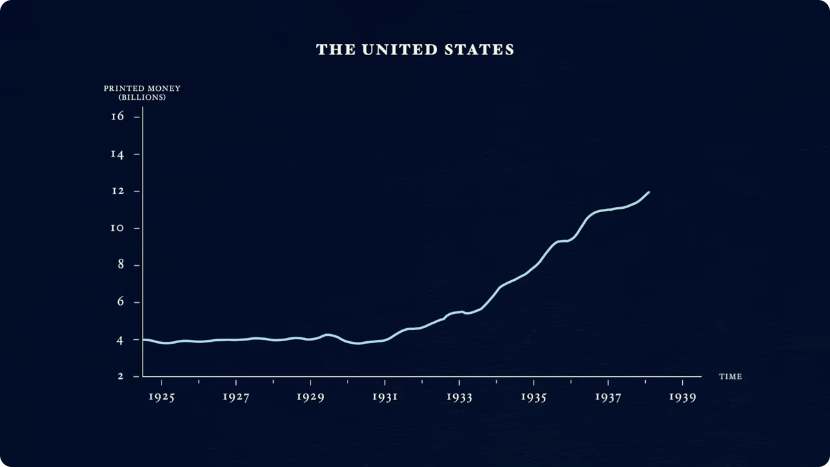

印钞购买金融资产会推高资产价格，让资产持有者显得更“值得授信”。但这里有一个关键的限制：**它只帮助拥有金融资产的人**。

### 10.2 央行的能力边界

央行能印钱，但**只能买金融资产**；它不能直接买商品和服务，也不能直接把钱塞进普通人手里用于消费。

中央政府恰好相反：它**能买商品和服务**，能把钱送到人们手里（比如通过刺激项目、失业救济），但它**不能印钱**。

因此，要真正刺激经济，两者必须合作：

### 10.3 央行与政府必须合作

央行购买政府债券，本质上就是**把钱借给政府**，让政府能够维持赤字、扩大在商品和服务上的支出。通过刺激项目和失业救济，居民收入增加；代价是政府债务上升，但整个经济的**总债务负担会下降**。

这是一个风险极高的时刻。政策制定者必须在四条路之间寻找平衡：用通胀性的印钞，去对冲通缩性的紧缩、债务重组与财富再分配，才能维持稳定。如果平衡得恰到好处，去杠杆就可以是“**和谐的**”。

## 十一、和谐的去杠杆：把痛苦摊平

*(参考时间：00:26:21–00:29:36)*

### 11.1 什么是“和谐的去杠杆”

去杠杆可以是丑陋的，也可以是**和谐的（beautiful deleveraging）**。“和谐”不是说不痛苦，而是说：**以尽可能好的方式处理一个困难的局面，本身就是美好的**——它远好过杠杆化阶段那种由债务驱动、失衡而过度膨胀的状态。

在和谐的去杠杆中，三个条件同时成立：

1. 债务相对于收入**下降**；
2. 实际经济增长为**正**；
3. 通胀**不成为问题**。

要实现这三点，需要恰到好处的组合：削减支出、减少债务、转移财富、印钞，四者的比例要能同时维持经济稳定与社会稳定。

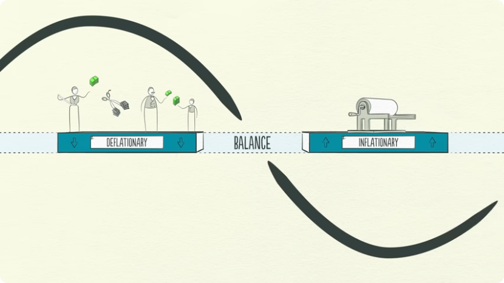

### 11.2 印钞为什么不一定引发通胀

人们常问：印这么多钱，不会引发通胀吗？答案是：**如果印钞刚好抵消了消失的信贷，就不会**。

关键仍然是“支出”：一美元由货币支付的支出，和一美元由信贷支付的支出，对价格的影响是一样的。信贷消失会让总支出萎缩；央行印钞，正是用增加的货币去补上消失的信贷。只要补得刚好，总支出就不会急剧萎缩，通胀也不会失控。

### 11.3 关键不等式：收入增速高于利率

要真正扭转局面，央行不能只把收入增长“抬起来”，还必须让**收入增长率高于存量债务的利率**。换句话说：

> **收入增长，必须快于债务增长。**

举个数字例子。假设一个正在去杠杆的国家，债务与收入之比是 **100%**，也就是债务总额等于全国一年的收入。假设这些债务的利率是 **2%**，债务因此以每年 2% 的速度增长；而收入每年只增长 **1%**。那么债务负担永远不会下降：分子（债务）以 2% 增长，而分母（收入）只以 1% 增长，这个比值不会下降。

要打破这个局面，就必须印足够的钱，把收入增长率推到利率之上。但印钞极易被滥用，因为它做起来太容易，而且人们偏爱它胜过其他选项。关键在于**不要印得太多**，避免造成不可接受的高通胀——1920 年代德国在去杠杆中就是这样失控的。

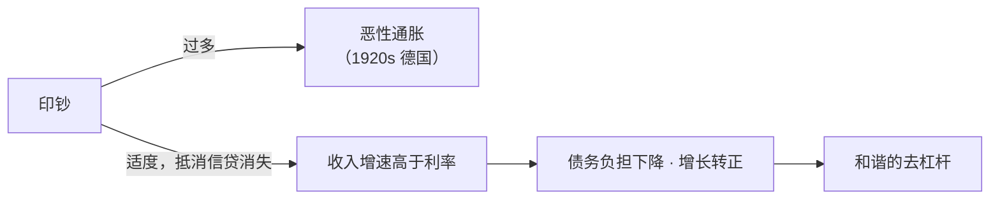

### 11.4 从去杠杆到再通胀

如果政策制定者找对了平衡，去杠杆就不会那么剧烈：增长虽然缓慢，但债务负担在下降，这就是和谐的去杠杆。

当收入开始上升，借款人重新显得“值得授信”；借款人值得授信，贷款人就开始重新放贷；债务负担终于开始下降。能够借到钱，人们就能多支出；经济最终重新增长，进入长期债务周期的**再通胀**（reflation）阶段。

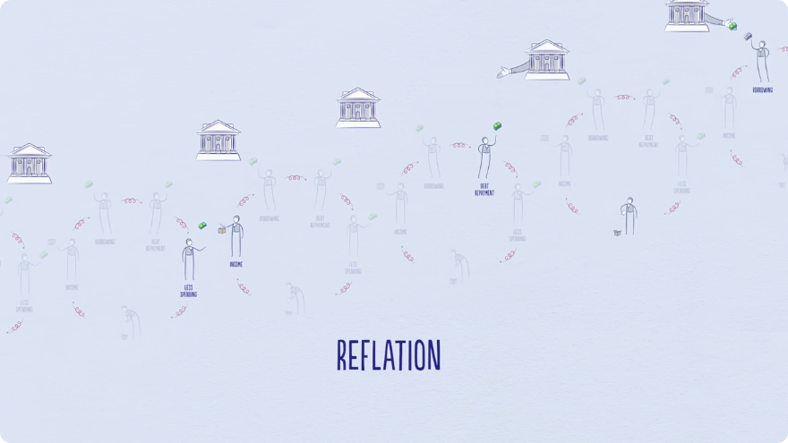

### 11.5 “失去的十年”

去杠杆如果处理得糟糕，过程可能非常可怕；如果处理得当，问题最终会被解决。但无论哪种方式，都需要时间：大约**十年或更久**，债务负担才能降下来、经济活动才能回到正常水平。这就是“**失去的十年（lost decade）**”这个说法的由来。

## 十二、结语：三条经验法则

*(参考时间：00:29:36–00:31:00)*

### 12.1 三条法则

Dalio 在结尾指出：现实中的经济，比这个模板要复杂一些。但是，把短期债务周期叠加在长期债务周期之上，再把两者一起叠加在生产率增长线上，已经能提供一个相当好用的模板，帮助我们看清：我们曾经在哪里、现在在哪里、接下来大概率会去哪里。

他把整部片子压缩成三条经验法则：

1. **不要让债务的增长快于收入**——否则债务负担早晚会把你压垮；
2. **不要让收入的增长快于生产率**——否则你早晚会失去竞争力；
3. **尽一切努力提高生产率**——因为长期来看，这才是最重要的。

这三条既适用于个人，也适用于政策制定者。Dalio 提醒说，你可能会感到意外，但大多数人——包括大多数政策制定者——并没有足够重视这三条。这套模板对他自己有效，他希望对观众也有效。

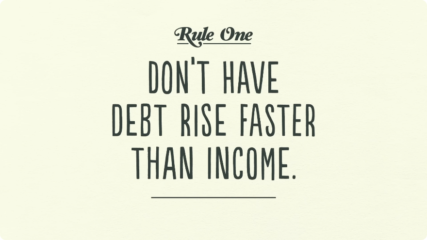

## 附：官方参考与延伸阅读

- **原视频**：[How The Economic Machine Works by Ray Dalio](https://www.youtube.com/watch?v=PHe0bXAIuk0)（Principles by Ray Dalio，2013）
- **经济原则官网**：[economicprinciples.org](https://www.economicprinciples.org/)：Dalio 的经济原则资料入口，本片所属的系列资料都从这里展开。
- **同主题延伸**：Ray Dalio《债务危机》（*Principles for Navigating Big Debt Crises*）对长期债务周期与去杠杆的四种工具做了更完整的展开，可与本片对照阅读。

---

*本电子书由 [videobook](https://github.com/Luke-Evan/videobook) 流水线生成。课程讲义与幻灯片版权归讲师所有，依 [CC BY-NC 4.0](http://creativecommons.org/licenses/by-nc/4.0/) 发布。*
