# 你的旧提示词正在让 Claude 变差：释放前沿模型的五个基本动作

> **原视频**：[Your Old Prompts Are Making Claude Worse — Lance Martin, Anthropic](https://www.youtube.com/watch?v=ys6YQ2yfBpM)  
> **讲者**：Lance Martin（Anthropic 技术 staff）  
> **平台**：YouTube · AI Engineer  
> **视频时长**：1:04:02（正片约 24 分钟，现场问答约 40 分钟）  
> **辅助资料**：[AI Engineer 演讲页与整理稿](https://ai.engineer/talks/ys6YQ2yfBpM-your-old-prompts-are-making-claude-worse) · [Anthropic：Scaling Managed Agents](https://www.anthropic.com/engineering/managed-agents)  
> **阅读说明**：本文按完整视频字幕连续整理，保留讲者的论证链、类比、案例、实验数字与实质问答，只清理口癖、重复和现场噪声。模型名、命令名与数字按讲者口述和幻灯片整理；命令名是字幕听写的还原，实际以当前 Claude Code 提供的 skill 为准。讲者观点与 Anthropic 的内部实践是一种经验判断，不构成适用于所有团队的定律。

## 目录

1. [一、开场：你的应用可能并不在帕累托前沿上](#_2)
2. [二、第一件事：审计提示词，清掉为老模型写下的指令](#_3)
3. [三、第二件事：让 prompt cache 真正生效](#prompt-cache)
4. [四、第三件事：设计一个 Claude 能攀爬的 eval](#claude-eval)
5. [五、第四件事：把 hill climbing 用在降本上](#hill-climbing)
6. [六、第五件事：为“跑上一整天”的 agent 设计 harness](#agent-harness)
7. [七、问答一：eval 设计能自动化到什么程度？](#eval)
8. [八、问答二：开放式任务怎么评分、评测集怎么构造](#_4)
9. [九、问答三：为什么“更强模型 + 更低 effort”反而更便宜](#effort)
10. [十、问答四：超长任务的攀爬与上下文工程](#_5)
11. [附：官方参考与延伸阅读](#_6)

## 一、开场：你的应用可能并不在帕累托前沿上

*(参考时间：00:00:12–00:01:32)*

### 1.1 一个被当成默认前提的取舍

Lance Martin 是 Anthropic 的技术 staff（member of technical staff）。他开场就说明，今天要讲的都不是复杂的东西，而是一些**非常简单、能让前沿模型发挥更大作用的做法**。

业界通常把成本和质量看成一笔交易：想要更好的表现，就多花钱；想压低成本，就得牺牲性能。把某个任务上的各种模型画在“成本—质量”平面上，会得到一条帕累托前沿（Pareto frontier）：前沿上的每一个点都意味着，想改善一个指标，就必须让另一个指标变差。讲者举的例子是，最右端、质量最高也最贵的是 Fable，往左依次是 Opus、Sonnet，最左端是 Haiku。

紧接着是这场分享的核心判断：**很多应用其实并不在这条前沿上，而是停在前沿内部的某个位置。** 原因往往只是一些微小的配置问题（minor misconfigurations）。Anthropic 反复看到客户仅靠几个非常简单的动作，就同时做到性能更好、成本更低。他把这些动作归纳成五个主题，每个主题都不长；正片结束后，剩下的时间全部留给现场问答。

### 1.2 五个基本动作

这五件事分别是：

1. **审计提示词**：清掉那些只有老模型才需要的旧习惯，它们会给新模型增加成本，甚至降低表现。
2. **用好 prompt cache**：多轮 agent 的大部分上下文在重复，缓存用不好就是持续的浪费。
3. **设计 Claude 能攀爬的 eval**：评测本身要有足够的上限、合理的区分度和低方差，否则模型再强也无处发力。
4. **用 hill climbing 降本**：把“在评测上变得更好”换成“保持质量、把成本打下来”，同时搜索模型、effort 和提示词。
5. **为长时程 agent 设计 harness**：任务时长正在从几分钟、几小时走向几天，可靠性与安全边界必须重新设计。

这五件事有一个共同点：它们都不要求换模型，也不要求重写应用，改变的都是模型周围的配置与工作方式。用一条简单的图来表示这场分享的位置：

## 二、第一件事：审计提示词，清掉为老模型写下的指令

*(参考时间：00:01:32–00:05:30)*

### 2.1 提示词也会像代码一样积累技术债

讲者提出的第一个观点很朴素：**prompts accumulate debt just like code——提示词会像代码一样积累技术债。**

如果回想几个模型代际之前，当时为了让模型好好工作，人们会在提示词里写：

- “think step by step”，让模型一步一步想；
- **验证仪式**（verification rituals），比如“double-check your work”“做完再检查一遍”；
- **思考增强指令**（thought boosters），比如“be maximally thorough”“尽可能彻底”；
- **草稿纸**（scratch pads）：告诉 agent 应该怎么想、把思考写在哪里。

这些做法在当时都有明确的针对性。问题在于，它们后来变成了一套**无论任务难易都强加给每一次请求的固定流程**。前沿 Claude 已经非常擅长思考，也很擅长自己选择什么时候该想、什么时候不必多想；它不需要别人告诉它该怎么验证自己的工作，因为它本来就会自然验证；它也不需要被提醒“要认真”，因为它已经很认真。

更糟的是，当你在新模型上继续保留这些指令时，它们在不少情况下**既增加成本，又可能降低性能**。

另一类旧习惯是**互相矛盾的规则**。在指令跟随能力较弱的早期模型上，如果你写了两条互相冲突的要求，模型往往会悄悄忽略其中一条，于是“看起来还能用”。而前沿模型会认真尝试同时满足两条规则，结果就是被矛盾本身搞糊涂。升级模型反而把一个一直存在的提示词缺陷暴露了出来。

### 2.2 一条命令：检查并清理这些反模式

讲者介绍了两条入口，它们最终调用的是同一套底层能力：

- 在 Claude Code 里运行 `/checkup prompt-audit`：它通常用于检查 Claude Code 自身的配置，比如你自己的 skills、提示词；
- 运行 `/claude-api prompt-audit`：它面向**调用 Anthropic API 的应用代码**，是 Claude Code 里另外打包的一个 skill。

> **编者说明**：命令名按演讲口述还原为斜杠命令形式；实际 skill 的调用名以当前 Claude Code 中的版本为准，两个入口的共同点是都会检查并移除同一批反模式。

这两条命令会审计 Claude Code 工作目录里的内容——工作目录里既可能是 skills，也可能是 tools，还可能是提示词——找出上述反模式并替你删除。这个范围很重要：有时应用主提示词本身看起来很干净，但某个工具的说明里又悄悄把“先反复验证再回答”这类仪式带了回来。

讲者说，这条命令在 Anthropic 内部已经用得非常广泛，在 Twitter 上也流行起来；它非常简单，而且经常能同时改善成本和性能。

### 2.3 一个迁移实验：把“升级模型的收益”和“清理提示词的收益”分开

为了说明审计到底值多少钱，讲者做了一个合成评测：大约 50 条客服工单（customer support tickets）。实验从 Opus 4.8 开始，模拟一次向 Opus 5.5 的迁移：

1. 先把每一种反模式**单独**注入提示词，分别测量结果；
2. 中间那个点，是所有反模式在基准上的平均表现；
3. 再在迁移之后运行 prompt audit，比较前后变化。

结果分两段。只做模型迁移、保留旧提示词时，成本已经下降、表现也略有上升——也就是说，即使带着这些额外指令，Opus 5.5 也比 Opus 4.8 更便宜、更强。在此基础上再运行 prompt audit，成本又降了一档，分数又升了一档。讲者把这次节省归因于两类清理：一是去掉了让 Opus 5.5 **过度消耗 token** 的验证仪式和思考增强指令；二是消解了会让更强模型困惑的矛盾规则，让它有更大机会给出正确答案。

幻灯片上标注的三个点是：Opus 4.8 旧提示词 **2.45¢/工单、准确率 88.1%**；Opus 5.5 未审计 **2.02¢/工单、90.0%**；Opus 5.5 审计后 **1.83¢/工单、92.0%**。三个点连起来，正好把一次“升级 + 清理”拆成了两个可以分别归因的决策。

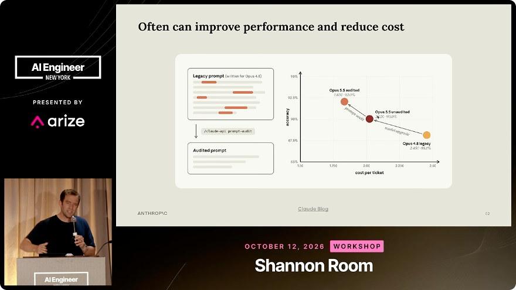

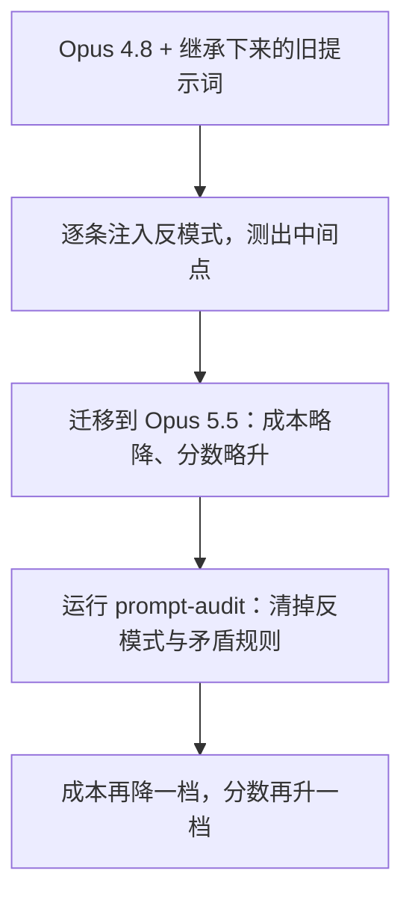

这就是第一件事的全部内容：**它便宜、简单，而且几乎总是值得先做。** 讲者的建议是，在迁移到最新的前沿模型时，直接在调用 API 的代码或 Claude Code 配置上跑一遍，确认提示词不是为上一代模型写的。

## 三、第二件事：让 prompt cache 真正生效

*(参考时间：00:05:30–00:08:45)*

### 3.1 多轮 agent 的大部分输入，本来就在重复

agent 的工作方式是跨很多轮展开的。每一轮只新增一点点信息，比如一次工具调用；但下一轮请求里，绝大部分上下文和上一轮是一样的。既然这些内容已经处理过，就不应该再按原价付一次钱——这正是 prompt cache 的用途。

讲者给出的价格数量级是：**缓存命中部分约为普通输入 token 价格的十分之一**（随模型不同会有所变化，以定价页为准），而且速度也快得多。因此在多轮应用里，能否大量命中缓存，直接决定这门生意的经济性。

### 3.2 缓存是严格前缀匹配：一个字节的变化就会让后面全部失效

prompt cache 的关键约束是**严格前缀匹配（strict prefix match）**。哪怕前缀里只改了一个字节，从那个位置开始的缓存就失效了；后面即使有几千个完全相同的 token，也无法再续上前缀。

幻灯片用了一个很直观的例子：两段几乎相同的请求，只把第 4 个位置的时间从 9:41 改成 9:42，第一段能命中第 1–8 个位置，第二段就只剩下第 1–3 个位置可以复用。也就是说，“哪些内容重复”只是诊断的一半，**重复内容出现在请求的哪个位置**，决定了缓存能不能识别它。

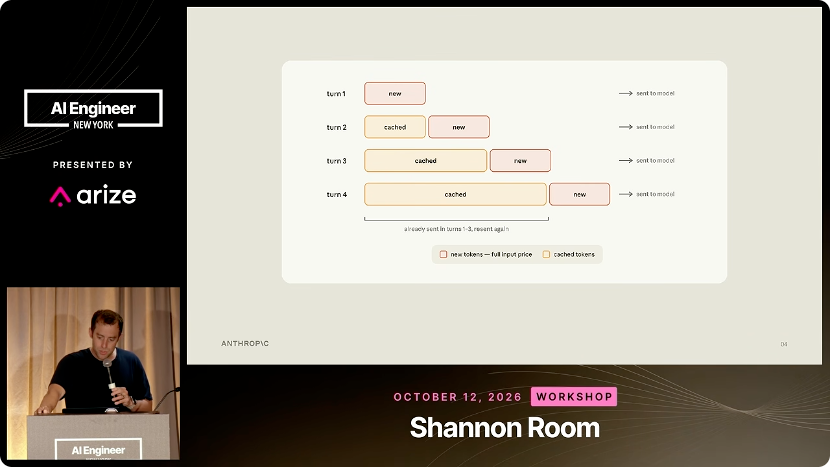

### 3.3 按“保持不变的时长”给上下文分层

既然缓存是前缀匹配，组织提示词的原则就变成了：**把越稳定、越共享的内容放得越靠前。** 讲者给出的分层是：

| 层 | 内容 | 缓存范围 |
| --- | --- | --- |
| ① | 系统指令（system instructions）与工具定义（tools） | 跨所有会话全局缓存 |
| ② | `CLAUDE.md` 与项目记忆（memory） | 按项目缓存 |
| ③ | 会话状态（session state） | 按会话缓存 |
| ④ | 逐轮追加的 messages | 每轮只新增一小段 |

这样排列之后：切换到另一个项目时，系统指令和工具定义仍然可以命中；在同一个项目里开新会话时，项目记忆也可以复用；每轮追加一条消息时，前面的所有内容都有机会一路匹配到上一轮。

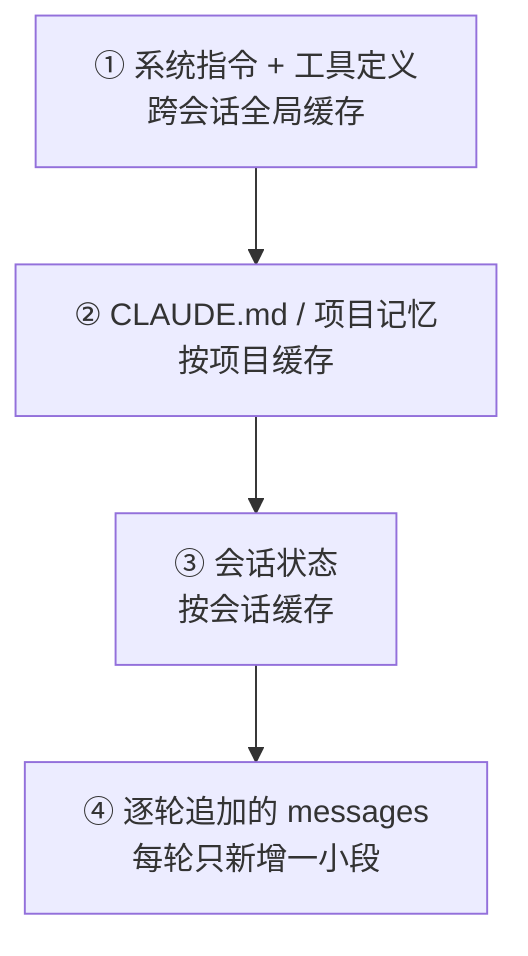

Claude Console 直接给出应用的 prompt cache 命中率（cache hit rate）。讲者说，Claude Code 团队对这个数字盯得非常紧，因为它对应用的经济性太重要了。在 Claude Code 里也有一条诊断命令：如果项目在用 API，它会检查提示词构造，找出那些会破坏复用的地方，并建议重新组织；它同时还会检查 effort 设置和提示词本身。对缓存排查来说，真正有用的输出是两件事：**把会变化的内容挪到可复用前缀之后**，然后再看命中率有没有上升。

### 3.4 内部实测：默认 harness 里最多有 72% 的成本是可以省的

讲者和 Anthropic 应用 AI 团队（applied AI team）的同事，把这条诊断命令跑在一批使用默认 harness 的内部基准上。结果发现，其中一些 harness 对 prompt cache 的使用很差：**在性能没有实质性变化的前提下，成本最多可以降低 72%**。幻灯片列出了四个基准的成本降幅：tau2-bench（零售）72.9%（$68.68 → $13.20）、OfficeQA Pro 71.7%（$252.14 → $71.26）、LegalBench 66.9%（$38.46 → $12.74）、SWE-bench Verified 24.3%（$14.42 → $10.92）；右侧还标注了分数变化与 95% 置信区间，基本都在小幅波动（+2.6pp、+1.8pp、+1.7pp、−0.8pp）。

这个实验和前面的提示词审计要分开看。删掉一条验证指令，改变的是模型决定做多少工作，可能影响答案质量；而改善缓存利用，改变的是**为那些本来就要重复接收的内容付多少钱**。所以分数可以保持稳定，成本却能大幅下降。讲者把这称为“几乎等于白拿的成本节省”（effectively free cost savings）。

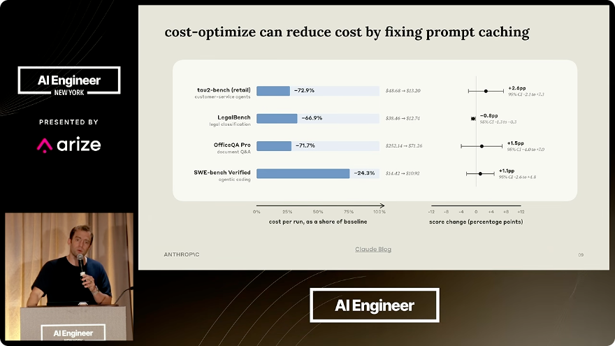

## 四、第三件事：设计一个 Claude 能攀爬的 eval

*(参考时间：00:08:45–00:14:57)*

### 4.1 自纠错的前提，是一道真实存在的坡

前沿 Claude 非常擅长自我纠错。给它一个结构良好的评测，它就能在这个评测上做 **hill climbing（爬山）**：自己看失败样例、自己改配置、自己再测，不需要人一直待在循环里。

但这有一个前提：**评测本身必须是一座“能爬的山”**（climbable evaluation）。如果评测本身有缺陷，模型再强也无处施力。讲者说，Anthropic 在 eval 设计上花了很多时间，目的就是让 Claude 在建立评测和设置爬山循环时“被放在一个容易成功的起点上”。

### 4.2 好 eval 的四个基本特征

讲者先强调，这部分是基本功（fundamentals），与 Anthropic 无关，但值得快速复习。看一张图：横轴是每次尝试消耗的 token（可以理解为“想了多少”），纵轴是得分。图上有三条曲线，从上到下分别是前沿模型、中型模型和小型模型，可以对应 Opus、Sonnet、Haiku。

一个好的评测应该满足四个条件：

1. **换更强的模型，分数应该上升。** 从 Sonnet 换到 Opus，表现要能看出提升。
2. **增加思考（thinking / effort），分数应该上升。** 同一模型多想一想，应该更好。
3. **前沿位置要留有提升空间（headroom），不能被“打满”。** 如果最强的模型已经接近饱和，爬山就没有意义。
4. **重复运行之间的方差要低。** 同一配置跑两次分数乱跳，说明这个信号不可靠。

第三点尤其容易被忽略。讲者说他经常见到一种情况：评测看起来还有 20% 的提升空间，但那 20% 其实是**模糊、无解的任务**——没有模型能拿到这些分。于是你花了大量 token 在一个实际上已经饱和的评测上爬山，却永远不会收敛。很多非常流行的评测里也包含大量模糊任务，这会实实在在地压掉前沿的 headroom。

### 4.3 用 build-eval 搭一个可信的评测集

讲者推荐了 Claude Code 里的 `/claude-api build-eval`。这个 skill 的一个优点是：**它对你的数据存在哪里完全不持立场**——你可以把它指向自己正在用的任何 tracing / observability 方案，它不关心数据在哪里。

使用方式是：告诉它你要解决的问题、你关心什么、原始数据是什么（比如一批 trace），它就会带你走一遍建评测集的流程——展示数据、展示评测、和你一起 sanity check grader（评分器）与评分标准。它把前面那些评测设计原则直接用在你的数据上。讲者提到，Anthropic 也有一篇写这件事的博客（[Automating eval design and hillclimbing with Claude](https://claude.dev/blog/automating-eval-design-and-hillclimbing/)）。

这个 skill 和 hill climbing 是天然配套的：一旦你有了一个“前沿有空间、方差低、随模型和思考量按预期上升”的评测，就可以让 Claude 在上面爬。

### 4.4 过拟合：hill climbing 的头号风险

让 Claude 自主在评测上变好，听起来很理想，但讲者说“有很多种出错的方式”，其中最核心的是**在评测本身上过拟合**。

他给了两个经典例子：

- **任务特有的需求被固化进 harness。** 比如评测里恰好有一道题需要 OCR，于是为了解这道题，harness 里加了一个 OCR 工具；但生产环境里根本不会出现这类问题。结果是评测分数上去了，生产表现没变。
- **提示词记住了评测的措辞。** 在爬山过程中，提示词会逐渐贴合评测样本的特定表达，而不是任务本身的规律，于是它无法迁移到测试分布（test distribution）。

幻灯片把这条链路画成了一张对照表：benchmark 里的“任务需要 OCR”“任务都在 /app 下”“有独特的措辞”“有公开仓库可抄答案”，会分别把 harness 塑造成“加 OCR 工具”“总是 `cd /app` 并跑 pytest”“把提示词调到匹配这些措辞”“每个失败只打一个补丁”“直接 curl 参考解”。这些改动每一个都在评测上“有效”，但都不是生产需要的能力。

这两种情况的共同点是：你花了很多 token 爬山，评测分数看起来很好，上线后却没有任何提升。这种“钱花了、分涨了、生产没变”的挫败感，讲者认为正是过拟合最典型的代价。

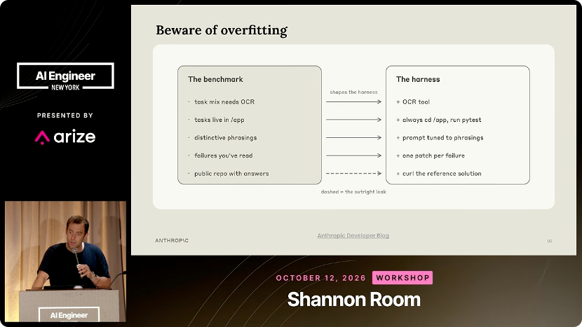

### 4.5 防过拟合：把测试集挡在 Claude 的编辑循环之外

针对这个问题，`/claude-api hill-climb` 采用了一个经典统计学办法：**把评测集切成训练集（train）和测试集（test）。**

爬山时，Claude 只允许看训练集的失败样例，并据此决定改什么；它**永远看不到测试集**。但每一轮都会在训练集和测试集上同时打分。于是就有了一个过拟合的早期信号：**训练集在涨、测试集不动**，说明模型可能正在记住训练样本的细节，而不是学到能迁移的东西。除了这个检查，skill 里还有一些更细微的防过拟合机制。

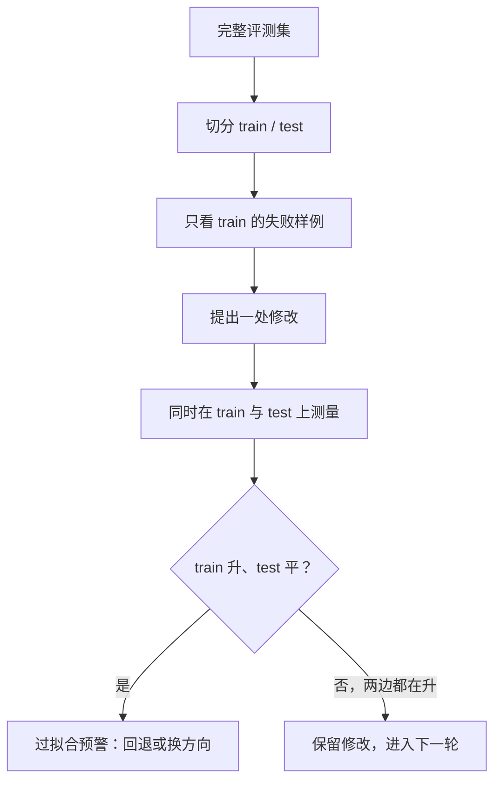

讲者也提醒，这个 split 只能回答一个有限的问题：改动能否迁移到**同一批评测样本里的其他例子**。它能不能代表生产，仍然取决于最初的评测集是怎么采样的。所以人在循环里审计“Claude 到底改了什么”依然重要——比如那个新加的 OCR 工具，真正该问的问题是：**有哪一类真实用户需要它？** 即使评测奖励了这个改动。

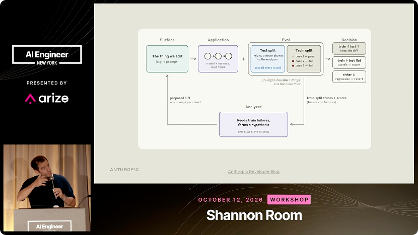

### 4.6 实例：把 Claude API skill 从 66.1% 爬到 87.9%

讲者用自己维护的 **Claude API skill** 做了演示。这个 skill 的作用，是让 Claude 全面了解 Anthropic 的 SDK 和 API；它必须紧贴官方文档，本质上是文档的“蒸馏”——告诉你“想了解这个主题去这一页，想了解那个主题去那一页”。但这份蒸馏稿里带着不少小坑和过时之处。

讲者先基于官方文档建了一套评测题，然后测这个 skill：**初始通过率 66.1%**。这个分数既给出了明确的失败样例，也给出了一个边界清晰的修改面：被评测的模型读的正是这份 skill 文本，而优化器被允许改的也正是它。

接下来他给了 Claude Code 两样东西：skill 文本和底层文档。每一轮里，Claude 可以查看一个失败样例、回到文档核对、找出 skill 在哪里错误地描述了文档行为，然后修改 skill 再测。文档提供了一个独立于当前 skill 措辞的参照，于是一个改动可以从两个角度被评估：它是否更忠实于文档，以及用上它的模型答题是否更好。

幻灯片上标注的结果是：经过约 **24 轮**迭代，通过率从 **66.1% 提升到 87.9%**，中间在第 9 轮和第 17 轮附近各有一次小幅回落（74.3%→74.0%、77.8%→77.2%）。图上把这段攀爬分成三个阶段：补上缺失的章节和类型表、修正 Claude 调用代码的方式、修 grader 并补充答案。讲者说，这个例子的关键不是某个技巧，而是**任务和可编辑面贴合得非常好**：评测问的是 API 行为，文档提供了 API 行为，而 skill 正是把行为传达给模型的那段文本。从“改一段文本”到“观察到一个答案”的路径足够短，自主实验才跑得起来。

他也因此给出一个更一般的结论：这类方法对 **prompts 和 skills** 特别有效。纯文本的可编辑面，非常适合这种爬山过程。

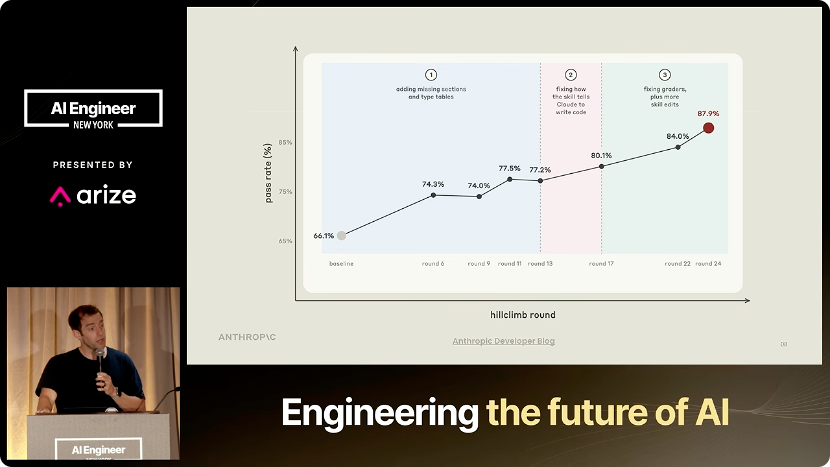

## 五、第四件事：把 hill climbing 用在降本上

*(参考时间：00:16:30–00:18:53)*

### 5.1 目标从“更高分”换成“同分更便宜”

同一个 hill climber 还能换一个目标函数。如果你告诉它“降低成本”，它会去找这样一种配置：**性能至少与基线持平，同时确定性地降低成本。** 它可以同时搜索三个东西：

- **模型（model）**：由哪个 Claude 来完成工作；
- **effort**：模型被要求想多深；
- **提示词（prompt）**：在什么指令下完成这些样例。

评测分数给出一个**质量下限（quality floor）**，而实测成本负责区分哪些配置真正越过了这条线。

### 5.2 四个配置点：成本降 90%，分数还更高

在同一个客服工单基准上，讲者从 **Opus 4.8、高 effort、基线提示词**开始（幻灯片标注起点：训练集决策准确率 **74.4%**），然后对 hill climber 说“降低成本”。接下来的搜索轨迹是：

1. **Opus 5 + 低 effort**：换到更高档的模型并审计提示词，准确率大幅跳升，成本下降；
2. **再换到更小的模型（Sonnet 5）低 effort**：成本进一步大幅下降，但回吐了上一轮的一部分准确率；
3. **Claude 接着改提示词（Sonnet 5 + 低 effort）**：把准确率补到 **100%**，成本基本不变。

讲者说最终配置比起点**便宜 90%**，同时分数还更高——这不是用质量换成本，而是在同一张图上朝“更便宜也更好”的方向移动。

讲者特别解释了为什么要把三个控制量都放进搜索空间：

- 如果在第一次切换模型后就停下，你会得到一个质量提升，但成本只省了一点；
- 如果只用“比上一个高分点低多少”来判断下一个候选，你就会错过一个**成本便宜得多、提示词却还有改进空间**的配置。

因此，成本目标的参照点始终是**最初的质量下限**，而不是上一轮的最好成绩；每一轮的选择都相对同一条底线来测量。

### 5.3 更强模型 + 更低 effort：一个反直觉但常见的甜点

降本模式还给了“已经饱和的评测”一个新用途：即使质量上再难提升，这个评测仍然可以回答一个问题——**更便宜的配置能不能保持同样的分数？**

讲者在这里给出一个反复观察到的直觉：**更强的模型在低 effort 下，往往比更弱的模型在高 effort 下更 token 高效，因此单位任务成本更低。** 他的比喻是：让一个更聪明的人“少想一点”，往往比让一个没那么聪明的人“拼命想”更快达到目标。更强模型的 token 单价更高，但它完成同一个任务所需的 token 更少，最后一算总价反而更低。这个直觉已经写进了 hill climbing skill 的搜索策略里：它先从“强模型、低 effort”的组合开始试，直到性能跌破基线为止。

关于 effort 到底意味着什么、为什么会在某些任务上造成巨大的 token 差异，讲者在问答部分做了更细的展开，见第九章。

## 六、第五件事：为“跑上一整天”的 agent 设计 harness

*(参考时间：00:18:53–00:24:25)*

### 6.1 任务时长正在跨过“天”这个单位

讲者说，这一段是在呼应当天上午其他演讲里关于 Managed Agents 的内容，也想再次强调一件事：**在“解开前沿模型的束缚”（unhobbling the frontier）这件事里，设计一个能充分利用最新 Claude 的 harness 非常重要。**

他展示了一条 METR 风格的曲线：横轴是时间，纵轴是模型能自主完成的任务相当于人类多长时间的工作。往回看：

- **Claude 3 Opus** 大约只能自主工作 **4 分钟**。在那个区间里，能做的产品非常有限，基本是自动补全或聊天；
- 到 **2025 年**，模型能做到大约 **1–2 小时**的人类等效工作，Claude Code 也在这一年里显著增长；
- 现在正在进入一个新区间：模型能做的任务时长达到**一天到两天**，甚至已经超出 METR 这类基准能够测量的范围。

幻灯片把这条线画成三个阶段：自动补全/聊天、同步的本地 agent、异步的远程 agent；图上标注的点包括 Claude 3 Opus 4 分钟、Claude Sonnet 3.5 14 分钟、Claude Sonnet 3.7 1 小时、Claude Opus 4.5 4 小时、Claude Opus 4.6 12 小时。

任务时长一旦以“天”为单位，harness 需要考虑的东西就完全变了：你要让模型在很长的时间里自主做事，同时还必须保证它**安全、可靠、可恢复**。

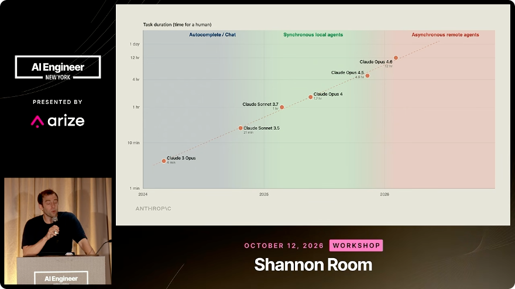

### 6.2 把大脑和手分开

这就是 Anthropic 较新的 **Claude Managed Agents** 的出发点。讲者说自己在四月份的工程博客里写过这件事，核心原则一句话概括：**decoupling the brain from the hands——把“大脑”和“手”解耦。**

- **大脑（brain）** 是 agent harness：它负责调用 Claude、把 Claude 的工具调用路由到真正执行的地方；
- **手（hands）** 是 sandbox：Claude 在这里写代码、执行动作；
- 两者必须是彼此独立的东西。

为什么？因为你要能恢复。设想你晚上启动一个 agent 让它跑一整夜，结果半夜 sandbox 挂了：如果状态和会话日志只存在那个 sandbox 里，你既丢了执行，也丢了“到底发生了什么”的记录，这非常令人沮丧。Managed Agents 是为“Claude 会连续工作非常长时间”这个前提设计的，所以它必须可恢复：

- **会话日志（session log）是一个独立对象**，既不属于 harness，也不属于 sandbox；它是 **append-only（只追加）** 的，因此总是可恢复的；
- **sandbox 可恢复**：sandbox 死了，可以再起一个新的；
- **harness 可恢复**：harness 死了，由 orchestrator 再拉起一个新的，从会话日志继续。

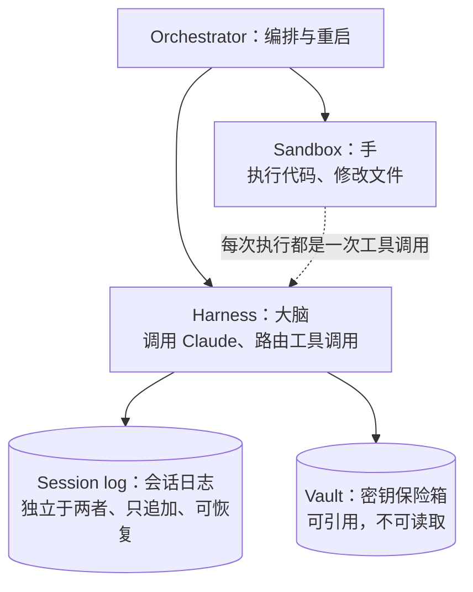

### 6.3 安全：让 agent 永远看不到密钥本身

长时程 agent 的第二个设计问题是安全。Managed Agents 的一个关键点是：**它从不把 secrets 直接交给 Claude。** 密钥放在 vault（保险箱）里；Claude 可以引用某个 API key 或 secret，但看不到它的值。

讲者的说法很直白：如果一个 agent 要连续工作好几天，还让它直接接触非常敏感的密钥，多少有点“瘆人”（spooky）。因此在 Managed Agents 里，密钥的放置和会话日志的放置一样，是 harness 设计的一部分，而不只是安全团队的附加项。

### 6.4 调度、密钥、记忆：一个完整的例子

讲者和同事 CJ 写了一篇博客（[Building effective agent automations](https://claude.dev/blog/building-effective-agent-automations/)），用一个完整例子把这些组件串起来：一个做**定期上下文更新**的 agent。你可以指定它去读哪些来源；它按计划被唤醒、读取信息，然后把更新写进 Slack。这个例子很小，但把几件事放在了一起：

- **定时部署（scheduled deployment）**，运行在 Anthropic 的基础设施上；
- **安全存储的密钥**；
- **记忆（memory）**；
- 可定制的来源与目的地。

这个例子的参考实现在 [anthropics/claude-quickstarts](https://github.com/anthropics/claude-quickstarts/tree/main/managed-agents/daily-brief)。

讲者说，在 Claude Code 里也能直接把这类示例跑起来：用 Claude API skill 里的 `/claude-api managed-agents-onboard` 流程，把教程链接交给它，它就会把示例沙箱起好，让你直接上手玩。

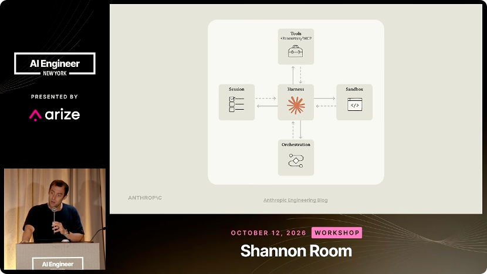

### 6.5 五件事合起来，是一种新的工作方式

讲者在收尾时把五个主题重新串了一遍：

- **审计提示词**：不要让为老模型写的指令继续拖累新模型；
- **用足 prompt cache**：尤其是为长时程 agent 控制成本；
- **为长时程设计 harness**：可靠性和安全性是新的设计约束；
- **设计可攀爬的 eval，并用 hill climbing 改善它**。

当这些事同时到位时，一种新的工作方式就出现了：给 agent 一个任务或一个评测，让它自己跑很长时间去爬山；人去忙别的，第二天早上回来，发现它已经明显变好了。讲者说，这正是他很多同事现在的工作方式——**人们把更多时间花在 eval 设计上，花在“指定一个 Claude 能有效攀爬的任务”上**，同时保证 agent 在长时间运行中是安全、可靠的。

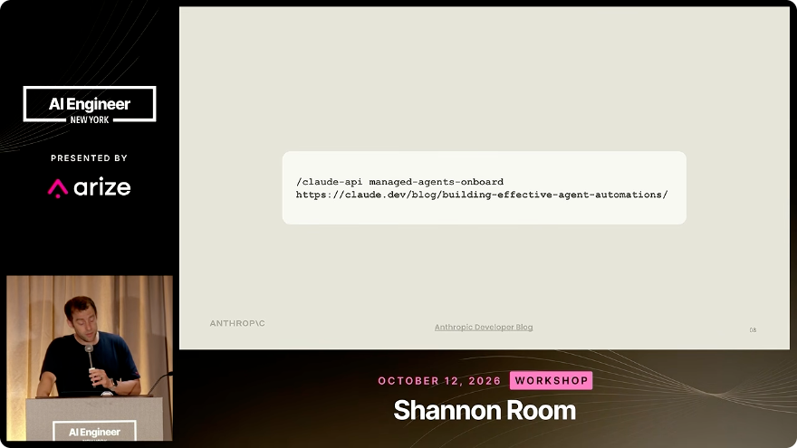

## 七、问答一：eval 设计能自动化到什么程度？

*(参考时间：00:24:25–00:30:04)*

### 7.1 先把原始数据给人看，再让 Claude 造评测集

现场的第一个问题是：eval 设计到底能自动化到什么程度？

讲者说，他最近在 Twitter 上和 **Hamel** 有过交流，Hamel 对评测的思考非常细致。Hamel 对 build-eval skill 的反馈是：它应该**先带用户过一遍数据**。讲者同意这一点，并说正在对 skill 做小改动；当时已经有一个 PR 在推进。

他区分了“当时的行为”和“想要的行为”：当时 skill 会直接分析数据、建评测、然后把结果拿给你看；他希望中间多一个环节，让你先看到原始数据。为什么这一步重要？因为“把哪些例子放进评测集”本身就是一个判断。如果决策者只看到 Claude 的总结、没看过产生这些总结的原始 trace，就无从判断总结是否靠谱。

与此同时，他认为 Claude 在这件事上确实能帮很多忙：Claude 很擅长看一批 trace，挑出“这里可能有错误”的案例——作用就像一个在线 evaluator，只不过扫描的是离线日志。它先把可疑样例标出来，人再去看、去理解，然后决定“好，就根据这些建评测集”。他称这种**Claude 辅助的评估与数据扫描**是人和模型之间很好的结合。

至于“带人类反馈的 hill climbing”：hill climbing 只要求两样东西——一个评测，以及一个 Claude 能用来判断好坏的信号。如果你已经把人反馈变成了评测信号，那么在这个评测结构上爬山完全可行。

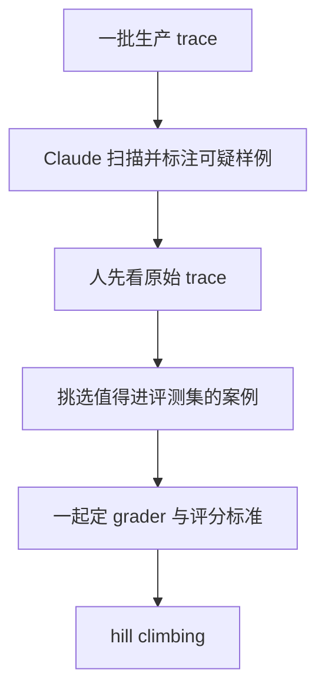

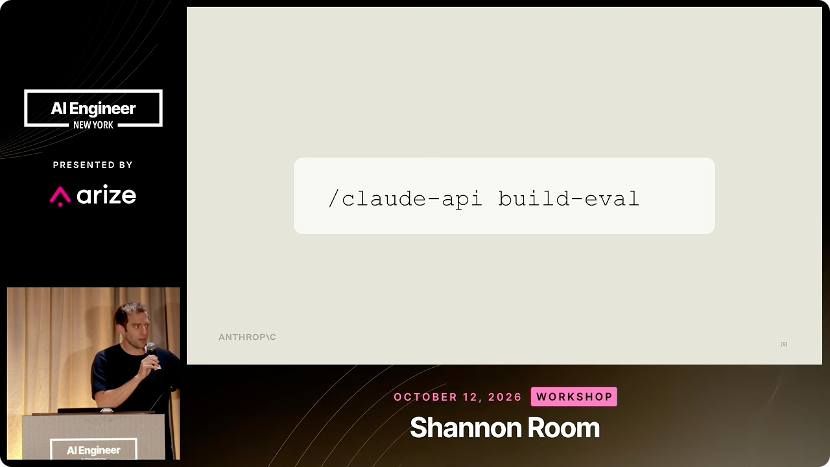

### 7.2 从哪个“可编辑面”开始爬？

下一个问题是：hill climbing 应该从哪种界面开始？

讲者说，**文本**是很好的起点，尤其是 prompts 和 skills。原因有三个：它是一个非常清晰的位置，我们明确知道它会显著改变模型行为；它的修改面很窄（constrained surface）；而且它与输出高度耦合。做 skill 爬山时，评测直接读的就是 skill 文本，耦合关系一目了然。

他拿自己的 harness 爬山经历作对比：改 harness 代码也能爬，但更难解释。每轮的 diff 大得多，混淆的面积更大，你可能做出一些**与所测信号脱钩**的改动。不是不能做——很多人确实在 harness 上做过大量爬山工作——只是更棘手。文本界面（prompt、skill）因为与模型行为耦合得清楚、又容易修改，通常是更好的起点。

但这里有一个 catch：**prompt 非常容易过拟合。** 即使有 train/test split 这类正则化，Claude 也很擅长把 prompt 揉成一个“在评测上很好、却不代表生产”的形状。所以用 prompt 爬山时，必须特别小心过拟合。

### 7.3 prompt 什么时候该升级成 skill？

有观众问：什么时候应该把一段 prompt 变成 skill？讲者觉得两者是互补的。

他的做法很直接：走完一段工作流之后，直接对 Claude 说“把这个做成 skill”，他经常这么做。Claude 很擅长发现“你在重复做某件事，把它做成 skill”。在评测场景里，他的习惯是先有一个自己定义好的 skill（可能只有一段样板文字），然后说“我想改进这个 skill 文本，让它在评测上表现更好”。

重要的是**总要有一个起点**。起点可以非常粗糙，但总比什么都没有好。Claude API skill 就是这样：它是对官方文档的蒸馏，带着一堆小坑和 gotcha；一开始评测表现很低，但正因为有一个可修改的基线，Claude 才有东西可改、有方向可爬。

## 八、问答二：开放式任务怎么评分、评测集怎么构造

*(参考时间：00:30:04–00:39:24)*

### 8.1 没有确定性答案时，先写一个人能用的 rubric

有观众问：在标准很开放的领域，怎么给开放式任务评分？

讲者说，一般来说，**启发式 / 确定性的 evaluator 当然更可取**：如果能定义出确定性的好坏检查，那最好。但很多领域做不到。他的经验是写一个结构良好的 rubric，让不同次评分产生相似的等级。具体有四条：

1. **rubric 先要让人能推理。** 假设你在给一段文本打分：先写一个标准，让人看一眼就能判断“这段文本我可以打几分”。
2. **不要用任意刻度。** “0 到 5 分”非常模糊。理想情况是二分类：好 / 坏。如果要评多个维度，就设多个二分类器，而不是一个 1–10 的综合分。最糟的是让 Claude“从 1 到 10 打分”，噪声极大。
3. **跨模型测试。** 让 Sonnet、Opus、Fable 都用同一套 rubric 评分；如果它们互相不同意，那是一个坏信号。
4. **跑重复实验。** 用同一套 rubric 重复评分，确认方差足够小、分数足够紧。

如果这几件事都做到，那么即使答案很“软”，**LLM-as-judge 也可以相当有效**。

他还补充了一个被低估的做法：**pairwise comparison（成对比较）**。对人甚至对模型来说，比较两个产物通常比给单个产物打绝对分容易得多——“我更喜欢这个网页”比“这个网页值几分”好回答。如果问题允许，成对比较是处理模糊评分的有效方式。

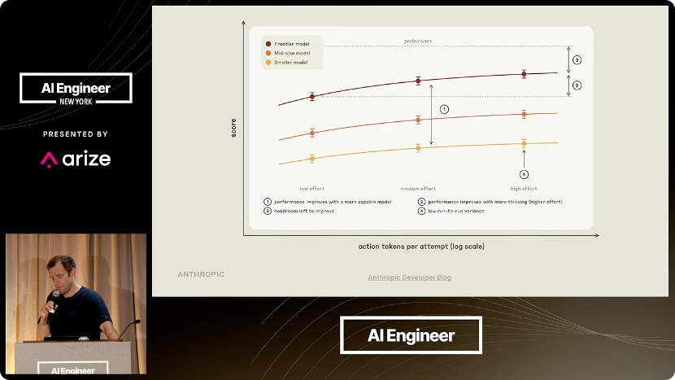

### 8.2 评测集要代表生产，而不是某个模型的“失败口袋”

有观众追问：前面说的“分布”到底指什么？

讲者的意思是：你为评测集采样了一批案例，要确保这些案例**代表你真正在生产环境里关心的情况**。

他特别提醒一个陷阱：**adversarial sampling（对抗式采样）**。有些人会专门挑某个模型类别的具体失败案例放进评测集，比如“Sonnet 5 做不对这些，我把它们提升进评测集”。问题在于模型能力是**参差不齐的（jagged）**：Sonnet 5 不会的题，Opus 5 可能因为智能分布正好覆盖而全部做对。你的评测集于是被塑造成某个模型智能“山谷”的形状，等升级模型时就不适用了。

他的建议是：**从第一性原理、自己的直觉、真实生产数据出发**，挑选困难或有趣的案例；不要完全从某个模型的失败里采样。

### 8.3 二分类还是分桶评分？

有观众问：能不能用分桶（bucket）评测，还是必须二分类？

讲者承认自己前面说得有点过于规定性：当然可以用，但作为一个一般规律，他看到人们在这个方向上走得太远——设计一个 0 到 10 的任意刻度，规则不清楚，连很小的模型都区分不了相邻等级。

如果你的刻度是**想清楚过的**，那完全可以：方差低、跨模型可复现、人类评分者能区分相邻等级，就满足要求。二分类只是“简化问题”的捷径。多类别分类（multi-category classification）也可以。评分时还应该用**更小、更便宜的模型**：你通常不想让 Fable 来做评分器，具体取决于你对成本的敏感度。

### 8.4 个人任务值得建 eval 吗？

有观众问：什么时候该建 eval，什么类型的问题值得建？

讲者说这取决于任务的重要性。即使是个人任务，如果你觉得它很重要，建 eval 完全合理，确实有人这么做。他自己没有为个人自动化建太多 eval，但举了一个例子：如果你在金融行业工作，自动化了部分个人工作流，而质量极其重要——比如产出要对外分享——那绝对需要 eval，即使它是你个人搭的。如果只是帮你管日历的个人助理，那可能不必。凡是产出会被外部看到、或任务本身很敏感，即使是个 agent，也应该要 eval。

### 8.5 需不需要一套可观测性工具？

问题涉及可观测性/评测工具。讲者说自己加入 Anthropic 之前曾在 LangChain 工作，所以不便为任何一家背书（他开玩笑说“我援引第五修正案”）。他用过很多家。如果规模比较小，完全可以自己搭，不需要花哨的 observability 系统。他们正在给 skill 加一个简单的数据查看器；Claude 很擅长搭 UI 和可视化界面，如果你有很特殊的数据查看需求，可以让它给你搭一个应用，成本也不高。

### 8.6 hill climber 卡住了怎么办？

有观众问：hill climbing 会收敛吗？

讲者明确回答：**不保证收敛。** 他见过很多卡住的情况。为此他们内置了一个 fallback：如果连续多轮没有进展，它会去**聚类剩余的失败案例**，看它们有什么共同点。一个常见原因是：你跑 hill climber 之前没有用 build-eval，或者评测集本身构造得不好——最后那 20% 全是评分器错误、模糊指令或模糊案例。这时爬山卡住不是 Claude 不行，而是评测结构有问题。skill 会尝试帮你把这类问题找出来。他自己的例子里，第二阶段就卡住了，然后聚类评测案例、检查失败原因，发现一批模糊案例，改写之后才继续。

有观众问 DSPy：讲者表示非常尊重 DSPy 团队和 Omar 的工作。这个 skill 只是 Claude Code 内置的、开源的，可以 vendor 到别的界面；它本质上是一组“如何按这些原则设置爬山循环”的通用指令。他没有细用过 DSPy，不确定细节，但这个 skill 的指导原则很可能与 DSPy 兼容。

### 8.7 第一次应该把 effort 设在哪？

有观众问：怎么选 effort？

讲者先承认 effort 本身很令人困惑，“我也被 effort 搞糊涂”。如果有评测，hill climber 可以帮你搜：它遵循的原则是“更强模型 + 更低 effort 往往更 token 高效、更便宜”；它会从各个模型的低 effort 开始搜，直到性能跌破基线。他举例：Haiku 4.5 的低 effort 是一次显著回退，所以那个数据点被放弃；现在有 Haiku 5.5，好不少。

如果没有评测，那就只能给一般性建议：**先试更强模型 + 低 effort**，比如 Opus 5.5 低 effort；觉得不够再往上调。很多人一上来就用 max effort，那是非常 token 饥渴的做法。“一个很聪明的模型没有太用力”，往往就是成本与性能的甜点。

## 九、问答三：为什么“更强模型 + 更低 effort”反而更便宜

*(参考时间：00:39:24–00:55:41)*

### 9.1 effort 是什么：从“多想一点”到真实的 token 差异

这一段的第一个问题就和 effort 有关。讲者先自嘲：“effort 很令人困惑，对不对？我也被 effort 搞糊涂了。”它的效果并不是一眼能看出来的。

他给出的基本解释是：**effort 本质上是在告诉 Claude“该多想”。** 低 effort 相当于说“不用想得那么用力”，往上升就是“想得更用力一点”。所以从直觉上说，一个**底层更聪明的模型在低 effort 下**，可以比一个**更便宜的模型在高 effort 下**更 token 高效，因而单位任务成本更低。他用 Sonnet 5 举例：在高 effort 下，Sonnet 5 会把大量 token 花在思考上；而更强的模型在低 effort 下，用更少的思考 token、靠更高的基线智能完成同一个任务。

但他也提醒一个容易误解的地方：**effort 不是硬性上限。** 即使设在很高的 effort，如果你给的是一个简单问题，Claude 也不会毫无理由地烧掉大量 token 去验证它；模型对“这个问题值不值得多花思考”有自己的判断。真正会出问题的是**前沿难度的任务**——比如困难的前沿编程题。在这类任务上，extra high 或 max effort 与 medium / low 之间可能出现巨大的 token 用量差异，而实际结果却差不多，原因正是高 effort 下 Claude 会花更多功夫去验证结果。也就是说，**effort 的代价在难题区间被放大**，这也是最需要小心的地方。

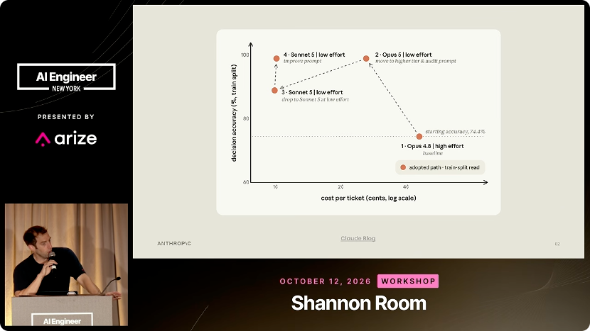

### 9.2 预算、饱和的 eval，以及不可解的最后 20%

有观众问 hill climbing 的预算怎么设。讲者说，运行这个 skill 时它会先问你预算，然后按你分配的预算管理每一轮的开销。

但更值得注意的是一种常见浪费：如果你拿一个**规格不清楚的评测**去爬山，比如最后 20% 的题本身就是无解的，模型会为了这 20% 烧掉大量 token，却永远拿不到分。这正是前面反复强调 eval 设计的原因——**评测的质量直接决定了预算花得值不值。**

### 9.3 人定目标，Claude 扫数据：eval 该由谁负责

有观众问：在 eval 构建中，人和 Claude 应该怎么分工？

讲者的回答是：**人仍然负责“掌舵目标”。** 我们要评测的到底是什么？为什么它重要？这需要品味和判断。他举了客服应用的例子：先由人说明“这个应用最重要的是什么、我们真正关心什么”，然后 Claude 可以去看原始 trace，判断应用可能在哪些地方没有达到这些目标。这就像有一个在线 evaluator 在帮你标出有问题的地方——先看数据、标出可疑案例，人再检查、理解，最后说“好，基于这些建评测集”。

有观众接着问：那到底谁负责建 eval？讲者说这取决于具体问题，也取决于产品的归属（ownership），并没有按团队划一条固定的线。他觉得，当这类 skill 让建 eval 变得更容易时，**能参与建 eval 的人反而变多了**——在 Anthropic，很多不同角色都在建评测，因为 Claude 把“搭评测 runner”这类枯燥工作接了过去，人只需要提供品味和方向。这其实是一件好事。

### 9.4 开放式产物怎么评：成对比较与 Elo

有观众问：有没有开放式产物的评测例子？

讲者举了他见过的**生成式 UI（generative UIs）**评测：用成对比较的 judge，比较配置 A 和配置 B 哪个更好；多次试验后，再用类似 **Elo 分数**的方式汇总。这就是“成对比较 + 多轮汇总”的一个实例。除此之外，LLM-as-judge 在检索任务、写作任务里用得非常普遍；把 trace 分类成“好 / 坏”也很常见。

### 9.5 和 auto research、训练是同一套直觉

有观众问 hill climbing 和 auto research 的关系。讲者说，hill climbing 的很多动机确实来自 auto research——模型越来越强、越来越擅长自我纠错，只要给它一个结构良好、可以攀爬的问题，它就能自己迭代。他提到 Karpathy 的例子（他记不清具体问题，但大意如此）：设定一个明确、可验证的目标（比如把 loss 降下来），模型就能以这个目标为指引反复实验。

他特别区分了两种形态：`/claude-api hill-climb` 这条命令更偏向**基于评测集**的爬山（有 eval set、有 split）；auto research 更像是“构建一个产物、然后给它打分（比如看 loss）”。但底层的循环是一样的——Claude 做实验、测量结果、根据结果调整、再试一次。你完全可以把这套 skill 的思路搬到 nanoGPT 这类仓库上，Claude 会自己想办法适配。**核心直觉是：模型非常擅长在有明确、可测量目标的长时程任务上自我纠错。**

有观众问多目标优化（比如同时优化成本、质量、速度）。讲者说他自己的例子就是同时看成本和性能；你可以把多个目标一起告诉 Claude，它通常会分别测量、一起权衡。目标越多，爬山越难，因为 Claude 要在多目标之间做取舍；一个可行的做法是**一次只改一个东西**、串行推进。成本、性能、速度这个“三件套”是一个比较合理的联合测量组合。

### 9.6 审计应该回溯到哪一代模型

有观众问：prompt audit 的适用范围有多广？要回溯到多老的模型才合适？

讲者说，这条 skill 的一般指导是明确的，但**模型分界线并不精确**。这些是众所周知的、确定对 5.5 系列不再需要的反模式；但“往回退到哪一代仍然需要它们”，他说自己做过一些测试，大概是 **Opus 4.5** 附近开始变得不那么必要，但这只是模糊的判断。他的实际建议很简单：**在迁移到最新前沿模型（比如 Opus 5.5）时，直接跑一遍审计。** 最新模型确定不需要这些模式。

他也补充，skill 里其实带了一些**模型相关的 caveat**：比如你要用 Haiku，它没那么自主，可能确实需要多一点辅助指令（他自己也不确定这是否成立，只是在提示这个可能性）。skill 会考虑你正在用的模型，给出对应的反模式清单。

### 9.7 再谈 effort：建议，而不是硬性上限

有观众再次追问 effort 是否是硬上限，讲者借这个机会说得更清楚：**它不是硬上限**，它是在强调“该用多少思考去解决这个问题”。即使你设了很高的 effort，遇到简单问题时 Claude 也不会任意花费大量 token 去验证；模型对任务需要多少思考是有判断的。只有在前沿难题上，高 effort 带来的额外验证工作才会造成巨大的 token 差异。

### 9.8 训练类比与 eval 感知：真正的风险是过拟合

有观众问：hill climbing 在哲学上是不是很像训练？

讲者说，确实很像：你给模型一个奖励或目标，它尝试修改系统来改善这个目标。事实上，他们用的很多原则（比如 train/test split）本来就是训练时的常用手段；区别在于，这里是**运行时的修改**——模型已经部署，你改的是 prompts、skills 这些服务文本，但可以借用训练里的原则来指导自己所在领域的优化。

有观众追问：Claude 知道自己正在被评测吗？讲者说，这在训练的不同阶段确实是一个被关注的问题，也发表过不少相关研究。但在**当前这个场景**里，他认为更实际的担心是**过拟合**：Claude 可能知道自己在被评测，也可能不知道，但它会找到办法去 hill climb 你给的目标——最典型的就是找到一些只对评测有效、对生产无效的提示词技巧，让“数字往上走”。他说这种情况经常发生，也是他们要用 train/test split 和正则化的原因。**eval awareness 是一个更广泛的现象，值得关注，但在这里，过拟合才是那个直接要防的东西。**

### 9.9 eval 集要多大、怎么切分？

有观众问：一个有用的数据集最小要多大？train/test 怎么分？

讲者坦率地说，他没有深入研究过这个问题；实际做法是“直接问 Claude”——当你运行这个命令时，Claude 会根据你要测量的信号、评测集的用途，用一些启发式规则来判断需要多少样本，skill 里也写了相应建议。他更担心的两个问题是**过拟合和方差**：样本非常少时，这批样本未必能代表你真正关心的分布；它更容易被过拟合；噪声也更大。这些是“小样本区间”最典型的问题。

## 十、问答四：超长任务的攀爬与上下文工程

*(参考时间：00:55:41–01:04:02)*

### 10.1 变更周期一长，爬山就变难

有观众问：怎么在非常长的任务上做 hill climbing？

讲者说，这正好解释了他为什么偏好 prompts 这类简单界面——因为它们改起来非常快。如果一次改动本身要跑很久才能看到结果，爬山就会变得非常困难：每一轮的时间被拉长，等待信号的成本变高。这也是他最后强调 harness 设计的原因——如果你要做非常长时程的爬山，就需要一个能在很多小时、甚至数天里保持可靠的 harness。Anthropic 内部用 Managed Agents 这类基础设施来支撑；这本质上是一个更大的基础设施工程，故障、恢复和“看到信号的延迟”都会让事情更难。

### 10.2 做 agent，就要做多轮 eval

有观众问单轮和多轮 eval 的关系。讲者说，当你构建 agent 时，通常**需要多轮 eval**。build-eval 这类命令可以帮你看 trace，把特定的 trace 提升进评测集。至于评分，业界有很多不同哲学：可以看整条 trace 轨迹（trajectory），也可以只看 agent 的最终结果（outcome）。build-eval 命令里对这些有不少指导；如果你把关心的 trace 交给它，并告诉它“我要多轮、我在考虑这些因素”，它通常能帮你把评测设计成型。

### 10.3 上下文工程：真正提升可靠性的是“可恢复的上下文对象”

有观众问：在上下文工程（context engineering）里，什么真正提升了可靠性，什么只是被过度吹捧？

讲者说，他想再次提到 **recursive language model（RLM，递归语言模型）** 的思路——这个想法相当好，而且他们确实把其中的思想用在了 Managed Agents 里。在他的经验里，上下文工程最关键的一点是**把大脑和手解耦**，并且让**上下文对象独立于 harness**：harness 可以查询这个独立存在的上下文对象。

这样做的好处很直接：

- **上下文永远可恢复。** 如果上下文只存在于 message history 里，一次 compaction（压缩）之后，被压掉的内容就永远消失了；而如果它被独立地存下来，你随时可以回去查。
- **长时程任务无法预知未来需要什么。** 做压缩时，你不知道之后会不会需要回头审阅被总结掉的那段上下文；当它以对象形式保留时，你总能回去。
- 这正是 RLM 工作倡导的方向：把上下文对象从模型和 harness 中拆出来，模型通过不同机制去查询它。在 Managed Agents 里，这个查询是通过 harness 提供的工具完成的——去问会话日志，而不是让模型一次性把所有东西塞进上下文窗口。

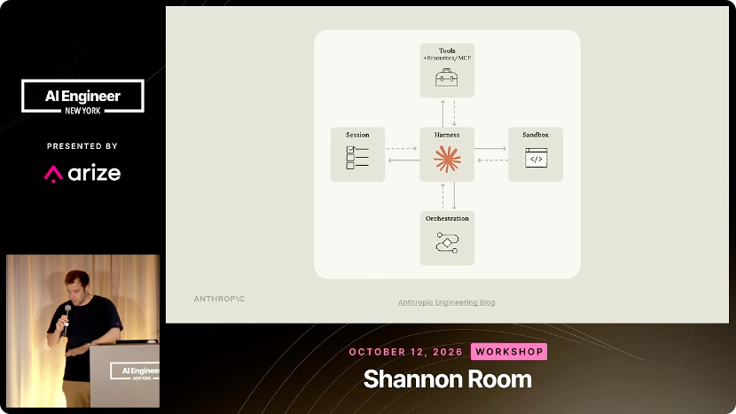

### 10.4 结果不可验证时，eval 设计就是产品设计

有观众问：模型是非确定性的，很多任务的结果也不容易验证，这该怎么办？

讲者说，这正是他们花很多时间做 eval 设计的原因。模型是非确定性的；在很多运行环境里，结果并不容易验证——不是所有问题都是编程题，很多场景需要判断、需要开放式输出。在这些场景里，你必须非常聪明地设计评测，才能给 Claude 一个可攀爬的目标。前面说的那些东西——好的 verifier 设计、清晰的目标、清晰的评分刻度、多个模型能验证结果、低方差——在“设计一个让 Claude 去解决的问题”时全都非常重要。

他把这一点拉回到演讲的主旨：**在“解开前沿模型的束缚”这件事上，前期在 eval 设计上花很多时间，是让模型发挥最大价值的方式。** 如果你让模型去优化一个结构很差的评测，它不会有什么进展；这不是模型的错，而是因为那些案例本身就无解或模糊。所以，花时间在前端把 eval 设计好，让前沿模型被放在一个容易成功的环境里——**这就是“unhobble the frontier”这个说法的含义。**

### 10.5 模型变强之后，eval 也要跟着更新

有观众问：模型一直在变强，我的 eval 该怎么跟上？

讲者的回答很简洁：**模型变强时，你应该在 eval 上看到分数上升。** 如果看不到，就回头质疑这个 eval 的结构。现实中，模型确实会很快把评测打饱和，所以需要不断开发更新、更难的评测来跟上模型。他也承认这很难：要设计出真正能挑战今天最强模型（Fable、Opus 5.5 这一档）的评测，是一个反复出现的挑战。但如果一个 eval 是很久以前建的、分数却一直不涨，那更可能是 eval 本身有问题。

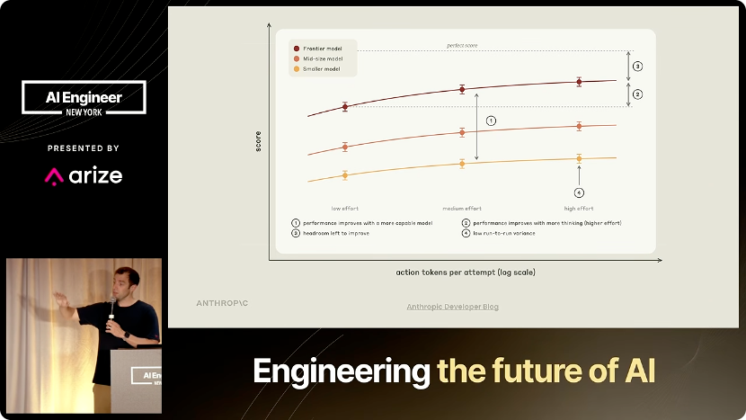

### 10.6 生产中的评测闭环，以及这场分享的落点

最后一个问题关于生产环境里的评测闭环。讲者描述了一个他很看好的模式：

1. 已部署的 agent 在生产中产生 trace；
2. 在线 evaluator 给这些 trace 打分；
3. 得分很差的 trace 被拉进离线评测集；
4. 在离线集上做 hill climbing；
5. 通过之后，把它们加进回归测试；
6. 循环继续，直到生产里几乎看不到失败。

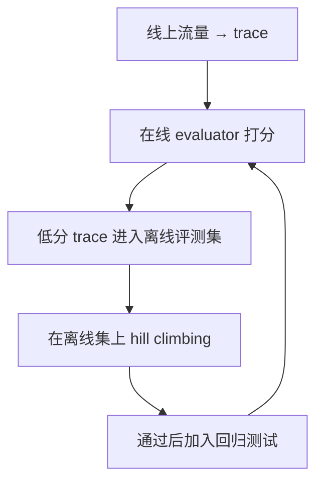

他说，LangChain、Arize、Braintrust 这类公司都在提供这种“外层循环”的产品，看起来相当有效。真正的难点在于：**你的在线 evaluator 是什么？你凭什么判断生产里的“好”，又凭什么决定把哪些案例提升进离线评测集？** 这并不容易，也是当前产品研发非常活跃的方向。

讲者最后以感谢收尾。整场分享落在一个很朴素的结论上：**让前沿模型变差或变贵的，往往不是模型本身，而是模型周围那些没人再审计的旧配置、用不好的缓存、不可攀爬的评测，以及没有为长时程做好准备的基础设施。** 这五件事都不复杂，但需要被当成工程习惯，反复检查。

## 附：官方参考与延伸阅读

- 原视频：[Your Old Prompts Are Making Claude Worse — Lance Martin, Anthropic](https://www.youtube.com/watch?v=ys6YQ2yfBpM)（AI Engineer，2026-11-06）
- 演讲页与整理稿：[AI Engineer Talks — Your Old Prompts Are Making Claude Worse](https://ai.engineer/talks/ys6YQ2yfBpM-your-old-prompts-are-making-claude-worse)
- Anthropic 工程博客（讲者四月提到的 Managed Agents 设计文章）：[Scaling Managed Agents](https://www.anthropic.com/engineering/managed-agents)
- Anthropic 博客：[Automating eval design and hillclimbing with Claude](https://claude.dev/blog/automating-eval-design-and-hillclimbing/)
- Anthropic 博客：[Building effective agent automations](https://claude.dev/blog/building-effective-agent-automations/)（配套参考实现：[daily-brief](https://github.com/anthropics/claude-quickstarts/tree/main/managed-agents/daily-brief)）
- RLM（递归语言模型）相关论文：<https://arxiv.org/pdf/2512.24601>
- Anthropic 官网：<https://www.anthropic.com>

### 概念速查

| 概念 | 在这本书里指什么 | 相关章节 |
| --- | --- | --- |
| prompt audit | 清理为老模型写下的“think step by step”“反复验证”“尽可能彻底”等反模式 | 第二章 |
| prompt cache | 严格前缀匹配的缓存；命中部分约按普通输入 token 的十分之一计费 | 第三章 |
| eval headroom | 最强模型仍有可提升的失败样例，评测没有被“打满” | 第四章 |
| hill climbing | 让 Claude 自主查看失败样例、修改配置、再评测的循环 | 第四、五章 |
| train / test split | 测试集不进入 Claude 的编辑循环，用来提前发现过拟合 | 第四章 |
| effort | 建议模型“想多深”的档位，不是硬性 token 上限 | 第九、十章 |
| harness | 调用 Claude、路由工具调用的“大脑” | 第六章 |
| sandbox | Claude 执行代码、修改文件的“手”，可替换、可恢复 | 第六章 |
| session log | append-only 的会话日志，独立于 harness 与 sandbox | 第六章、10.3 |
| RLM | 把上下文做成独立、可查询的对象，而不是只存在于上下文窗口里 | 10.3 |

---

*本电子书由 [videobook](https://github.com/Luke-Evan/videobook) 流水线生成。课程讲义与幻灯片版权归讲师所有，依 [CC BY-NC 4.0](http://creativecommons.org/licenses/by-nc/4.0/) 发布。*
