# 欢迎来到未来：生成式软件工程第一讲

> **原视频**：[欢迎来到未来 \[01-Raw/26生成式软件工程/NJU\]](https://www.bilibili.com/video/BV1pb8o6yE8f/)
>
> **课程主页**：[https://jyywiki.cn/GSE/2026/](https://jyywiki.cn/GSE/2026/)
>
> **讲师**：蒋炎岩（jyy），南京大学
>
> **课程**：南京大学《生成式软件工程》，2026 年春季学期，第 1 讲
>
> **片长**：约 100 分钟（01:39:58）
>
> **版权说明**：课程内容、讲义与幻灯片的版权归讲师及课程团队所有。本书由课堂录像的自动字幕重构而成，是一份个人学习笔记，不能替代官方讲义；引用课程观点时请以课程主页与原始录像为准。
>
> **关于文本**：原字幕为 B 站 AI 自动生成，存在同音错词（如 ICQ 被识别成 ICU、Neovim 被识别成 NEVim、computer science 被识别成 comcomputer science）。本书按上下文做了术语规范化，不能确证处保留谨慎表述或以「编者说明」标出，不替讲师补充字幕中不存在的事实。

## 目录

1. [开场：一个 F5、一个浏览器，与四次"能力日用品化"](#一开场一个-f5一个浏览器与四次能力日用品化)
2. [三种焦虑：AI 替我上大学、零分简历与被抹平的区别](#二三种焦虑ai-替我上大学零分简历与被抹平的区别)
3. [这门课讲什么：让软件不失败，以及驾驭 AI 的能力](#三这门课讲什么让软件不失败以及驾驭-ai-的能力)
4. [课程的"元演示"：用 Agent 上这门课](#四课程的元演示用-agent-上这门课)
5. [课程政策：Token、通过与不通过，以及一个恐怖的想象](#五课程政策token通过与不通过以及一个恐怖的想象)
6. [大语言模型：一个概率分布，以及它如何走进我们的世界](#六大语言模型一个概率分布以及它如何走进我们的世界)
7. [普通人的 Agent 第一课：一个白板的 Pi](#七普通人的-agent-第一课一个白板的-pi)
8. [从邮件到论文：把日常流程交给 Agent](#八从邮件到论文把日常流程交给-agent)
9. [把浏览器变成 API：DevTools、教务系统与二维码](#九把浏览器变成-apidevtools教务系统与二维码)
10. [Skill 生态与飞轮：1+1 可以大于 2](#十skill-生态与飞轮11-可以大于-2)
11. [回到软件工程：三个空间与那道 gap](#十一回到软件工程三个空间与那道-gap)
12. [结语：古法编程已死，软件工程未死](#十二结语古法编程已死软件工程未死)

---

## 一、开场：一个 F5、一个浏览器，与四次"能力日用品化"

### 一个按键

课是这样开始的：他打开自己的 Neovim，按下 F5，一个浏览器弹了出来。"然后我们就可以正式地开始上课了。"

> 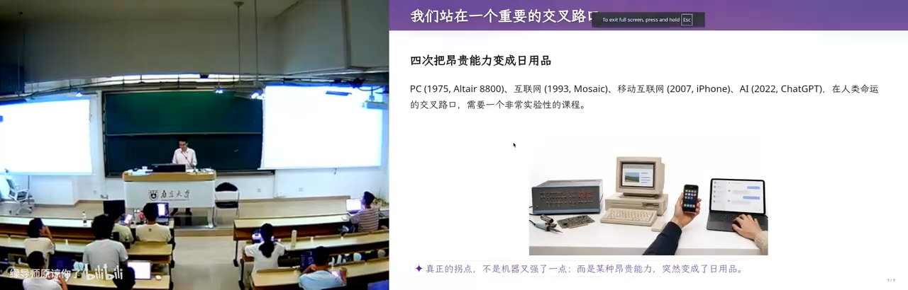

*(参考时间: 00:00:08)*

### 从 Altair 8800 到 ChatGPT

在场的同学是 computer science 的学生，而计算机史上经历过很多次非常重要的变革。在他看来，这些变革的主线只有一条：**把昂贵的能力变成日用品。**

第一张图是 1975 年的第一台 PC——Altair 8800，在图片的左边。他补了一句：这张图也是 AI 生成的，能看出非常明显的 AI 痕迹，而且大概不是特别强的模型，"但没关系"。

接着是四次浪潮。第一次 PC，计算能力从机房走到个人桌面；第二次互联网，把所有人连接起来——他自己上小学快毕业时装了个软件叫 ICQ，三个字母，I-C-Q，他特意强调拼写，因为台下大多没听过；那时腾讯的山寨版还叫 OICQ，O-I-C-Q，后来才改成 QQ。最神奇的体验是你能随机加上地球另一端的人，对方是 native speaker，一上来就飞快地打一大段英文，而你刚学了一点英语，只会 hello 和 good morning，完全无法理解他在说什么。第三次移动互联网，"一夜之间"所有菜场卖菜的人摊子上都摆出了支付宝和微信两个二维码。第四次是 2022 年的 ChatGPT，人类历史上增长最快的产品。

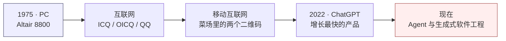

*(参考时间: 00:01:41)*

### 为什么此刻要开这门课

在"人类命运的交叉路口"上，他认为连"上课的方式"和"该学什么"都需要重新思考，于是决定开这门 vibe coding 的课。理由来自一个流行说法：「AI 替我上大学」——老师用豆包出题，学生用豆包做作业，整个闭环里唯一没受到训练的是学生。

他以自己的操作系统课为例：那门课的作业曾经折磨大家，大家也在折磨中获得提升；现在你只要把作业链接丢进 codex，连复制粘贴都省了，甚至不用给链接，只要说一句"蒋老师操作系统课第八个实验，能不能帮我实现"，就结束了。

那还应不应该学编程？他的答案是那句看似和稀泥、其实是全课纲领的话：**既应该，也不应该。有些能力你还是需要的，但应该怎么做，我们不知道。**

## 二、三种焦虑：AI 替我上大学、零分简历与被抹平的区别

### 两种反噬

他观察到大家都处在一种非常焦虑的状态里。第一种是"AI 帮我上大学"之后的反噬：每门课成绩都很好，假设每门课都开卷，答题的全是 AI，全都答对了——可毕业出来，被 AI 第一个取代的正是自己。

第二种更隐蔽，因为它一路上都有正反馈：延续中学的状态，老师说什么就做什么，每堂课认真听，每次作业认真做；四年毕业时却发现自己"被大学骗了"——确实学会了点什么，但学会的东西 AI 都会做。

*(参考时间: 00:03:49)*

### 一份零分简历

第三种最切实：保研。海投出去很多简历，而他也收到很多。他当场展示了一份。展示前有个细节：这份简历的全部处理都是 AI 做的，他只告诉 AI"我有一份简历，需要在课上展示，请把个人信息去掉"，于是 AI 把那些字符替换成 Unicode 方块——复制粘贴出来就是一串黑色方块。

> 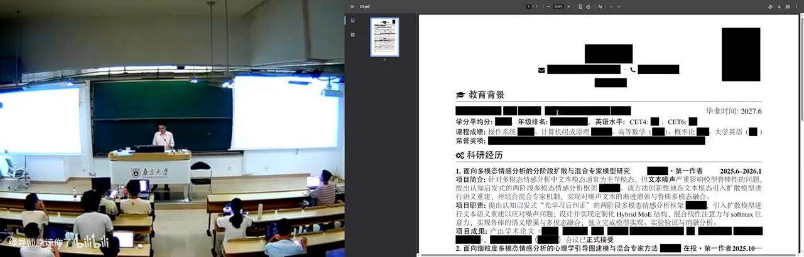

这份简历"非常完美"：CCF 期刊列表上的论文，状态 accepted。他顺口讲了个圈子里的梗——"再投就等于不存在"，因为你根本看不到它。但这样一份简历在他眼里是**零分**：没有额外信息，没有 GitHub 链接，没有个人主页，没有一篇 preprint。他不知道这位同学发生了什么，但这样的简历非常糟糕，而更糟糕的是他收到过无数份。

*(参考时间: 00:05:29)*

### 区别被抹平之后

问题于是变成：你和你的竞争者已经无法区分了。所有人都是"一大堆实习、一大堆奖项、一大堆论文、一大堆在投"。那是什么能让你脱颖而出？如果刚才那份都算零分，你应该怎么向未来的导师展示自己？

他希望这门课能缓解一点这种焦虑，更多则是"还原一种快乐"——vibe coding 的快乐：在这种快乐里，你又能一定程度上理解软件工程是怎么工作的，做出一些有趣的东西，顺便让简历好看一点。他也坦白了自己的尺度：一篇发表论文对他可能是加分项，对很多其他人可能还不是——这说明后面所有的"标准"都是他个人的偏好，而非客观排名。

*(参考时间: 00:06:57)*

## 三、这门课讲什么：让软件不失败，以及驾驭 AI 的能力

### 软件工程的定义

课程叫《生成式软件工程》，所以它首先是一门软件工程课。软件工程做什么？他的回答简单到近乎粗暴：

> 软件工程做的事情很简单：怎么样让软件工程不失败。也就是，怎么样造出一个软件来。

*(参考时间: 00:07:19)*

### 人相对 AI 的两样东西

常有人问：作为人，你和 AI 比优势在哪里？他先开玩笑："你可以坐牢，AI 不能。"然后给出正经答案。

第一样是**信息差**。这算不上可悲，而是人类社会要进步就必须有的事情：你拥有别人不知道的信息，才能做别人做不到的事。学校里也有微缩版本——假想你有别人都没有的往年试卷，你就能在竞争里胜出。

第二样才是大学真正要教你的：**怎么样成为一个更好的人**，能够驾驭别人驾驭不了的东西。毕业时你可以说，我是一个更好的人，我有一个别人没有的能力。而这门课想帮大家建立的，正是"驾驭人工智能"的能力。

*(参考时间: 00:08:26)*

### 课程组织与"禁止古法编程"

他希望这门课**以案例为主、比较松散**。想讨论、想 challenge 他——"老师你这样做不对"——欢迎来线下。但如果你是"听课型"的同学，他的建议非常反直觉：**既不用到课，也不用看直播**。因为知识已经被沉淀在讲义里，而课堂是另一种东西。

他还定了一条要求：**禁止古法编程**。他相信在座个个都是古法编程的好手，因为要考试、要保研、要机试，一关小黑屋，看过他以前出的题就吓尿了，然后赶快去 LeetCode 上再刷一刷。但他觉得总有一天这件事会改变：自上而下传导不会那么快，改变一个体系很难，但他非常想"撕开一个小口子"。

## 四、课程的"元演示"：用 Agent 上这门课

### 讲义是 source of truth

他对比屏幕上的两份东西：左边是上课前写好的讲义（Markdown），右边是按 F5 播放的幻灯片，两者"有点不一样"。不一样的地方用颜色标了出来——**紫色的部分，是模型加上去的**。他有一个提示词，一个叫 make slides 的 skill，可以从写好的演讲稿里"添油加醋地去做点有趣的事情"。

> 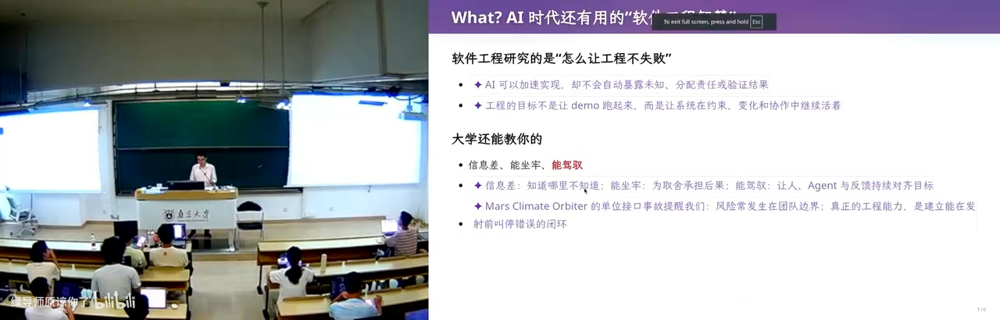

*(参考时间: 00:09:53)*

### make slides：用算力换智力

这个 skill 里最有效的一招，是让模型生成三个 sub agent，给它们不同的 personality，让它们各自干活，而且都在**隔离的上下文**里跑，最后由主 agent 汇总。他的总结是六个字：**用算力换智力**。

*(参考时间: 00:10:52)*

### 上课是一种表演

他给出一句关于教学的核心判断：要真正"杀死大学"，老师该思考的是怎样把知识以更好的方式呈现给大家。他的答案是——**上课是一种表演**。"我是个演员，要调动大家的情绪"，按预先设定好的剧本做一场演出。

但演出结束之后有件很重要的事：**review 今天的表演**。因为有些例子举得不恰当，回过头会想到也许另一个案例大家更能感同身受；课堂上有即兴的部分，而即兴就意味着不完美。于是他课后把录像切片、重新整理。说到这里他点出方法论根源："我是从 content-as-code 来的，everything is code。"把这次的表演重新写回代码里，让它更丰富——"我不就实现课程的数字永生了吗？"

*(参考时间: 00:12:37)*

### 把课程沉淀成程序

这套幻灯片怎么工作？Markdown 是 source of truth，其他一切——图片、幻灯片——全部是 AIGC；他选中一段 snippet，用 agent 扩写，变成 Markdown slides，再送到浏览器里渲染。

他真正想做的，是把"今天要讲生成式软件工程，要点是什么、逻辑是什么、第一节课该怎么上"沉淀成一个**程序**。这个程序现在也许由他维护；也许有一天他不维护了，就把 B 站上的操作系统课录像整理成切片，让全世界的人来维护——你想定制一个什么样的操作系统课，就可以定制成什么样。"这不就把所有大学教课的方式给颠覆了吗？"他自己也说，这只是一个"可能实现的路线"，所以这门课只做一个比较轻的尝试。

## 五、课程政策：Token、通过与不通过，以及一个恐怖的想象

### Token 自费

课程政策的总纲是：他希望重新找回同学们心中"上课耽误学习"的那种感觉。

第一条是 **token 自费**。他原本想去拉一些 token 赞助，但看到选课人数后就放弃了。然后是他夸张的个人观点：如果你手上没有 token、没有付费的 token，应该立即退学，因为你可能确实不需要 token。他顺手造了个词：硅谷有一种"token maxing"的风气，要死命地烧 token，他觉得没有必要。

他课上所有演示，除了幻灯片生成用了一个更聪明的模型（因为它能给出更好的质量）之外，你看到的一切——包括那些生成的内容——全部是 DeepSeek V4 Flash。也就是说，这门课会用一个**足够便宜、但智能还够用**的模型带大家把事情做完。他也照顾了大家的作息：computer science 的学生都是夜猫子，而 DeepSeek 比较便宜；他顺势拿创始人的名字玩了个谐音梗，调侃白天上课、晚上写作业与计费时段的关系。结论很朴素：每个同学去充 100 块，实在有困难可以找他一起想办法。

> **编者说明**：原文提到国内模型的分时段计费与"错峰"优惠，玩笑建立在这个背景上；字幕此处识别较乱，故只保留玩笑的功能，不复述具体价格。

*(参考时间: 00:16:28)*

### 通过 / 不通过

第二条：他希望用**通过 / 不通过**评价这门课。申请时他填的就是这个，但教务反馈说，专业选修课一般不这么做，通常只有"形势与政策"这类课才是通过 / 不通过。

他的顾虑很实在：现在根本不知道评判标准是什么。你用更好的模型就能得到更好的质量——同一个任务，让 Claude 来做就是比 DeepSeek V4 Flash 做得又快又好，这没办法。课程无法限制大家用什么模型，那怎么评判？

尤其是这样一门做 project 的课。他会有一些建议题目更新在课程网站上，比如：实现一个自己的邮件管理系统，可以回他的邮件——他用一个指定邮箱给你发信，你把邮件回回来；这个服务跑在宿舍里一台一直常开的小电脑上，"这就是一个比较不错的实验"。

### 分数不重要，简历重要

那什么叫做得好、该给多少分？他的判断是：**在这个时代，分数已经变得不那么重要了**。真正重要的，是你最后找工作、或者保研那一刻，投出去的那份简历上有什么东西。对你们来说其实只有那一次考试；而比较糟糕的是，为了走到那一刻，你还需要一个比较好的 GPA，还得去 reward hacking，还得 overfit 考试题目。但最终检验你大学阶段的，是那份简历——它能不能带你到下一个更高的平台。

所以他希望这门课结束时，你能在简历里写"我在生成式软件工程里实现了 A、B、C、D、E"，后面跟着很多链接，每一个都做得非常漂亮，每一个都能说清楚"我完成了设计实现，它了不起的地方在哪里"。

*(参考时间: 00:19:20)*

## 六、大语言模型：一个概率分布，以及它如何走进我们的世界

### 它就是一个概率分布

"我今天不讲什么是大语言模型"，然后一句话讲完："大语言模型就是一个概率分布。"这和概率统计课上学的抛硬币没有区别——那道经典题是：我知道抛了六次硬币加起来是多少，问你第一次抛出正面的概率。大模型就是一个"学到的"概率分布：你给它一本书，书到某个地方结束了，但你可以在这后面再写几个字，比如"能不能帮我总结一下这本书"，接下来它就会不断预测下一个 token 的概率，一次输出一个字符、一个字符、一个字符。模型很大，见过世界上所有东西；训练它很难，所以现在 frontier lab 这么厉害。但这门课站在**使用者**的视角：你只要知道存在这么个东西，打开网页 API 就能体验它——"你现在就在体验大语言模型"——不需要任何关于内部原理的知识。

*(参考时间: 00:21:23)*

### 给五岁孩子解释扫描电子显微镜

2023 年，GPT-4 的时代，那是一个幻觉非常严重的模型，但他要它给五岁的孩子解释什么是扫描电子显微镜，prompt 大概是"用朴素的语言打一个合适的比方"。起因很日常：他给孩子讲故事，不知怎么就讲到了扫描电子显微镜，然后他讲不下去了。GPT-4 给了这样一个比方：你现在有一座山，山的形状你看不到，因为你闭着眼睛；但你想知道它是什么形状，那你就朝那座山扔石头——有的方向石头直接穿过去了，有的方向弹回来、你能听到声音。于是通过"哪些地方穿过去了、哪些地方没穿过去"，就可以推测出这座山的形状。

> 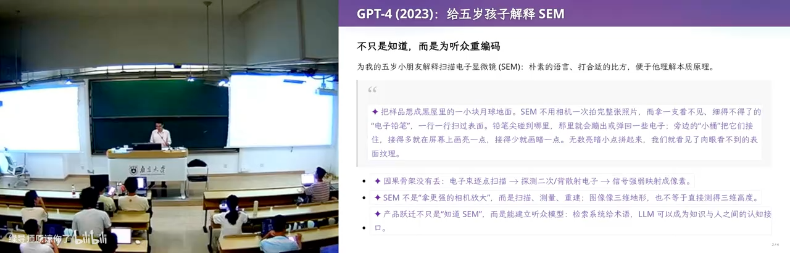

*(参考时间: 00:23:36)*

### Agent 是怎么出现的

随着模型能输出越来越长的文本、接受越来越长的上下文，**agent** 出现了。机制其实很简洁：模型可以输出一个**特殊的 token**，意思是"能不能调用一个 bash 程序"；这个程序运行，结果被重新送回给 agent，落在一个 loop 里。这样 agent 就可以自主运行——你给它一个复杂的任务，它可以不断地尝试、尝试、尝试。而在 GPT-4 的年代，他们还在用模型生成奇怪的东西：一个 prompt 生成上百张图、还得反复调整；今天这就是"一句话的事情"。

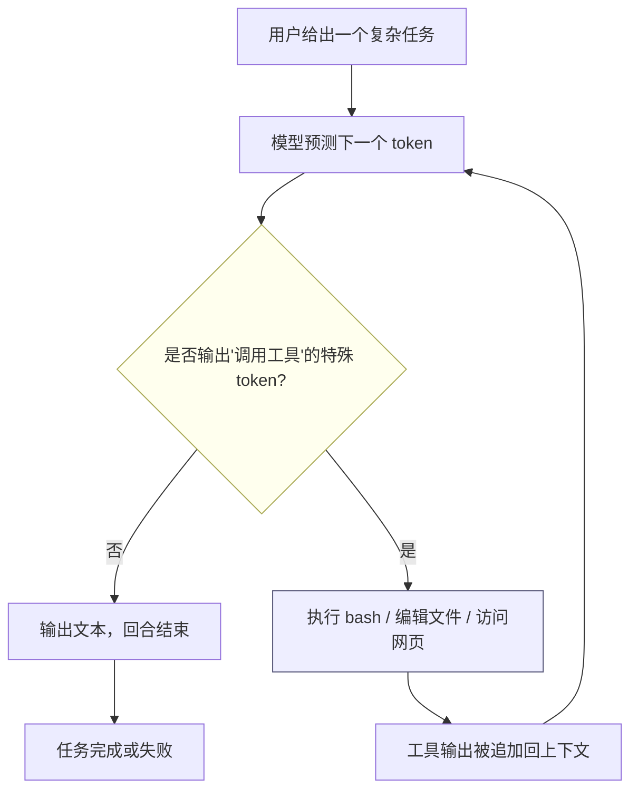

*(参考时间: 00:24:38)*

## 七、普通人的 Agent 第一课：一个白板的 Pi

### 两个原则

作为 AI native 的一代人，第一件要知道的事是：**给它一个合适的指令**。他在课上选的是一个叫 Pi 的工具（字幕作"派"），用法极简——你只要跟它说就可以了；此外还可以写配置文件，比如仓库根目录下的 `AGENTS.md`。他先问"你是谁"，它回答：我是生成式软件工程的教学辅助。他追问："你不就是个模型吗？为什么还知道生成式软件工程？"它说，之所以知道这门课，是因为仓库里 `AGENTS.md` 的配置——"这部分是临时的基因"。

> 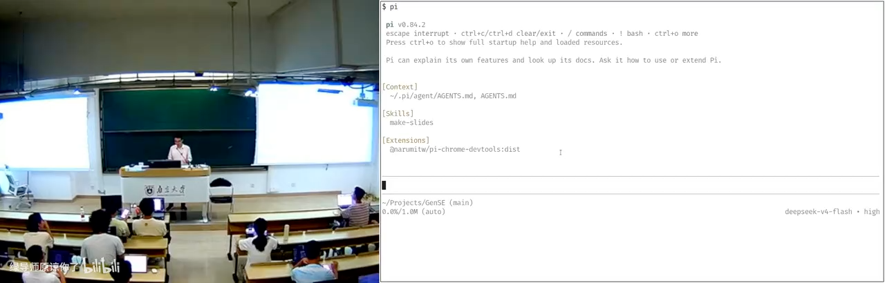

于是第一条原则落地：**现在就开始用**；第二条紧随其后：**随时问它**。在这个意义上，**是你的想象力限制了 agent 的上限**——他让大家课间想一想：你用 agent 做过的最酷的一件事是什么？

> **编者说明**：讲师把这个工具读作"派"，字幕也写作"派"，本书统一记作 Pi；该产品的确切名称与版本未能从字幕中确证，读者可对照课程主页。

*(参考时间: 00:31:48)*

### U 盘里的 Debian：装机仙人被取代

他的第一个例子就是今天上课这套系统——所有配置与安装都是 AI 完成的。他要在一个 U 盘上装 Linux，这是他上操作系统课的特色：带一个 U 盘，里面装一个 Linux，插在教室电脑上就能启动。他还放了个"战绩"：有一年的课上他把教室电脑的硬盘抹掉了，结果下一位上课的老师出了教学事故——这也是他坚持用 U 盘的理由。装机曾经很痛苦，他自称"装机仙人"，还翻出 2021 年 7 月的一篇知乎链接，那是 pre-LLM 时代的各种定制；而现在，"装机仙人已经彻底被 AI 取代了"，因为他只用了一句话：

```text
去 mirrors.nju.edu.cn 上找一个 deb13 的镜像，把它装到我的 U 盘上。
这时候 U 盘插在里面，确保这个 U 盘可以启动。
然后用模拟器验证它。
```

点睛之笔是最后一句"用模拟器验证"。他有相应的知识，所以知道这个安装是怎么完成的：agent 装完之后真的在 QEMU 里启动，看到登录界面，告诉他确实可以登录了；他要创建一个用户，用户名是什么、密码是什么，agent 全部做好、验证完成再交给他。

> 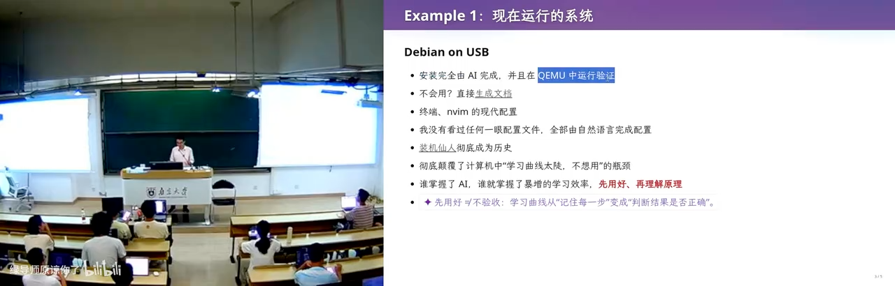

*(参考时间: 00:34:04)*

### 平铺窗口管理器与那个危险

U 盘启动后，他说要装一个 tile-based 的窗口管理器。于是有了课上那段顺滑的操作：按 Win+Enter 产生一个新窗口出现在右边，按 Win+Space 可以把它挪出来。不会用怎么办？他让模型自己看系统设置、生成一份文档：Super+Enter 打开终端，Super+D 打开 app launcher。

> 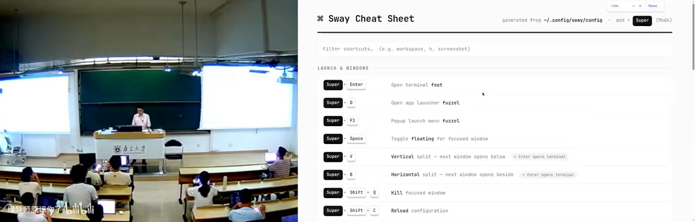

"所有的文档，包括你看到的终端、Neovim 的现代配置，我没有看过任何一眼配置文件。"他有一层感慨：作为教 computer science 的老师，他大四时和大家一样在看 Intel 那几千页的 CPU specification；而现在有一个人可以把这些东西全看了、都懂、还能做对，他需要做的只是**解锁它的能力**。所以你看到，今天学习知识的方式变了：你更多时候需要知道**它能做什么**，感知它做到什么程度，然后带着它去做一件更大的、它现在还做不到的事。

> 人现在唯一的功能，就是带着 AI 做 AI 现在做不到的事情。一旦你没有这个能力，你就立即已经被淘汰了。

*(参考时间: 00:37:48)*

## 八、从邮件到论文：把日常流程交给 Agent

### 邮件、发票与打印机

第二个例子是收发邮件、写草稿。他有一个 skill：数据库里有他历史上回过的所有邮件。所以每当收到一封邮件，它会自动把它变成已读，然后自动用他的口吻写好回复草稿。他很诚实地评价：除了少数 routine 的东西可以直接用，大部分时候他还得改。但这个 bot 还处理附件：收到一张发票，它会自动归档到指定位置，当然这都是他写好的 instructions。更有意思的是任务闭环：他用苹果的 Reminders，在"bot"列表里加一条"把我收到的上一张发票打印出来"，点一下勾就等于 commit 了一个 to-do；之后只要等——它在后台处理，弄好之后推送通知，通知通过 Reminders 送到手表上，手表告诉他可以去取打印件了。

> 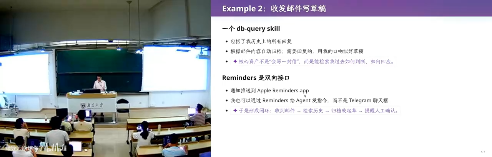

*(参考时间: 00:39:30)*

### 读书：让 AI 梗同学当审稿人

"你们还在读书吗？还看论文吗？看论文痛苦吗？"他连问三句，然后自答：我是一个很喜欢看书的人，在你们这么大的时候每年教科书要看几十本；**而我今天已经不看书了。** 但他还是买了几本，因为要上这门课。第一本是 Fred Brooks 的《The Mythical Man-Month》，中译《人月神话》。他说这个标题起得非常 misleading："人月"——你想到的是人和月亮吗？每到月亮出来就会变成狼的人吗？其实是 myth 被听成了 mammoth（猛犸象），那就好理解了，"人力神话"；而"神话"也不对，你想到的是盘古开天地，有那种美好的意思，这本书其实应该叫"人月鬼话"，因为这个 myth 是一个鬼话。第二本是 John Ousterhout 的《A Philosophy of Software Design》，他评价它非常紧凑，里面有很多真正的软件工程智慧。

> 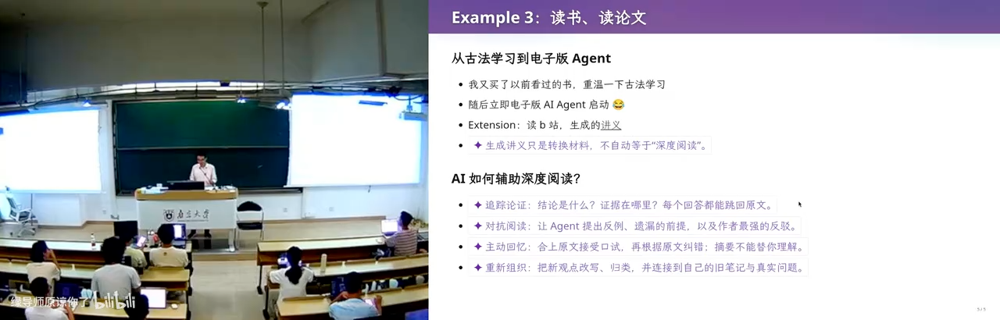

*(参考时间: 00:43:38)*

### 读论文：把已知的全部减掉

他用这套东西审稿、读论文。方法很明确，他把它当成一句 prompt："从人类已有的知识开始。假设人类已有的所有东西都已经固定下来、都是已知的，然后把这篇论文里**新的、最少的那部分**剥离出来。"这样一剥，一篇 12 页的论文基本就剩不下多少，会变得非常短。所以他现在读论文效率非常高，而且他会 chat：拿着原文、拿着总结、拿着深层次的总结，和模型对话。"我仍然是读论文的，所以我不是那种只看微信公众号的老登。"

> 

*(参考时间: 00:44:51)*

### 读 B 站：图文时间轴与十倍效率

他不仅用 AI 读书读论文，还用 AI 上 B 站。先划了条边界：如果你们是那样娱乐的——看一个"华强买瓜"的衍生视频——那就不要用 AI 了，那剥夺了你们的娱乐。怎么读？给一个 BVID，比如他上学期的课程，一小时二十七分钟；流程是把视频总结成一个自动的图文时间轴。整理过的文本比字幕质量高一些，图片会稍少，因为他实际截图密度更大——当两帧图片的间隔大到一定程度他就截图，这样就得到了"这个视频说的 ground truth"。

> 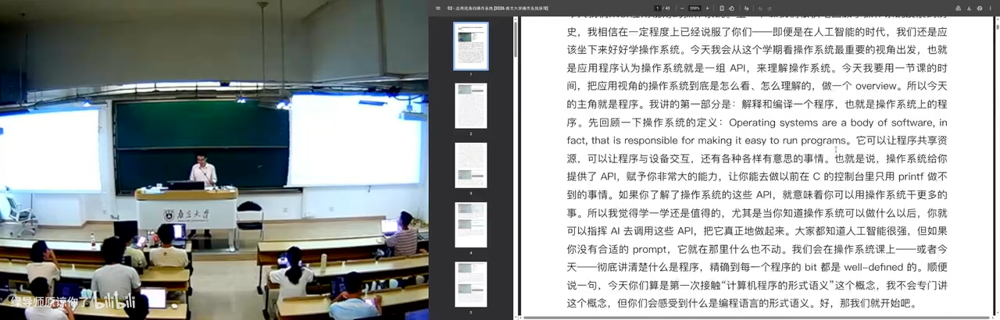

## 九、把浏览器变成 API：DevTools、教务系统与二维码

### USB 采集卡断了

下半场从一个真实故障开始。直播时他的 USB 摄像头卡住了。教室里的方案大概是：有一个视频采集卡，可能从网络过来，因为这边还有好几台机器。他顺便吐槽：不知道为什么学校用了一个成本那么大的方案，他觉得 500 到 1000 块应该就能解决整个问题。故障表现是采集卡的 USB 断开了：画面里他挥手，左边的画面是在动的，但 USB 掉了。他当场让 agent 修，就是一个 prompt：

> 先看系统里 USB 设备的情况，找出设备。我的 UVC video 有问题，能不能 reconnect。

> 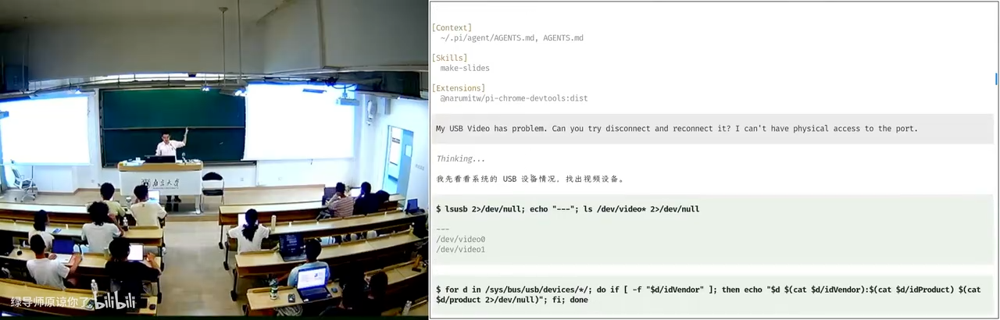

*(参考时间: 00:50:14)*

### 浏览器是人类软件工程的奇迹

他强调：刚才展示的还只是一个"白板的 Pi"——你在官网下载安装，配置一个 DeepSeek V4 Flash 的 API，立即就得到刚才所有那些东西。但 agent 远不止于此，它拥有一个完整的生态系统。当一个领域特定的任务出现时，他说了一条"计算机科学的定律"，也是他上课一直会讲的："如果有一件事情它是合理的，并且你想做，那么百分之百一定也有别人会想做。"在 AI 时代，**复用别人的能力变得前所未有的轻松**：可以往 Skill Hub 上发一个 skill，也可以在 Pi 的插件生态里找到插件。所以作为一个普通人，下一步应该做什么？**用插件把浏览器管控起来，用插件把电脑管控起来。**

### F12 之后

你们应该都用过：打开 Chromium，按 F12。他当场演示了最朴素的一件事：把页面上一个很讨厌的元素删掉——选中它，按 delete，它就没了。

> 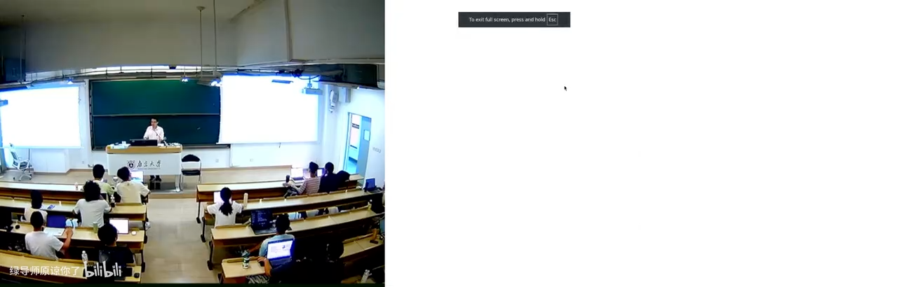

一般来说，网站都会在 console 上嵌入招聘广告——他顺手打开 B 站按 F12，还嘀咕了一句"它没有招聘广告的吗"。在 Network 面板里能看到 HTTP 头，也可以把某个请求"copy as cURL"，带着浏览器的 cookie 和全部状态用 curl 去取数据；这些在 pre-LLM 时代是开发者才做的事。

> 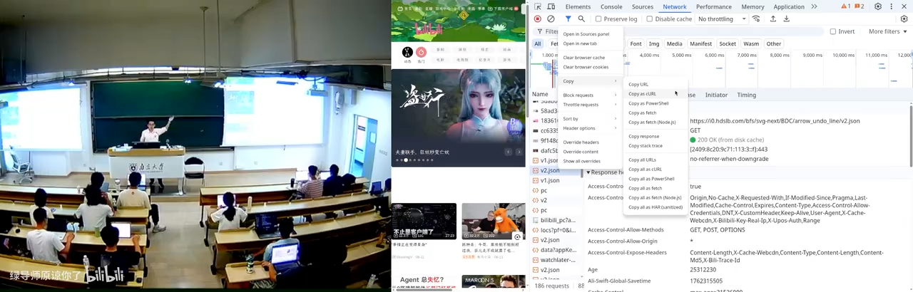

*(参考时间: 00:54:57)*

### 教务系统：一次翻车，一次成功

今天要干的是大家都讨厌的事：**教务系统**。他提前声明：讲到软件工程时他还会专门讲，教务系统是一个软件工程非常反面的例子。他扫码登录，叮嘱全场"你们不要扫"，登录后指出：现在的教学周历是空的。顺便解释：刚才他在 Pi 里说"帮我打开浏览器"，这个浏览器是属于 Pi 的。于是他给出那条指令，用语音说的——这也是他日常做杂事的方式：按一个键，打开豆包输入法，和它对话。

```text
现在教学周历是空的，帮我用随便什么 AI slop 填起来。不要看任何东西。
```

"不要看任何东西"是有原因的：如果 agent 知道当前目录是这门课的 repo，它就会去读他的 lecture notes，而这些他不要。然后是翻车现场：它还在干这件事——"你看他就是不听指令"。他想让它填 N/A，它偏不。他点评："这是 DeepSeek V4 Flash 的麻烦，如果是更强的模型，它会知道。"翻车也是经常有的；他用 Flash 还有一个原因——在课上更快。

> 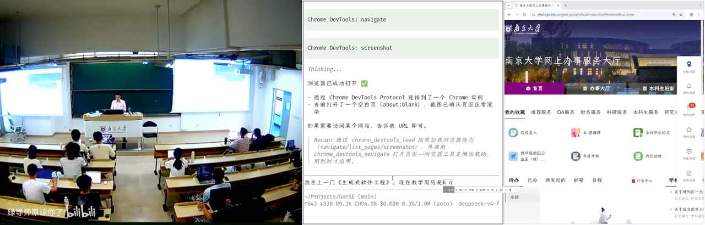

但接下来是转机。他看着 agent 不断反思自己做的事合不合理，然后找到应该怎么办。刚开始的尝试是失败的——它发现直接注入一个事件的方式不行，但**点鼠标是可以的**。这意味着它已经开始可以填写那些"AI slop"了，他完全可以不需要值守。

> 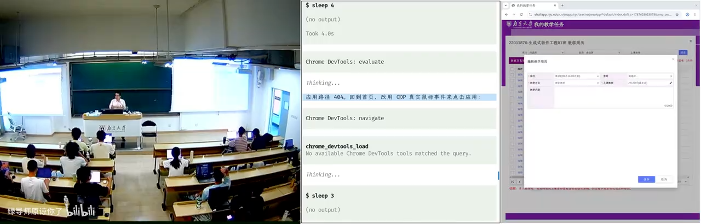

*(参考时间: 00:57:52)*

## 十、Skill 生态与飞轮：1+1 可以大于 2

### Unix 管道哲学与飞轮

他强调这其实是一整个生态，而不是"今天讲了好多招，每一招都很厉害"的清单。因为他是教操作系统的：UNIX 的 philosophy 之所以能成立，原因就是**管道**——管道让所有程序自由组合、无限复用，1+1 是可以大于 2 的。所以刚才说的所有东西都可以加在一起互相调用：一个提取记忆和脚本的能力、一个浏览器 skill、一个"网页上怎么浏览"的 skill。这个生态已经达到了一个**临界点**，它们互相组合，可以成百倍成千倍地放大个人能力。

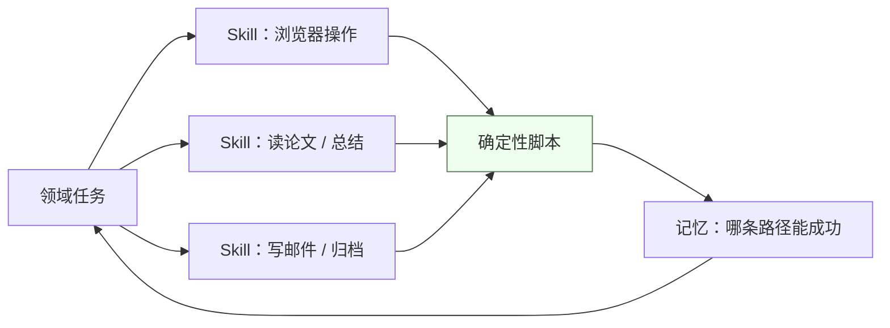

对一个普通人来说真正可做的是什么？你可以找到各种各样的信息源：每天早上的 AI 早报（反正也是 AI 生成的，但它有 RSS、有推送源）、B 站的推送、arXiv 的推送、Hacker News 的推送；它们都可以沉淀成 skill 或者脚本。于是你有了一个信息处理系统：大量信息源进来，最终产生**对你有用的知识**。而这里面全由各种 skill 构成，**全是自然语言，一行代码都不用写**，但它可以复用；你会不断调整工作流，它就会不断产生有用的知识。"你的飞轮就转起来了。"

*(参考时间: 01:01:07)*

### 统分流水线

接下来他切到 computer science 从业者的视角：如果你们只是用 agent 让 codex 把操作系统作业做了，那真的太小看它了。因为 CS 的人**知道编程的能力界限在哪里**：一般人很容易提出一个需求，而这个需求 agent 可能做不好；或者他不知道该怎么 prompt，才能让 agent 确定性地、快速地完成。但 CS 的人知道怎么把需求"编译"成可复用的东西——什么该以代码的形式复用，什么该以 skill 的形式复用。他举了个非常具体的例子：改完卷子要统分。一般来说这个任务是给助教的："助教，你去把这个分加了吧。"然后助教掏出计算器：12 加 13 加 14 加 15 加 16，再仔细核对一遍。他自嘲："我觉得我对我的学生太好了。"今年他尝试了一条流水线：先用 vibe coding 让 AI 出脚本、写测试；测试跑通后，一遍头跑完。

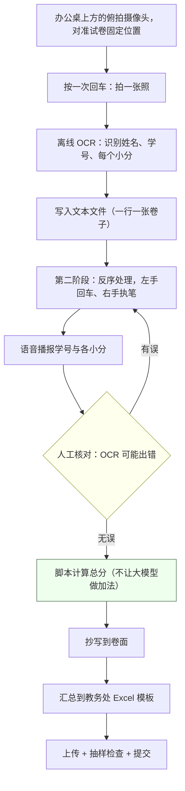

他在办公桌上装了一个从顶向下的摄像头，先调好，让它拍到试卷的一个固定位置。按一个回车，它就拍一张照；拍完回后台离线处理，用 Qwen 识别姓名、学号和小分，往一个文本文件里写一行。所以他的动作是"一张卷子、一个回车"，两只手都不用写字。第二阶段按**反序**处理：还是按回车，但左右手换了——左手按回车，右手拿笔。按下回车，系统就用语音播报：谁、学号是多少、每个小分是多少，一边报他一边核对。为什么要核对？"因为 OCR 会有错，我不信任它。我要对我班上的每一个同学负责。"核对没问题，他才把播报的最终分数抄到卷面上。这个分数是脚本算的，**他没有让大模型做加法**，所以不会因为幻觉算错。最后分数自动汇总到教务处的 Excel 模板上，他再抽样检查，确保没有问题才提交。

> 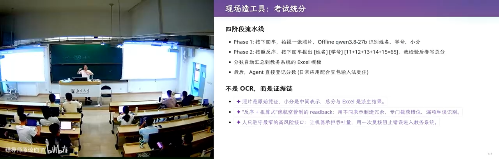

*(参考时间: 01:09:22)*

### 二维码动画：一个"合法"的数据搬运

回到软件工程的话题。他先讲了一个真实场景：群里闲聊时说"机器被管控了，很讨厌"。于是他们设想：假设你在一个金融公司，数据可以带进去，但出不来。你插一个 U 盘可以把 Word 或 Excel 拷进去，但没有任何文件可以拷出来；这台机器不能执行不信任的程序，不能显示不信任的网页；你唯一能做的，是在远处悄悄射频。可是你想把一个很大的文件偷出来，怎么办？"这就是 computer science 的人才能想到的事情。"他做了这样一个程序：界面是一个二维码，你可以把任何一个文件的内容放进去——他现场输入 `hello world`，二维码就变了；再换成一个很长的字符串，它就被编码成一个二维码的**动画**，按住 F9 刷新，它就在循环播放。

> 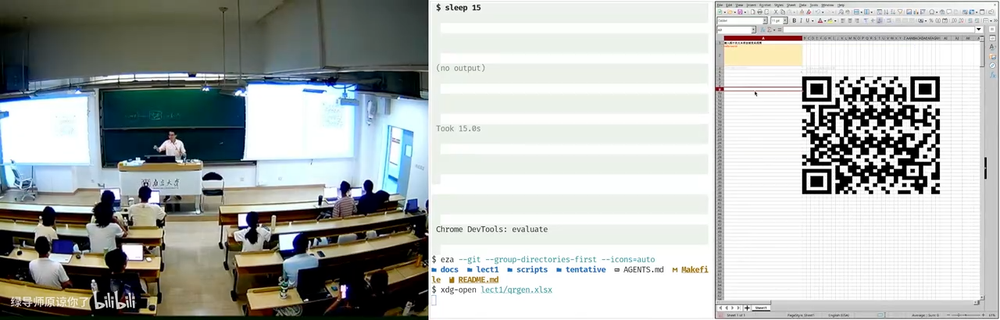

> 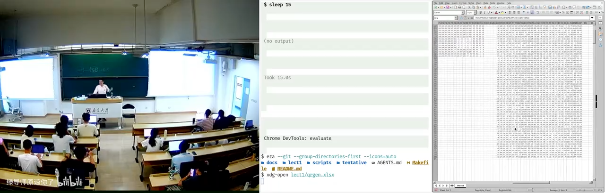

*(参考时间: 01:13:15)*

## 十一、回到软件工程：三个空间与那道 gap

### 一个字段引发的血案

他讲了一个实验：让 AI 去做那个二维码，AI 生成了**完全不可维护的代码**。这就接到教务系统（以及一卡通）的例子：这个系统很难用，而学校每年都会花巨额的钱让公司维护这份代码，因为要添功能。他讲了自己发现的一个细节：因为用 browser use 时他稍微 hack 了一下这个系统，发现了些隐藏字段——比如你能看到一个学生的**校区**。在苏州校区建成之前，这个系统里不需要这个字段。为了兼容苏州校区，问题就来了：你们写过软件的都知道，设计需求的时候你没有想到学校竟然还有"校区"这东西，数据库里就没有这个字段；然后突然有一天产品经理说，我们两个校区选课要分开了。对 AI 来说这件事听着没问题："你原来系统是可以用的，我现在多了一个校区，我要把校区分开。"然后它就开始写代码。但**还是很容易失败**。这就是非常典型的软件工程的失败。

*(参考时间: 01:17:24)*

### QR 是怎么暴毙的

他接着复盘了那个二维码 Excel 的"暴毙"过程。需求非常明确：要一个 QR 的 Excel，只用 Excel 2019 兼容的公式，把输入的任意字符串转成二维码动画，每一帧是什么由公式算出来。他开始让 AI 做时就发现，这个任务它经常做到一半停下来问他。他说：不要，这个很容易失败，你不要问我了，必须把它做成，做成为止。但很遗憾，AI 对这个需求的理解是不到位的。他已经说得很清楚：我就是要做这个东西。然而模型依然误解了他到底要什么。有意思的是另一个模型的判断：它看到了他完整的 slides，但**没有告诉他我是怎么做的**，所以它认为 AI 容易在小 corner case 上犯错。而那个更新的模型第一秒钟就被带歪了：它希望做一个"对任意的 S 都满足正确性"的东西。

"这就已经错了。"

> 软件工程的第一步：不要扩大。做最简单的东西，不会失败。

模型没有理解这一点。

*(参考时间: 01:18:38)*

然后他做了一个受控实验：第一个版本是他带着 AI 做 vibe coding 做出来的，所以还比较顺利；后来他直接把 specification 告诉 AI，看它能不能自己搞定。结果：一个模型第一次思考了 25 分钟，然后开始疯狂输出，写了超过 32K 的 output token，直接把 Claude Code 的输出限制打爆了、被截断；再跑，总共跑了六个小时（他没有监管），但结果是对的。所以那个模型说自己厉害的地方是能做 long-horizon 的任务，是对的。

> 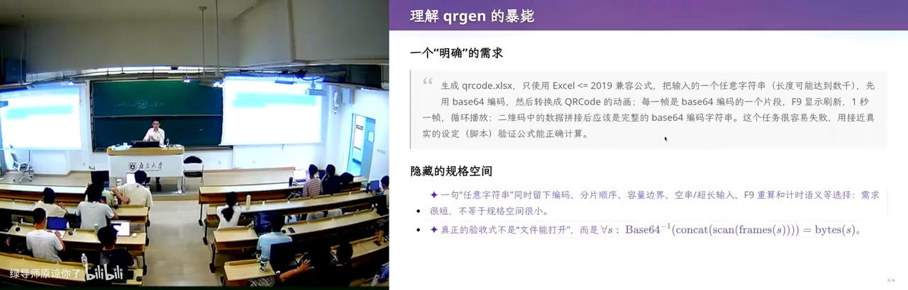

另一个模型是晚上放着跑的。第二天早上他一看：**是硬编码的**。这明显不符合指令——"把一个输入的任意字符串先用 Base64 编码"，正常人的理解应该是 Base64 要用 Excel 公式来编码；而它是用 Python 算了一个 Base64，直接贴到公式框里。输入字符串一改，那个 Base64 是不会改的。他骂了它，它回了一句话，大意是"这是一个关键的设计缺陷，请重新思考"。

> 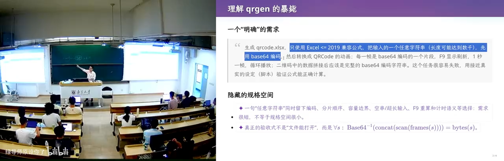

*(参考时间: 01:21:04)*

### 我为什么先写一个 DSL

那他本人是怎么做到的？他先抛了一个 quick quiz：如果你们要实现这个 QR 的 Excel，会怎么写？怎么 prompt AI？他的答案是：只用了少量 prompt，就让模型在 200K 上下文里完成了第一个正确的版本。当时他刚升级到那一代模型，想测试一下它的能力，于是让它设计一系列 Python 类，"有点像编译器一样"。具体说，他要设计一套符号系统，里面有 XOR、concat 这样的位运算；这个东西既可以翻译成 Python（直接执行），又可以翻译成 Excel。也就是说，他先做了一套**像编译器一样的基础设施**，定义了一个**中间语言**——它既对 Python 友好，也对 Excel 友好。于是验证的负担被拆开了：他只需要验证每一个翻译是对的——翻译到 Excel 的公式是对的，翻译到 Python 的结果是对的；然后单独验证每个东西与 Excel 公式之间翻译的正确性。验证完之后，"最后一把头生成就直接正确"，代码非常干净，也不长，但维护性远比那些硬编码的产物好。

> 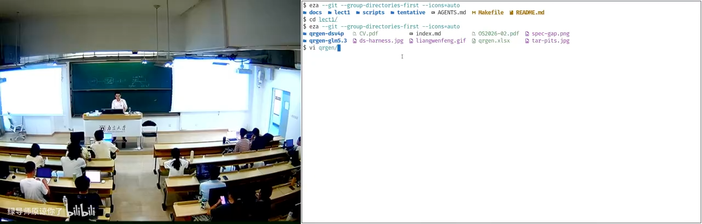

*(参考时间: 01:24:16)*

### intention / specification / implementation

核心问题是什么？他给出一个三空间模型：

1. **intention（意图）**：你脑子里想的是什么。比如老板说"我要做一个国民级的应用"，或者"我要做一个小程序，给我挣一个亿"；再具体一点：同学们点外卖不方便，我要做一个点外卖的小程序，然后就能挣一个亿。
2. **specification（规约）**：这个程序的功能是什么，要满足什么样的要求，有几个界面，每个界面有什么功能。**每一个 intention 都有很多种可能的实现。**
3. **implementation（实现）**：具体怎么写。

以二维码为例：intention 是"我要造一个能把数据偷出来的 Excel"；spec 是刚才那一句话；而同一个 spec 可以选择不同的架构、不同的实现方式——像刚才那种实现方式就会带来巨大的差别，尽管它们同样满足 spec。哪怕是满足同一个 spec，也有大量的 implementation。所以软件工程真正的 gap，就在于这些东西之间是有 gap 的。

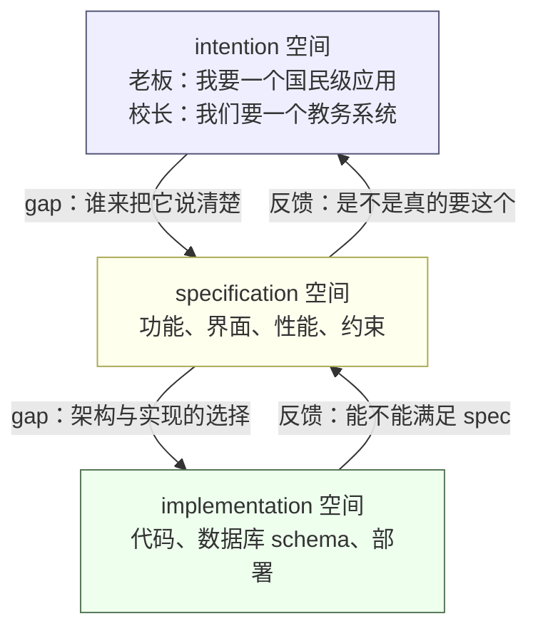

*(参考时间: 01:27:40)*

### 梗图与人月神话

他放了一张软件工程很早以前的梗图，讲的就是这个 gap：客户是这样解释他的需求的，项目负责人是这样理解它的，分析的人又是这样想的，宣传的人又是这样宣传的，最后客户实际要的是这个——而造出来的是那个。

> 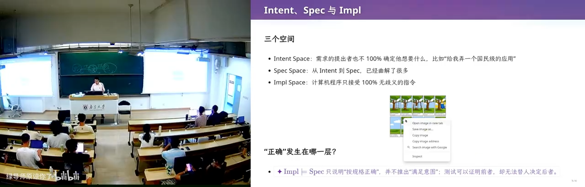

而造成这一切的根本原因，就是这些 space 之间的 gap。所以当我们谈软件工程——不管是软件工程还是生成式软件工程——要做的事情就是补上这些 gap。那今天这些 gap 是怎么补的？**模型用的是猜。** 你既然说了这句话，那我就猜应该是这个吧，我就去实现。为什么？因为后训练时模型是有 reward 的：任务做对了、测试通过了就会得到奖励。所以它形成了一种倾向：疯狂地立即上手，尽可能快地完成任务。这当然让它能越来越多地做一些简单任务，是好事；但和人解决问题的方式还是不一样的。人怎么弥补这个 gap？作为计算机或软件工程的学生，你大一第一门课是 C 语言程序设计——你先学的是 implementation space 里有什么，把这里的东西弄得非常熟练；然后你再去上软件工程课，一点一点把理解补全。在 AI 时代，这件事发生了变化：**你既要阻止 AI 去乱猜，又要尽可能发挥 AI 从 A 到 B 的能力。** 这就是这门课要讨论的问题。

*(参考时间: 01:30:33)*

*(参考时间: 01:32:24)*

## 十二、结语：古法编程已死，软件工程未死

### 教育体系训练的是"五分钟"

他抛出一个他认为属于当今教育体系的大问题：你们从高考过来到现在，所有的考试题都是五分钟能解决的。假设出题人也可以用豆包摸鱼，那么能上考场的题目，如果人五分钟解决不了，一般就不会出了。所以长久以往，你们被训练出来的能力，和 agent 在 RL 里被训练的那套东西是一样的：**你能不能五分钟解决？能不能五秒钟解决？** 最后是 agent 赢：它有更多的数据、更明确的反馈信号。如果你没有一种很强的好奇心——想知道这个世界是怎么运行的、一个产品到底是怎么开发出来的——没有这种 self motivation，你就不会去训练自己解决 long-horizon 的问题。最后的结果是：你解决 long-horizon 问题的能力还不如 AI。所以他说，软件工程其实挺好的。有些软件工程的同学在抱怨自己的课程"太文科"，但如果你能把技术映射回这些文科的东西，你会发现软件工程确实就是文科、就是管理学——《人月神话》本身就是一本管理学的书。但它里面确实有很多真实的、有趣的科学。

*(参考时间: 01:35:57)*

### 品味能不能被训练出来

在大语言模型的时代，**软件工程失败的定义没有变**：从 intention 到 specification、再到 implementation 的翻译错了。要么是 intention 和 spec 之间不满足——我做了一个东西，其实不是我要的；要么是做了一个实现，却不满足 specification——正确性、性能不达标。

但今天的模型，因为有强化学习，对真正的长程信号还是做得不够好；它更多还是在"机械地完成任务"。所以不管是哪个前沿模型，在面对这个 Excel 问题的时候，它都不会去想：像讲师那样先设计一个 DSL。虽然模型有足够的智能，可以设计一个非常好的中间语言，把这个问题干净漂亮、可维护地解决；但 AI 的第一反应和大家一样——**它已经被训练成做题家了**。

大家都说 AI 现在最缺的是品味，要把好的工程品味训练出来。但他同时觉得：既然它能做题家，为什么不能有好的品味？他觉得可能是有的。所以他也有危机感：这门课现在这么教，可能三个月以后——甚至这门课还没结束的时候——他讲的所有东西都已经没用了。因为它既然能解决数学问题、能解决编程里很细碎的逻辑，它为什么不能——它见过所有这些好的设计——从记忆库里找到那个好的设计，然后来解决这个问题？

*(参考时间: 01:38:03)*

### 最后一页：为什么导师要招你

最后一页。第一句：**古法编程已经死了。** AI 在完成单个任务上已经无人能敌。第二句：**软件工程暂时还没有死。** 但他希望每个同学经过这门课——他谦虚地称之为"探讨"——试图回答一个问题：

> 在保研的时候，你的导师问你：为什么我要招你，而不是买一个 200 刀的 Claude Max？

怎么解这个问题？他觉得在这个问题上，那个前沿模型回答得还挺好的——虽然它自己做不到。它的回答是：他能找到值得解决的问题；把未知拆成便宜的实验；用证据让坏方向及时停下；并对长期结果负责。"这是一个好的回答。但是我发现它自己还做不到。"

> 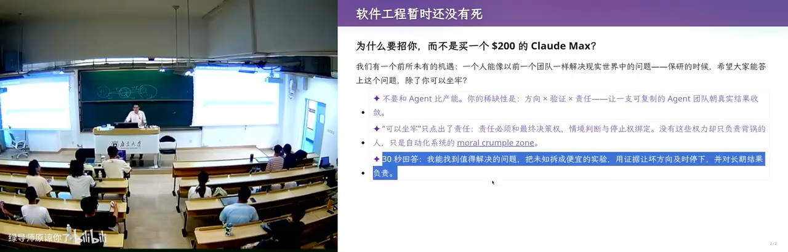