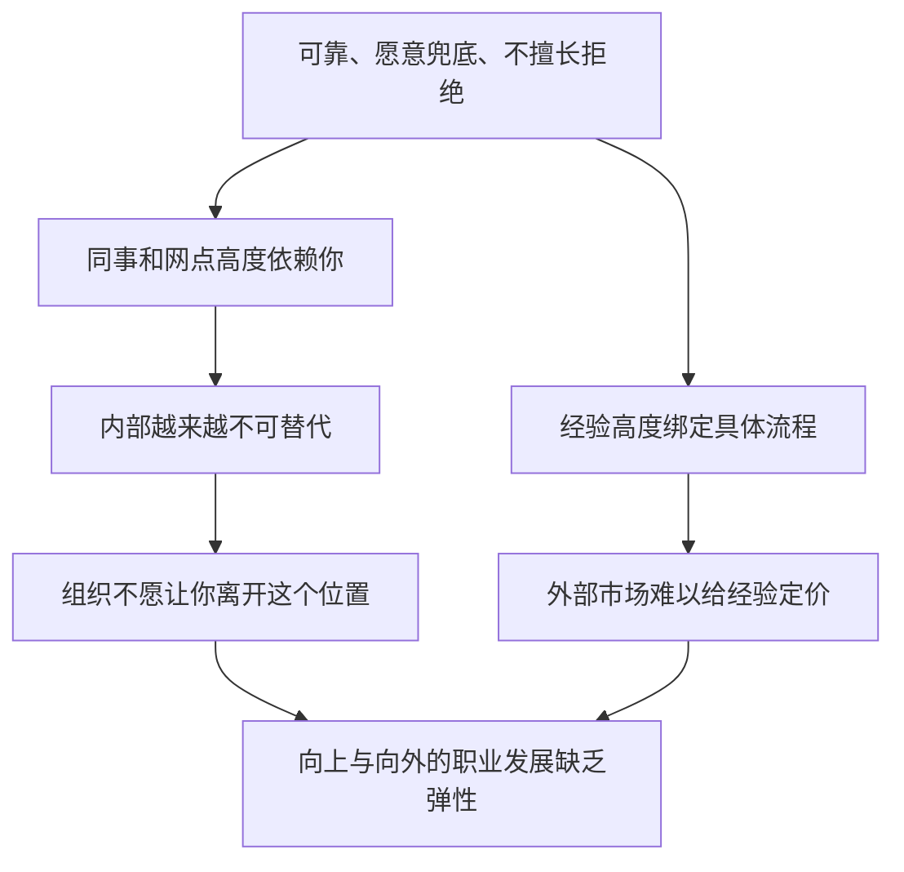
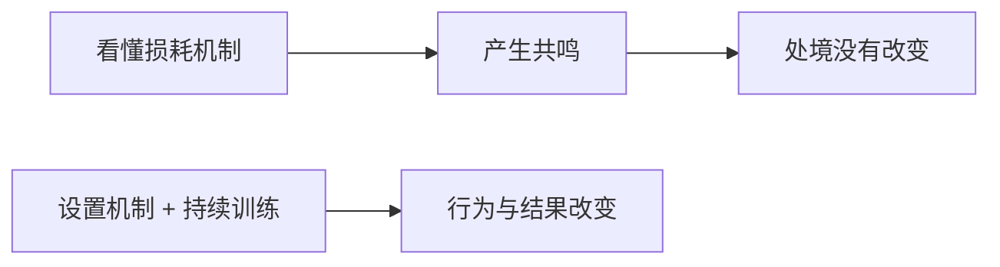
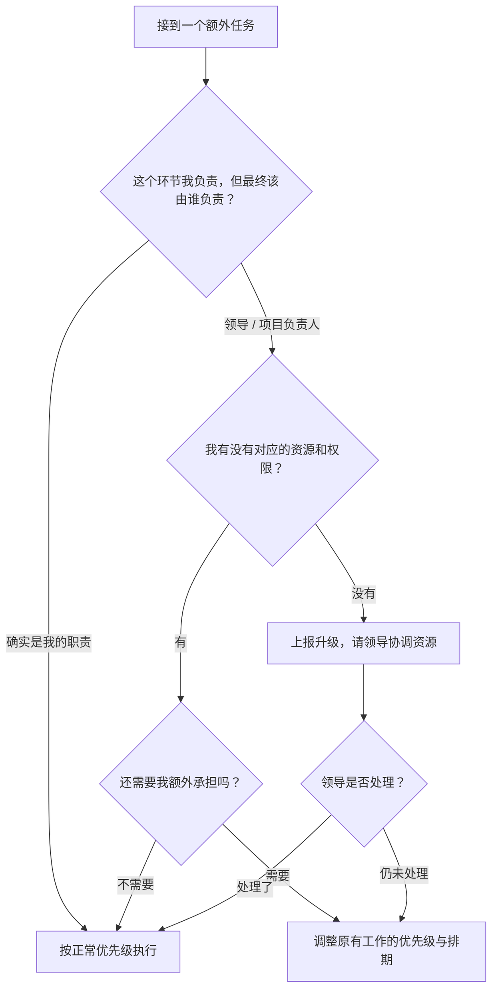
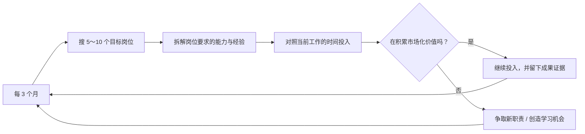
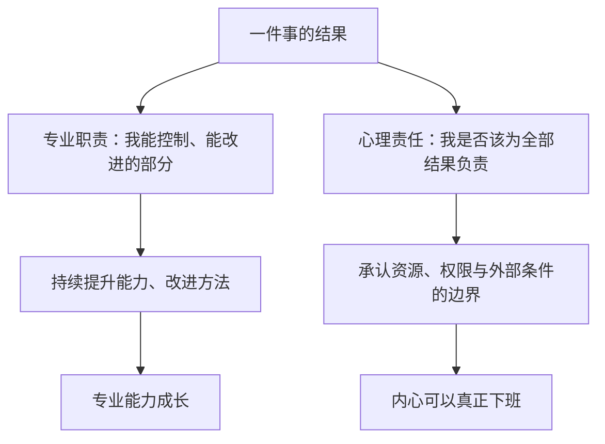

# 责任心强会带来哪些职业损害？三种损耗机制与边界管理的方法

> **视频来源**：[B 站 · Melissa职业规划](https://www.bilibili.com/video/BV1g6sf67Edz)（时长 10:46）
>
> **本讲说明**：责任心通常被当作一项正面的个人品质，但在真实的职场分工里，它可能反过来成为一个人过度消耗、长期困在低价值劳动里的原因。本讲先拆解三条让责任心反噬职业发展的机制——责任无限扩张、职业价值被锁定、权责不对等，再给出三条可以落地的训练方法：用项目管理的方式管理责任心、经营市场化的职业价值、管理责任的边界，最后回到一个常被忽略的问题：责任心的对象，也应该包括自己的职业生涯。

## 目录

1. [开场：一个被社会称赞的品质](#1)
2. [损害机制一：责任无限扩张](#2)
3. [损害机制二：职业价值被锁定](#3)
4. [损害机制三：权责不对等](#4)
5. [为什么"调整心态"没有用](#5)
6. [训练方法一：用项目管理的方式管理责任心](#6)
7. [训练方法二：经营市场化的职业价值](#7)
8. [训练方法三：管理责任的边界](#8)
9. [结语：责任心应该让你走得更远](#9)
10. [附：本期要点速查](#_3)

## 1. 开场：一个被社会称赞的品质

*(参考时间: 00:00)*

责任心和高敏感、低精力这类特质有一个很大的区别：**责任心强在社会评价体系里是一个很正面的品质**。也正因为它是"好品质"，很多人从来不会去怀疑它。但在职场环境中，这种品质很多时候会成为一个人过度消耗、长期困在低价值劳动里的原因。

这期内容主要回答两个问题：

1. 责任心过强，会给一个人带来哪些职业损害；
2. 理解这些机制之后，应该怎样应对、具体有哪些训练方法。

## 2. 损害机制一：责任无限扩张

*(参考时间: 00:27)*

责任心强带来的第一种损害，是**工作责任会无限扩张**。

### 2.1 一个常见的五人团队配置

设想一个团队里有五个人：两个新人什么都不会；领导不做业务；另一个同事上班就聊天、摸鱼。这是一个很常见的团队配置。

而你责任心很强。于是——

- 新人交付的那些东西，你总觉得不行，总是主动想去补，**没有办法克制自己这种心态**；
- 摸鱼的人总是把项目拖到延期，他自己还没有任何焦虑；
- 领导永远不去管这些事情。

那这些事最后就由你去做了。然后你会发现一个很神奇的现象：**摸鱼的人永远在摸鱼，不会的人永远不兜底，而你永远在干活。**

### 2.2 额外劳动如何变成新的 baseline

更麻烦的是，你的额外劳动会慢慢变得非常"理所应当"。

有一天你不想兜底了，或者你兜底的速度慢了，别人还会反过来质疑：你这个人是不是现在工作效率低下了？你是不是工作态度有问题？

这里有一个很重要的组织机制：每一次你接过来，都会**抬高别人对"你能消化多少工作"的期待值**。久而久之，你这些额外的工作就变成了你新的 baseline——你的基础线被抬高了。**你做得越多，别人越觉得这件事就应该由你完成。**

### 2.3 兜底掩盖了组织本身的问题

还有一个更底层的机制：**你的兜底，在掩盖这个组织、这个团队本身需要去解决的问题。**

这个团队的流程管理本来就有问题。流程的问题应该由领导、由公司去解决；但你每一次的额外投入，都在把这些问题消化掉。最终的结果是：这些事情看起来都在正常运转。

既然现在的配置可以正常运转，组织就没有动力去改善它。于是问题被稳定地保留下来，而成本由你一个人承担。

## 3. 损害机制二：职业价值被锁定

*(参考时间: 02:05)*

第二种损害，是**职业价值被锁定**。

有些人的职业价值长期建立在几件事上：做事情可靠、愿意兜底、从来都不擅长拒绝。听起来都是优点，但它们会把你固定在一个位置上。

### 3.1 银行网点里的"业务活字典"

讲者提到一个客户的例子。这位客户在银行工作，把网点所有业务指令全部倒背如流。网点上的新员工和老员工，在业务上都非常依赖他。

但工作了很多年，他一直都是在网点拿了很多荣誉奖状，**职位却从来没有变化过**。

### 3.2 对内失去支撑点，对外经验难以市场化

这类人非常容易锁死在原来的位置上：

- **对内**：如果提拔你，这个网点就失去了一个稳定的支撑点。组织反而更希望你留在原地。
- **对外**：你在网点里积累的经验，很难被市场化——离开这套具体流程，它的定价能力很有限。

这个机制的本质是：你在内部这个位置上越来越不可替代，但**向上和向外的职业发展会越来越没有弹性**。

## 4. 损害机制三：权责不对等

*(参考时间: 02:49)*

第三种损害，是**权责不对等**。

### 4.1 广告公司 AE 的案例

讲者的另一个客户是广告公司的 AE（客户执行）。在没有获得任何宣发资源的前提下，领导让他去做一个大项目的推广。交付时间、给客户承诺的数据，都是领导去和客户聊的，而且聊得很大。

总之，领导把这个项目谈下来了，但具体怎么交付、数据怎么达成、怎样兑现领导吹出去的那个数字，全都落在他身上。最终他没有达到领导说出去的数据，于是觉得非常自责，陷入很深的自我怀疑。

### 4.2 责任心如何反噬自己

> 不知道大家工作的时候，有没有遇到过类似的事情。

责任心很强的人，很容易把**外部的约束条件**当成**对内的自我要求**。

如果保持一定的观察距离去看，你会清楚这是一个不合理的需求；但当你自己身在这个事情里，你更容易想的是：

- 是不是别人都可以做到？
- 是不是自己不够努力？
- 是不是自己能力不太够？
- 是不是自己不太适合这一行？

这就是责任心开始反噬你。长期待在这种环境里，你可能越来越努力，同时也越来越自闭——因为你一直在试图增加自己的投入，去弥补那些本来就超出你能力范围、控制范围的事情。

## 5. 为什么"调整心态"没有用

*(参考时间: 04:05)*

听完这三种机制，很多人会有共鸣：原来我工作这么累，是因为我责任心很强；组织还在利用我的这种责任心。

但共鸣不能改善处境。如果只对你说"你要不要内耗""你要建立边界""你要学会拒绝"，这些是轻飘飘的建议，像在说空气。

讲者打了个比方：一个人本身就频繁受挫、很不自信了，你去跟他说"你要调整心态""你要自信"——他的自信的根源从哪里来呢？你还是需要给他**设置一些机制、设置一些训练的方法**，这样才有可能真正改变状态。

接下来是三个要去培养的职业能力。

## 6. 训练方法一：用项目管理的方式管理责任心

*(参考时间: 04:41)*

第一件事，是**从"自动承担"转向"主动管理"**：用项目管理的方法，去管理自己的责任心。

### 6.1 设计排期冲突的例子

假设有一个活动要推广，你需要设计部门的同事帮忙做视频和海报。但设计的人告诉你：有排期，很多部门都提了需求，你要等。

你算了一下，觉得时间来不及，可能会耽误项目上线，最后自己可能还要背锅。于是想：算了，等不起了，自己咬牙做吧。你自己去网上学攻略，有些还要花钱充 App 的会员。

这件事做完之后，领导和设计部的同事就会默认：反正你也会做，你做的东西也可以将就用，之后这类事情就交给你来做。

### 6.2 先问自己三个问题

如果遇到类似的事情，不要立刻进入"我自己扛"的模式，先问三个问题：

1. **这件事是由谁在负责？** 这个环节可能是你在负责，但整个项目最终由谁负责？是你的领导。
2. **你承担了这件事，有没有相应的资源和权限？** 如果没有资源，你去找设计部门要资源；但资源协调出了问题，这件事应该由你协调吗？
3. **如果确实需要你额外承担，你原先的工作优先级是否需要调整？** 这个项目的 deadline 现在卡得很紧，你需要交付，那其他事情是不是要重新设置排期？而不是默认"在一个交付时间里把所有事情都吞掉"。

### 6.3 把问题升级，而不是自己吞掉

领导既然不做很 detail 的具体业务，那么领导的职责之一，就是**做跨部门的资源沟通与协调**。

你把这个问题划过去、自己把它吞掉，就是一种不专业的工作思路。正确的做法是把它上报、升级；如果升级之后领导仍然不处理，再回到第三个问题：检查自己的优先级和排期，把额外承担的成本显性化。

## 7. 训练方法二：经营市场化的职业价值

*(参考时间: 06:34)*

第二件事，是**经营市场化的职业价值**。

前面讲到银行柜员的案例：职业价值被锁死。这里要破除一个默认的心理认知——**"有责任感的好人"和"有市场化能力的人"不是同一个维度的事情。**

很多人会想：我需要换工作了，再去了解市场；不换工作，就没有必要。但责任心可以让你在一份工作上"焊死"，很稳定；你同样需要保持对外部市场的了解，防止自己僵化、固化、退化。

### 7.1 每三个月做一次市场校准

具体做法是：**每隔三个月，在真实的招聘市场（招聘软件）上搜至少 5～10 个和自己的现职相关、或者未来想争取的岗位**，研究几个点：

- 这些岗位需要什么能力、什么经验；
- 回头检查你现在每天投入大量时间的工作，有没有在积累这些能力；
- 你和市场的需求之间是不是有很大的差异点；
- 如果没有在积累，你要怎样去争取一些新的工作职责，或者给自己创造一些新技能、提升的学习机会。

定期去看招聘市场，**不代表你需要去换工作**；但它能让你清楚地知道：你现在的努力，有没有在积累市场化的价值。

## 8. 训练方法三：管理责任的边界

*(参考时间: 07:46)*

第三件事，是**管理责任的边界**。对于容易内疚、有完美主义倾向的人来说，这一点非常非常重要。它既需要职业化能力的训练，也需要心理训练。

### 8.1 职业化训练：事前约定、事中反馈

职业化能力的训练，是养成责任管理的习惯。这也是一些专业的工作习惯：

- **事情开始之前**：先明确交付的目标、你在这个事情里的责任范围、你需要的资源；
- **工作过程中**：如果出现风险、出现问题，及时反馈，或者把这件事升级；
- **不要自己默认把它吞掉**——这是不专业的工作思路。

### 8.2 心理训练：把"能不能做好"和"该不该负责"分开

心理上要训练一件事：**"我能不能把这个事情做好"和"我应不应该对整个事情的结果负责"，要分开。**

一个事情能不能成功，受到很多因素的影响。你的专业职责需要提升、需要改进；但心理上的责任需要有边界。否则，人下班了，心永远下不了班。

## 9. 结语：责任心应该让你走得更远

*(参考时间: 08:41)*

我们好像从小就在被教导要有责任心，但很少去聊：**一个人要怎么管理自己的责任心。**

讲者再次强调：要向项目管理的方式管理自己的责任心。如果一个人只有责任心，却没有责任分配的意识、没有资源协商的能力、没有职业经营的能力，那你越努力承担越多的责任，就有可能承担越来越多**别人转移过来的成本**。

有些领导可能会**有意识地**利用你的责任心；但更多的时候，工作分配就是沿着"阻力最小化"的路径在进行——谁更可靠、谁更愿意兜底、谁更不拒绝工作，工作自然就更多地流向谁。

同时，讲者也明确反对另一种极端：因为职场存在问题，就去敷衍、不负责、冷漠地对待工作；也不认可网上教的那些"老实人圆滑世故、挖坑算计"的职场厚黑学。**一个人可以保留优秀的道德品质，同时发展出成熟的职业化能力。**

最后回到一个容易被忽略的问题：很多责任心很强的人，一直都是同事、家人、所有人都能信赖依靠的"靠谱的人"。但这是不是忽略了一件事——**你自己也需要对自己的职业生涯负责，对自己的人生负责。** 你的时间、你的精力、你的专业能力，还有你未来发展的机会，这些东西也值得被认真对待。

责任心应该帮助一个人走得更远，但不应该在不断为别人承担责任的过程中，把自己困在原地。

> 讲者在片尾提到，后续还会讲一期"责任心很重的人适合与不适合的工作类型"，并把完整内容整理成文档发布。

---

## 附：本期要点速查

| 主题 | 核心结论 |
| --- | --- |
| 损害机制一 | 责任无限扩张：额外兜底抬高期待值，变成新的 baseline，并掩盖组织流程问题 |
| 损害机制二 | 职业价值被锁定：内部越不可替代，向上、向外的弹性越小 |
| 损害机制三 | 权责不对等：把外部约束内化成自我要求，责任心反噬 |
| 训练方法一 | 用项目管理管理责任心：先问责任归属、资源权限、优先级排期三个问题 |
| 训练方法二 | 经营市场化职业价值：每三个月用真实招聘市场做一次校准 |
| 训练方法三 | 管理责任边界：事前约定、事中升级；把"能不能做好"与"该不该负责"分开 |
| 总原则 | 保留责任心这一品质，同时发展成熟的职业化能力，并对自己的人生负责 |

---

*本电子书由 [videobook](https://github.com/Luke-Evan/videobook) 流水线生成。课程讲义与幻灯片版权归讲师所有，依 [CC BY-NC 4.0](http://creativecommons.org/licenses/by-nc/4.0/) 发布。*
